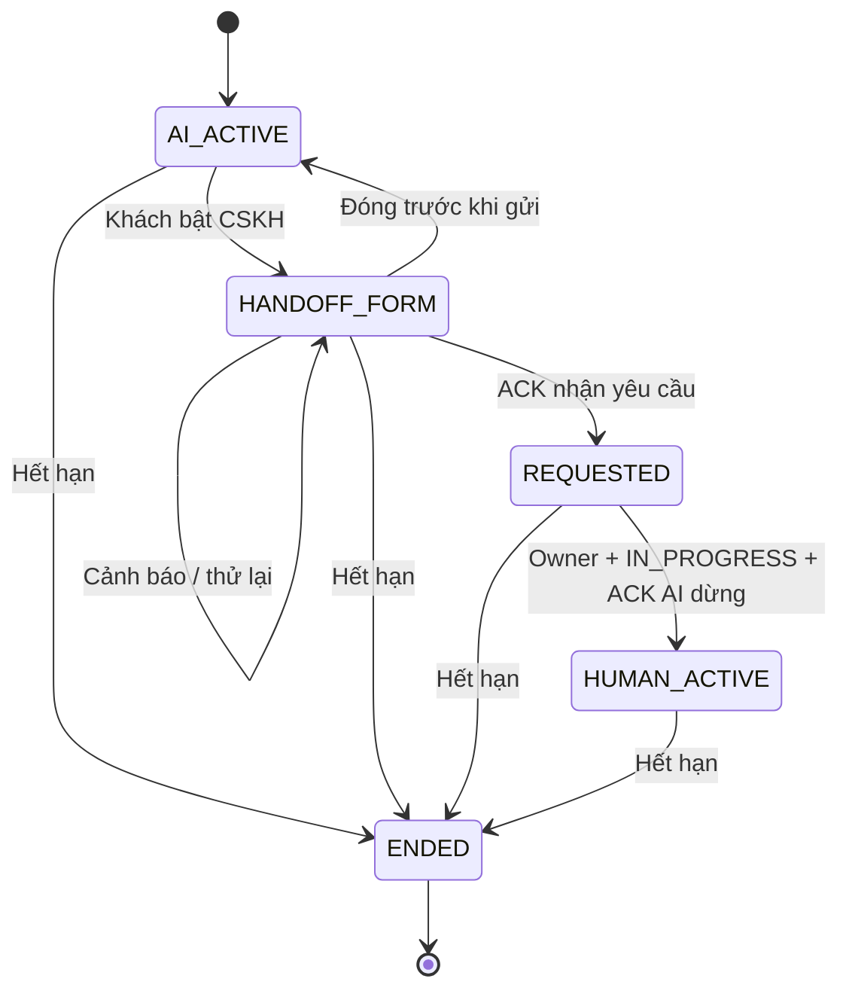

# AI chat và AI log — đặc tả thiết kế v0.8

02/11/2026 · In Review · [BRD v0.8](CSKH-01-brd-v0.8.0.md) · [Bộ review](prototype-portal-v0.8.0/review-ai.html)

Đây là phần mở rộng giao diện hiện hữu. Khách cần trao đổi với AI và có đường rõ ràng để gặp nhân viên. Nhân viên cần đọc đúng bối cảnh bàn giao và tiếp tục chăm sóc. Không đổi nhận diện HIUH hoặc tổ chức lại các module Portal.

## Phạm vi và cơ sở thiết kế

- Website thực tế: khung chat rộng, nền sáng, xanh HIUH, Montserrat; có lời chào, gửi chữ/giọng nói và hướng dẫn tham khảo. Khảo sát qua Chrome Debug, giữ tab người dùng. Chỉ đọc; không thử gửi tin/timeout production.
- Portal M-40/M-41: shell 264px/64px, bảng tiếp nhận, hội thoại ba cột, Lexend + Plus Jakarta Sans, token xanh `#0052d7`.
- Hai ảnh Rogers: tham khảo cách đặt thông báo nhỏ đầu phiên. Không kế thừa thương hiệu, bắt đăng nhập hay câu lỗi import.
- Luồng cảnh báo rồi cho tiếp tục đã được người dùng xác nhận. Các quyết định đề xuất còn cần chốt trước triển khai nằm tại V-18..20 trong BRD.

## C-05 — giao diện khách

| Vùng | Thiết kế |
|---|---|
| Đầu khung | Tên trợ lý, trạng thái AI/đang chờ/nhân viên, chọn ngôn ngữ, thu gọn. Thu gọn không kết thúc/reset phiên |
| Chuyển CSKH | Toggle và nhãn Chat với nhân viên CSKH, luôn trong vùng đầu. Khi gửi thành công: bật/khóa + giải thích không quay lại AI |
| Thời gian | mm:ss cạnh vùng chuyển CSKH. Cảnh báo 2 phút ở trên ô soạn với Tiếp tục trò chuyện. Không dùng chỉ màu để truyền đạt |
| Thông báo | Đầu transcript, tiếng Việt, link chính sách. EN hiển thị bản dịch bổ sung, không xóa bản VI |
| Tin nhắn | Nhãn AI/Khách/CSKH và thời gian; tin khách xanh, nhân viên trắng viền; văn bản xuống dòng và ngắt từ dài |
| Form | Nội tuyến trong cuộc trò chuyện, họ tên/số; giải thích một chiều, submit và quay lại AI trước khi gửi. Không modal phụ |
| Lỗi form | Dưới trường, `aria-invalid`/`aria-describedby`; focus lỗi đầu. Cảnh báo chung + Vẫn kết nối CSKH. Form `novalidate` để native required không chặn đường tiếp tục |
| Chờ | Đã gửi yêu cầu; cho nhắn tiếp, không hứa ETA/vị trí hàng đợi. Nút gặp người không còn chuyển ngược |
| Hết phiên | Banner rõ, ô gửi khóa, Bắt đầu phiên mới. Nháp được giữ khi lỗi/hết phiên; không tự phát lại tin |
| Mất mạng | Thông báo + thử lại. Chỉ sau ACK mới coi tin đã gửi; nháp giữ riêng với transcript |
| Mobile | Toàn chiều rộng, đầu và ô soạn giữ trong khung; vùng tin/form cuộn. Input 16px, nút chính ≥44px; bàn phím số điện thoại. App demo là mô phỏng web responsive, chưa native iOS/Android |

Nội dung lỗi Việt/Anh nằm trong `chat-i18n.js`; quy tắc nghiệp vụ chuẩn nằm ở BRD 4.17–4.22. Không thêm chữ “đã đọc”; trạng thái gửi trong demo chỉ là ACK mô phỏng.

## C-02 — AI log và bàn giao

Ba cột giữ đúng prototype 0.7: danh sách hội thoại / nguồn và trao đổi / khách hàng và xử lý. `ai-log.html` là route review riêng của phần mở rộng C-02; không là nguồn thứ tư hay module nhật ký mới.

| Vùng | Nội dung |
|---|---|
| Danh sách | Phạm vi Của tôi/Chờ nhận, tìm mã, trạng thái phiên. Chưa nhận không lộ tên/số/tin |
| Hội thoại | Nguồn Web/App, ID phiên, độ đầy đủ; trạng thái/countdown và tiếp quản. Ba tab Hội thoại/Mốc phiên/Nội bộ |
| Tóm tắt | Nội dung mẫu có dẫn nguồn; nút Xem tin gốc cuộn/highlight đúng tin; PARTIAL nói rõ phần thiếu; UNAVAILABLE không tóm tắt |
| Bàn giao | Mốc khách yêu cầu và nhân viên tham gia giữa transcript; thứ tự theo sequence khi timestamp bằng nhau |
| Khách hàng | Tên/số gốc, cờ Cần bổ sung thông tin, form thông tin chăm sóc. Sửa giá trị có sẵn yêu cầu lý do và giữ trước-sau |
| Bối cảnh | Kênh, ngôn ngữ/cách xác định, thời điểm bàn giao, người phụ trách, tiến độ và cờ chuyển một chiều |
| Thông báo | Thời điểm/ngôn ngữ/copy version/link. Nhãn phân biệt hiển thị thông báo và thu đồng ý |
| Soạn | Trả lời khách / ghi chú nội bộ tách biệt; kiểm tra owner, IN_PROGRESS, phiên và ACK bot. Ghi chú không vào khung khách |
| Mobile | Tab Nội dung / Khách & Xử lý / Hội thoại; giữ nháp theo ca và loại soạn |

## Ma trận trạng thái

W-01..W-10 và L-01..L-06 có link trực tiếp trong [review-ai.html](prototype-portal-v0.8.0/review-ai.html). Loading là trạng thái chuyển tiếp 400–450ms khi gửi/tiếp quản. Menu Mô phỏng cho tạo lỗi ở lần kế tiếp, mất kết nối, hết phiên và thu quyền.

Phiên mới là đối tượng khác. Không có cạnh HUMAN_ACTIVE → AI_ACTIVE trong cùng phiên.

## Hành vi prototype và giới hạn

- Hai góc nhìn đọc chung kho demo `hiuh-ai-chat-review-v08` trên cùng origin. Web Locks tuần tự hóa thay đổi giữa các tab; sự kiện storage làm mới UI. Không phải IAM/backend.
- Không phát tin đến bệnh viện hoặc gọi mô hình AI. AI trả lời câu mẫu thông tin dịch vụ, không tư vấn y khoa. ACK tiếp quản là mô phỏng chủ động; không giả vờ đã nối bot thật.
- Mô hình phiên mở rộng tách mô hình 46 frame Portal kế thừa. Dùng trang review để chuyển bề mặt; không tuyên bố ca demo đã vào cơ sở dữ liệu Portal thật.
- LocalStorage giữ transcript mẫu để thử refresh/chuyển tab; không dùng nơi này để nhập dữ liệu thật. Nháp giữ trong bộ nhớ tab; refresh chưa lưu bền vững nháp, khác giữ transcript/khóa bàn giao.
- Chưa có hệ thống dịch tự động, phiên bản chính sách chính thức, consent, callback mất ACK, nhận diện nhân viên đa ngôn ngữ hoặc kiểm thử trên thiết bị vật lý.

## Kiểm chứng

Bằng chứng và kết quả cụ thể tại [QA.md](prototype-portal-v0.8.0/QA.md). Phần mô hình kiểm tra các ràng buộc chuyển trạng thái, chất lượng dữ liệu, timeout, phân quyền demo và chống trùng. Phần UI kiểm tra nội dung, thao tác và kích thước thực bằng Chrome Debug. Kết quả này nghiệm thu prototype, không nghiệm thu production.
