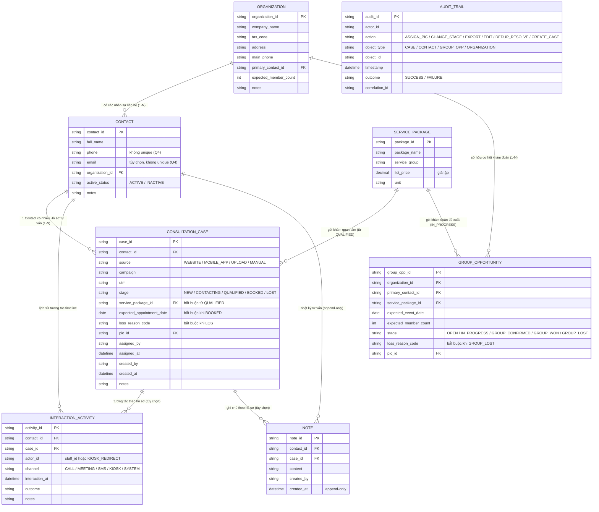
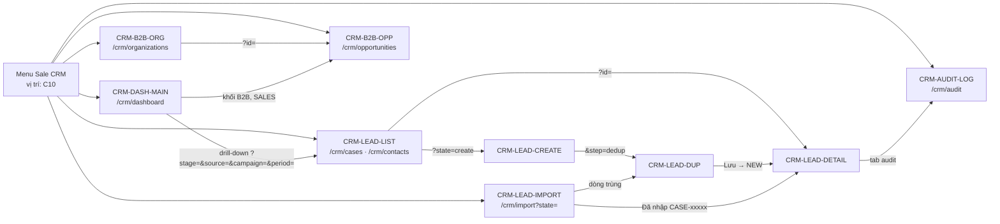

# Product Requirements Document — Sale CRM Phase 1 MVP (v1.0.0)

<!-- C11-OKF-NAV -->
Điều hướng sản phẩm bàn giao: [Part §8 EPIC-02](./kanban/prd-v1/parts/part-08-epic02.md) · [Part §9 EPIC-03](./kanban/prd-v1/parts/part-09-epic03.md) · [Part §10 EPIC-04](./kanban/prd-v1/parts/part-10-epic04.md) · [Part §11 Dashboard](./kanban/prd-v1/parts/part-11a-epic05-dash.md) · [Part §11 IAM](./kanban/prd-v1/parts/part-11b-epic05-iam.md) · [Part IV NFR](./kanban/prd-v1/parts/part-iv-nfr.md) · [Part V–VII](./kanban/prd-v1/parts/part-v-vii.md) · [Part VIII Nghiệm thu](./kanban/prd-v1/parts/part-viii-acceptance.md) · [Báo cáo QA](./kanban/prd-v1/qa-report-v1.0.0.md).

> **Mục đích:** chi tiết hóa BRD v0.4.1 (đã clarify Q1–Q5) thành yêu cầu sản phẩm có thể thiết kế, triển khai và nghiệm thu cho Phase 1 MVP của Sale CRM trên Operation Portal. Toàn bộ dữ liệu là giả lập; không có tích hợp HIS thật, không có dữ liệu người bệnh thật.
>
> **Quy tắc khi nguồn mâu thuẫn:** BRD > EPIC > Visual > Plan > Prototype. Prototype v2.2 chỉ là minh họa giao diện; các điểm prototype lệch với BRD (Q3/Q4/Q5) được ghi tại §17.5 và không được xem là yêu cầu.
>
> **Quy ước nhãn:** `[Cần bệnh viện xác nhận]` = quyết định thuộc bệnh viện HIUH (qua BA), mã C1–C10, C-UI-1..3. `NEEDS DECISION` = quyết định kỹ thuật thuộc Tech Lead/BE/CASC, mã R1–R13. PRD **không** tự chốt các mục này; giá trị tạm chỉ để prototype và dữ liệu giả lập chạy được.

<!-- C11-OKF-PROVENANCE -->
PRD được tổng hợp từ BRD,[^brd-v0-4-1] EPIC,[^epic-v0-6-1] sơ đồ luồng,[^visual-v0-6-1] kế hoạch triển khai,[^plan-v0-1-0] đề xuất API[^api-proposal-v0-1] và bộ UI contract.[^ui-contracts]

---

## PART I — Tóm tắt điều hành và bối cảnh

### 1. Tổng quan tài liệu

#### 1.1 Mục đích

PRD này là tài liệu yêu cầu sản phẩm cho Phase 1 MVP. Nó biến 28 yêu cầu nghiệp vụ trong BRD v0.4.1 §7 thành 28 User Story có tiêu chí nghiệm thu, ràng buộc phân quyền, tham chiếu màn hình và tham chiếu API đề xuất. PRD là căn cứ cho:

- Tech Lead và BE/CASC chốt các quyết định kỹ thuật còn mở (R1–R13).
- Đội phát triển spec hóa vào `docs/specs/` của repo `hiu-operation` (hard rule #1).
- QA xây kịch bản kiểm thử theo 8 lát cắt VS-01…VS-08 (EPIC §8).
- BA và bệnh viện chốt các điểm `[Cần bệnh viện xác nhận]` trước khi baseline.

#### 1.2 Phạm vi tài liệu

| Thuộc phạm vi | Không thuộc phạm vi |
|---|---|
| Phase 1 MVP: 5 EPIC, 28 User Story, năng lực nền PORTAL/IAM/POC (EPIC §6) | Tích hợp HIS thật, dữ liệu người bệnh thật, production readiness |
| Dữ liệu 100% giả lập, tái tạo được (POC-01), có nhãn "Dữ liệu giả lập" (POC-02) | Hủy sau `BOOKED`, mở lại `LOST`, roster khám đoàn, tự động chia hồ sơ, AI scoring |
| Yêu cầu nghiệp vụ, nghiệm thu, phân quyền, dữ liệu, giao diện | Thiết kế kỹ thuật chi tiết (đã có trong Plan v0.1.0); hợp đồng API chính thức (chờ BE/CASC) |

#### 1.3 Người đọc và cách dùng

| Người đọc | Dùng phần nào |
|---|---|
| Trưởng/Phó phòng Kinh doanh HIUH, Marketing | Part I, §6 quy tắc nghiệp vụ, §24 điểm cần xác nhận |
| BA Nexlab | Toàn bộ; chủ trì chốt C1–C10 |
| Tech Lead / BE / CASC | Part II, IV, VI; §24 (R1–R13); §20 API đề xuất |
| Đội phát triển FE | Part III, V, VI, VII |
| QA | Part III (AC), Part VIII (RTM, checklist nghiệm thu) |

#### 1.4 Quy ước thuật ngữ

- Tiếng Việt là ngôn ngữ chính. Thuật ngữ chuyên môn ghi tiếng Anh gốc trong ngoặc ở lần đầu, sau đó chỉ dùng tiếng Việt.
- Giữ nguyên mã định danh, enum, tên trường, tên API, permission key và mã yêu cầu (`INT-01`, `US-INT-01`, `AC-INT-01-1`…).
- Thực thể đi qua phễu khách lẻ gọi là **Hồ sơ tư vấn** (`Consultation Case`, khóa `case_id`). Không dùng Prospect, Lead, Opportunity cho hành trình khách lẻ (EPIC §7.3 #11). Mã màn `CRM-LEAD-*` giữ nguyên chỉ để đối chiếu prototype; nhãn hiển thị là "Hồ sơ tư vấn".
- Bảng thuật ngữ đầy đủ tại §28.A.

#### 1.5 Truy vết nguồn

| Nguồn | Phiên bản | Vai trò trong PRD |
|---|---|---|
| BRD `HBH-SCRM-BRD` | v0.4.1 (12/10/2026, đã clarify Q1–Q5) | Nguồn nghiệp vụ chính; 28 mã yêu cầu §7; ma trận quyền §8; điểm cần xác nhận §11 |
| EPIC `HBH-SCRM-EPIC-OPTION-MUST-PLUS` | v0.6.1 | Trần phạm vi; giá trị cần chứng minh §3; năng lực nền §6; yêu cầu phủ định §7.3; lát cắt §8; dữ liệu demo §9; khoảng trống §10 |
| Visual `HBH-SCRM-VISUAL-WORKFLOWS` | v0.6.1 | Journey Map, Swimlane, ma trận chuyển trạng thái §3, ERD 8 thực thể và ma trận khớp trùng §4 |
| Implementation Plan `HBH-SCRM-PLAN` | v0.1.0 | Ngữ cảnh kỹ thuật, Constitution Check, UI contract 9 màn, API đề xuất v0.1, R1–R13, C1–C10 |
| Prototype và UI State Machine | v2.2 | Minh họa giao diện và máy trạng thái; đã lệch Q3/Q4/Q5 (xem §17.5) |
| Constitution HIUH | v0.2 | Cổng PS/DP/SEC/ARCH (§4.4, §12, §26) |

---

### 2. Tóm tắt bối cảnh kinh doanh

#### 2.1 Vấn đề kinh doanh (BRD §2)

| Vấn đề | Hệ quả | EPIC xử lý |
|---|---|---|
| Khách hàng tiềm năng phân tán, thất thoát nguồn gốc | Mất khách, gọi trùng, không đo được hiệu quả kênh/chiến dịch | EPIC-01 |
| Phản hồi chậm, thiếu người phụ trách (PIC) | Khách chuyển sang bệnh viện khác, giảm chuyển đổi | EPIC-02 |
| Đặt hẹn chưa đồng bộ, dễ nhầm với lịch HIS | Vắng mặt cao, xung đột tại quầy | EPIC-03 (ranh giới `BOOKED`) |
| Hồ sơ và tương tác bị chia cắt | Tư vấn thiếu ngữ cảnh, mất khi bàn giao nhân sự | EPIC-02 |
| Quản lý khám đoàn B2B bằng bảng tính | Sai lệch quy mô, mất dấu đàm phán | EPIC-04 |
| Báo cáo thiếu trực quan | Lãnh đạo khó đánh giá năng suất và ngân sách tiếp thị | EPIC-05 |

Mức độ ảnh hưởng của từng vấn đề cần bộ phận Kinh doanh xác nhận trong buổi walkthrough (BRD §2).

#### 2.2 Mục tiêu kinh doanh (BRD §3.1)

1. 100% Hồ sơ tư vấn có nguồn gốc và PIC chịu trách nhiệm.
2. Minh bạch dòng thời gian tương tác và ghi chú theo cơ chế chỉ nối thêm (append-only).
3. Theo dõi độc lập hai hành trình: khách lẻ B2C bốn chặng và khám đoàn B2B năm trạng thái.
4. Ra quyết định dựa trên Dashboard hai chế độ Funnel/Pipeline có bộ lọc.
5. Phân quyền hai chiều Department × Role; Audit Trail bất biến; cấm dữ liệu lâm sàng.

Chỉ tiêu định lượng (SLA phản hồi, tỷ lệ chuyển đổi mục tiêu) `[Cần bệnh viện xác nhận]` — C9. PRD không đặt KPI mục tiêu.

#### 2.3 Giá trị cần chứng minh bằng dữ liệu giả lập (EPIC §3)

| # | Giá trị | Lát cắt chứng minh | US chính |
|---|---|---|---|
| 1 | Hồ sơ tư vấn từ Website, Mobile App, upload, nhập tay được quản lý tập trung, gắn Contact | VS-01, VS-08 | US-INT-01/02/09/11, US-CUS-01/02 |
| 2 | Không bỏ sót hồ sơ nhờ PIC, trạng thái, lịch sử tương tác | VS-01 | US-WRK-01/04, US-CUS-03/04 |
| 3 | Contact có khả năng trùng được cảnh báo, không tự gộp | VS-03 | US-INT-07 |
| 4 | Khách lẻ theo dõi qua `NEW → CONTACTING → QUALIFIED → BOOKED` hoặc `LOST` có lý do | VS-01, VS-02 | US-IND-01/02/03/05 |
| 5 | Cơ hội khám đoàn theo dõi riêng qua 5 trạng thái | VS-04 | US-GRP-01/02/13 |
| 6 | Dashboard Funnel/Pipeline theo nguồn và campaign | VS-06 | US-DASH-01/02/03/05/08/12 |
| 7 | Xem, thao tác, export giới hạn theo Department × Role | VS-05 | US-IAM-01, US-CUS-05 |
| 8 | Thay đổi trọng yếu có Audit Trail chỉ đọc | VS-05 | US-IAM-04 |

EPIC §3 liệt kê 8 giá trị; kế hoạch tạo PRD ghi "7 giá trị" — PRD dùng số 8 theo nguồn EPIC.

---

### 3. Người dùng và persona

#### 3.1 Sáu tổ hợp Department × Role (BRD §4, §8; EPIC §6.1)

| Tổ hợp | Vai trò nghiệp vụ | Phạm vi dữ liệu | Quyền thao tác chính |
|---|---|---|---|
| `SALES × HEAD` | Trưởng phòng Kinh doanh | Toàn Department | Phân công PIC, đổi chặng, Activity/Note, cơ hội đoàn (kể cả CONFIRMED/WON/LOST), export, xem Audit toàn phòng |
| `SALES × DEPUTY_HEAD` | Phó phòng Kinh doanh | Toàn Department | Như HEAD |
| `SALES × STAFF` | Nhân viên Kinh doanh / Tư vấn (PIC) | Chỉ hồ sơ được giao | Đổi chặng, Activity/Note trên hồ sơ được giao; tạo cơ hội đoàn; export hồ sơ mình phụ trách |
| `MKT × HEAD` | Trưởng phòng Marketing | Toàn bộ B2C (chỉ đọc) | Tiếp nhận (upload, kích hoạt nguồn giả lập, xử lý trùng); xem Dashboard B2C; không ghi hồ sơ |
| `MKT × DEPUTY_HEAD` | Phó phòng Marketing | Như MKT HEAD | Như MKT HEAD |
| `MKT × STAFF` | Nhân viên Marketing | Như MKT HEAD | Như MKT HEAD |

Vai trò nghiệp vụ (Marketing, Sale) dùng trong luồng và sơ đồ; permission key (`crm.*`) là cơ chế kỹ thuật, xem §12.2.

#### 3.2 Persona (Visual §1)

| Persona | Mô tả | Hành trình | Điều PRD phải đáp ứng |
|---|---|---|---|
| Chị Mai Phương, 36 tuổi | Trưởng phòng Nhân sự, đại diện tổ chức 120 CBNV | B2B khám đoàn | Phản hồi phương án nhanh; theo dõi đàm phán tập trung; mốc `GROUP_CONFIRMED` minh bạch |
| Anh Hoàng Nam, 42 tuổi | Khách lẻ quan tâm gói tầm soát tim mạch | B2C khách lẻ | Không bị gọi trùng; PIC rõ; `BOOKED` không bị nhầm thành lịch HIS |
| Trưởng phòng Kinh doanh (SALES HEAD) | Chủ trì nghiệp vụ, phê duyệt P0 | Vận hành | Pipeline toàn phòng, phân công, năng suất nhân viên |
| Nhân viên Sale (SALES STAFF) | PIC trực tiếp tư vấn | Vận hành | Danh sách hồ sơ được giao, đổi chặng nhanh, ghi Note |
| Marketing Lead (MKT HEAD) | Đo hiệu quả nguồn/campaign | Đo lường | Dashboard theo nguồn, campaign; đọc toàn bộ hồ sơ B2C |

#### 3.3 Nhu cầu chính theo tổ hợp

| Tổ hợp | Điểm đau | Nhu cầu trên Sale CRM |
|---|---|---|
| SALES HEAD/DEPUTY_HEAD | Không biết ai phụ trách hồ sơ nào; không có bức tranh phễu | Danh sách tập trung, phân công thủ công có lịch sử, Dashboard Funnel/Pipeline toàn phòng |
| SALES STAFF | Thông tin khách rải rác, phải hỏi lại | Hồ sơ được giao, timeline, Note, đổi chặng có kiểm tra dữ liệu bắt buộc |
| MKT (3 cấp) | Không đo được hiệu quả campaign | Lưu source/campaign/UTM, Dashboard theo nguồn và campaign, đọc toàn bộ hồ sơ B2C |

---

### 4. Phạm vi và ranh giới

#### 4.1 Trong phạm vi Phase 1 MVP (BRD §5, EPIC §5–§6)

| Nhóm | Nội dung |
|---|---|
| Tiếp nhận đa nguồn | 4 nguồn MVP: `WEBSITE`, `MOBILE_APP`, `UPLOAD` (Excel partial import), `MANUAL`; lưu source/campaign/UTM |
| Cảnh báo trùng Contact | So khớp độc lập theo SĐT và Email, liệt kê mọi Contact khớp kèm khóa khớp; người tiếp nhận chọn 1 Contact hoặc tạo mới; không tự gộp |
| Hồ sơ tư vấn B2C | Contact 1–N Hồ sơ tư vấn; bốn chặng `NEW → CONTACTING → QUALIFIED → BOOKED`; nhánh `LOST` có lý do; đổi chặng thủ công |
| Phân công và tương tác | Phân công/chuyển PIC thủ công; Activity Timeline; Note chỉ nối thêm; bộ lọc tác nghiệp |
| Cơ hội khám đoàn B2B | Organization mức nhẹ; Group Opportunity 5 trạng thái `OPEN → IN_PROGRESS → GROUP_CONFIRMED → GROUP_WON \| GROUP_LOST` |
| Dashboard | Hai chế độ Funnel/Pipeline; theo nguồn, campaign, Department, PIC; khối B2B riêng; nhớ chế độ |
| Nền tảng | Phân quyền 6 tổ hợp; Audit Trail bất biến; export theo phạm vi; menu trong Operation Portal; dữ liệu giả lập có nhãn |

#### 4.2 Ngoài phạm vi (BRD §5, EPIC §7.1)

- Tích hợp hai chiều thật với HIS; Patient ID, CCCD, BHYT, Appointment, Encounter thật.
- Dữ liệu lâm sàng dưới mọi hình thức (EPIC §7.2 chặn cứng).
- `BOOKED → Walk-in`, check-in, No-show, đối soát thật.
- Hủy sau `BOOKED`; mở lại hồ sơ `LOST` (chưa có quyết định, không suy diễn — C4).
- Kiosk tạo Hồ sơ tư vấn; Kiosk chỉ ghi Activity khi Contact giả lập đã được nhận diện.
- Roster thành viên đoàn, check-in cá nhân trong khám đoàn.
- Tự động chia hồ sơ, round-robin, self-claim, SLA đếm ngược, nhắc việc tự động.
- AI scoring, dự báo, BOD Dashboard, doanh thu/ROI, attribution thật.
- B2B Portal, báo giá/hợp đồng đầy đủ, phê duyệt nhiều cấp, công nợ/hóa đơn.
- API/event/webhook/idempotency/retry cho tích hợp thật; migration; SLA vận hành.

**Guardrail tích hợp tương lai (ARCH-01):** khi tích hợp với HIS/Patient Registry ở giai đoạn sau, mọi tích hợp liên hệ thống phải dùng mô hình hướng sự kiện (event-driven); không dùng gọi đồng bộ REST/gRPC làm đường trọng yếu cho quy trình lâm sàng. Phase 1 không có tích hợp thật nên ARCH-01 không áp dụng.

#### 4.3 Mười hai yêu cầu phủ định bắt buộc (EPIC §7.3)

| # | Yêu cầu phủ định | Cơ chế trong PRD |
|---|---|---|
| 1 | Không tự động gộp Contact hoặc Hồ sơ tư vấn | US-INT-07 chỉ có hai hành động: liên kết Contact đã chọn hoặc tạo mới; không có API merge |
| 2 | Kiosk không tạo Hồ sơ tư vấn | `source` chỉ 4 giá trị; Kiosk là `channel=KIOSK` của Activity (US-CUS-03) |
| 3 | Activity Kiosk không chứng minh Walk-in | Không có trạng thái/trường Walk-in; nhãn timeline "Kiosk điều hướng" |
| 4 | `BOOKED` không phải Appointment HIS thật | US-IND-03: nhãn "Cam kết dự kiến, không phải Appointment HIS"; không có `appointment_id` |
| 5 | `GROUP_CONFIRMED/GROUP_WON` không đồng nghĩa từng thành viên đã đặt hẹn | Không roster; `expected_member_count` là số dự kiến (US-GRP-02) |
| 6 | Dashboard không cộng `BOOKED` với `GROUP_CONFIRMED/GROUP_WON` | API và khối hiển thị B2C/B2B tách riêng (US-DASH-02/03) |
| 7 | Export không chứa bản ghi ngoài phạm vi người thực hiện | BE lọc theo scope; FE không gửi scope tự chọn (US-CUS-05) |
| 8 | Không dùng dữ liệu người bệnh thật hoặc bản sao production | POC-01, DP-03 (§15.1) |
| 9 | Không lưu nội dung lâm sàng trong Note/Activity | Helper text cảnh báo; quy trình kiểm soát `cần xác nhận` với bệnh viện (§15.1) |
| 10 | Không tuyên bố tuân thủ Nghị định 69 khi chưa có mapping tuyến A/B/C | §12.1: ma trận xác thực là đề xuất, gate SEC-01 giữ trạng thái chưa đạt |
| 11 | Không dùng Prospect/Lead/Opportunity cho khách lẻ | Nhãn i18n "Hồ sơ tư vấn"; mã màn `CRM-LEAD-*` chỉ để đối chiếu |
| 12 | Không tự đổi chặng theo Activity/sự kiện; `MKT` không đổi chặng, phân PIC, ghi Activity/Note | US-IND-01, US-IAM-01; permission `crm.case.stage/assign/activity` không cấp cho MKT |

#### 4.4 Cổng quản trị Constitution (Pre-Spec và Pre-Plan)

| Gate | Nội dung | Trạng thái | Căn cứ / việc cần làm |
|---|---|---|---|
| PS-01 | AI không ra quyết định | PASS | Không có AI scoring/quyết định AI (EPIC §2) |
| PS-02 | Triển khai mô hình AI có model card | N/A | Không có mô hình AI |
| PS-03 | Dự phòng ngoại tuyến cho quy trình lâm sàng trọng yếu | N/A | Sale CRM là hệ thống hỗ trợ kinh doanh, không phải quy trình lâm sàng |
| DP-01 | Consent khi xử lý PHI | PASS (giả lập) / BLOCKER (dữ liệu thật) | Không xử lý PHI; Consent Flow là điều kiện trước khi dùng dữ liệu thật |
| DP-02 | Audit log và retention | OPEN — blocker trước production | Audit Trail bất biến đã có (US-IAM-04). Retention cho `AUDIT_TRAIL`, `NOTE`, `CASE_STAGE_HISTORY` (nếu có) `[Cần bệnh viện xác nhận]`; không tự đặt 10/20/30/70 năm |
| DP-03 | Tách dữ liệu test/production | PASS | Dữ liệu giả lập sinh từ seed; không sao chép production |
| SEC-01 | Xác thực/phân quyền theo Nghị định 69 | WARNING, không chặn MVP | §12.1 ma trận giao dịch → mức xác thực là đề xuất; mapping tuyến A/B/C `[Cần bệnh viện xác nhận]`; không tuyên bố tuân thủ |
| ARCH-01 | Không gọi đồng bộ liên hệ thống trên đường lâm sàng | N/A cho MVP | Guardrail tương lai ghi tại §4.2 |
| ARCH-02 | Chiến lược xử lý lỗi theo nhóm người dùng | REQUIRED — đã bổ sung | §12.4 ma trận lỗi 3 nhóm |
| EMR-01 | Mô hình dữ liệu EMR | N/A | Không có dữ liệu lâm sàng |

**Kết luận:** CONDITIONAL GO cho Phase 1 MVP dữ liệu giả lập. NO-GO cho dữ liệu thật, HIS hoặc production khi DP-01, DP-02, SEC-01 chưa đóng.

---

## PART II — Mô hình dữ liệu và quy tắc nghiệp vụ

### 5. Mô hình dữ liệu

#### 5.1 Tám thực thể (Visual §4; Plan `data-model.md`)

| # | Thực thể | Khóa | Vai trò | Màn tiêu thụ |
|---|---|---|---|---|
| 1 | `ORGANIZATION` | `organization_id` | Tổ chức/doanh nghiệp mức nhẹ | CRM-B2B-ORG |
| 2 | `CONTACT` | `contact_id` | Khách hàng/đầu mối; `phone`, `email` **không unique** (Q4) | CRM-LEAD-LIST (tab Contact), CRM-LEAD-DUP |
| 3 | `CONSULTATION_CASE` | `case_id` | Hồ sơ tư vấn B2C; 1 Contact – N hồ sơ | CRM-LEAD-LIST, CRM-LEAD-DETAIL |
| 4 | `GROUP_OPPORTUNITY` | `group_opp_id` | Cơ hội khám đoàn B2B | CRM-B2B-OPP |
| 5 | `SERVICE_PACKAGE` | `package_id` | Danh mục gói khám giả lập | Modal Đủ điều kiện, form B2B |
| 6 | `INTERACTION_ACTIVITY` | `activity_id` | Dòng thời gian tương tác, gồm Kiosk | CRM-LEAD-DETAIL |
| 7 | `NOTE` | `note_id` | Ghi chú chỉ nối thêm | CRM-LEAD-DETAIL |
| 8 | `AUDIT_TRAIL` | `audit_id` | Nhật ký kiểm tra chỉ đọc | CRM-AUDIT-LOG |

Không có `CHECK_IN_RECORD`, `cccd`, `bhyt`, `patient_id` thật, kết quả khám hay dữ liệu lâm sàng.

#### 5.2 ERD (Visual §4)

Trường bổ sung do Plan đề xuất, chờ BE/CASC (không thuộc ERD chuẩn): `CONSULTATION_CASE.contacting_at/qualified_at/booked_at/lost_at` (R1 phương án c), `version` (R2), `CONTACT.case_count`, `GROUP_OPPORTUNITY.initial_need`, `AUDIT_TRAIL.detail`.

#### 5.3 Enum và trạng thái

| Enum | Giá trị | Nguồn |
|---|---|---|
| `CaseStage` | `NEW`, `CONTACTING`, `QUALIFIED`, `BOOKED`, `LOST` | BRD §6.1 |
| `GroupStage` | `OPEN`, `IN_PROGRESS`, `GROUP_CONFIRMED`, `GROUP_WON`, `GROUP_LOST` | BRD §6.2 (Q1) |
| `CaseSource` | `WEBSITE`, `MOBILE_APP`, `UPLOAD`, `MANUAL` | ERD; Kiosk không phải nguồn |
| `ActivityChannel` | `CALL`, `MEETING`, `SMS`, `KIOSK`, `SYSTEM` | ERD |
| `AuditAction` | `ASSIGN_PIC`, `CHANGE_STAGE`, `EXPORT`, `EDIT`, `DEDUP_RESOLVE`, `CREATE_CASE` | ERD + UI SM |
| `AuditObjectType` | `CASE`, `CONTACT`, `GROUP_OPP`, `ORGANIZATION` | ERD |
| `AuditOutcome` | `SUCCESS`, `FAILURE` | ERD |
| `Department` / `Role` | `SALES`, `MKT` / `HEAD`, `DEPUTY_HEAD`, `STAFF` | BRD §8 |
| `DataScope` | `own`, `department`, `all` | Plan R6 |
| `DedupMatchKey` | `PHONE`, `EMAIL` | Visual §4 |
| `ImportRowStatus` | `VALID`, `INVALID`, `DUP_PENDING`, `IMPORTED`, `DUP_RESOLVED`, `SKIPPED` | Plan R4 |
| `LossReasonCode` (B2C) | Tạm: `HIGH_PRICE`, `DISTANCE`, `UNREACHABLE`, `COMPETITOR`, `WRONG_INFO`, `OTHER`. Danh mục cuối `[Cần bệnh viện xác nhận]` — C3. Chỉ `WRONG_INFO` hợp lệ cho `NEW → LOST` | BRD §6.1, §11.3 |
| `LossReasonCode` (B2B) | Chưa có nguồn — `[Cần bệnh viện xác nhận]` — C3 | Plan `data-model.md` §2 |

Danh mục lý do, gói khám, campaign lấy từ API (`GET /loss-reasons`, `GET /service-packages`, `GET /campaigns`), không hard-code trong FE trừ mã ràng buộc `WRONG_INFO` (R13).

#### 5.4 Trường bắt buộc theo chặng

**B2C (Visual §4):**

| Chặng đích | Trường bắt buộc có giá trị | Mã yêu cầu |
|---|---|---|
| `NEW` | `case_id`, `contact_id`, `source`, `created_at` | INT-07, CUS-02 |
| `CONTACTING` | như `NEW` + `pic_id` (không yêu cầu Activity) | IND-01, WRK-01 |
| `QUALIFIED` | như `CONTACTING` + `service_package_id` | IND-02 |
| `BOOKED` | như `QUALIFIED` + `expected_appointment_date` | IND-03 |
| `LOST` | `loss_reason_code`; nếu từ `NEW` thì phải là `WRONG_INFO` | IND-05 |

Trường tối thiểu để "tiếp nhận hợp lệ" theo từng nguồn `[Cần bệnh viện xác nhận]` — C1. Giá trị tạm: `full_name` + `phone` bắt buộc; `email` tùy chọn.

**B2B (Plan `data-model.md` §4.2):**

| Trạng thái đích | Trường bắt buộc | Mã yêu cầu |
|---|---|---|
| `OPEN` | `organization_id` (không trùng `tax_code`/`company_name`), `primary_contact_id`, `pic_id` | GRP-01 |
| `IN_PROGRESS` | như `OPEN` | GRP-02 |
| `GROUP_CONFIRMED` | + `service_package_id`, `expected_event_date`, `expected_member_count` | GRP-13 |
| `GROUP_WON` | như `GROUP_CONFIRMED` | GRP-13 |
| `GROUP_LOST` | `loss_reason_code` | GRP-13 |

Tiêu chí nghiệp vụ chính thức cho `BOOKED`, `GROUP_CONFIRMED`, `GROUP_WON` ngoài trường bắt buộc nêu trên là khoảng trống EPIC §10 #4 — `[Cần bệnh viện xác nhận]`.

---

### 6. Quy tắc nghiệp vụ và kiểm tra dữ liệu

#### 6.1 Quy tắc Hồ sơ tư vấn B2C (BRD §6.1)

| Mã | Quy tắc | Nguồn |
|---|---|---|
| BR-B2C-01 | Chuyển tuần tự `NEW → CONTACTING → QUALIFIED → BOOKED`; không bỏ chặng, không chuyển ngược, không chuyển tắt | BRD §6.1 |
| BR-B2C-02 | Mọi đổi chặng do PIC (hoặc SALES HEAD/DEPUTY_HEAD trong phạm vi phòng) bấm thủ công. Hệ thống không tự đổi chặng theo Activity, Note, cuộc gọi hay sự kiện nào (Q3) | BRD §6.1; EPIC §7.3 #12 |
| BR-B2C-03 | Hệ thống chỉ kiểm tra: dữ liệu bắt buộc của chặng đích (§5.4) và ma trận chuyển hợp lệ. Thiếu dữ liệu hoặc chuyển không hợp lệ thì từ chối và báo lỗi | BRD §6.1 |
| BR-B2C-04 | `NEW → CONTACTING` chỉ cần đã gán PIC; không yêu cầu Activity trước (khuyến khích ghi Activity cùng lúc) | BRD §6.1 (Q3) |
| BR-B2C-05 | `LOST` chuyển được từ `CONTACTING`, `QUALIFIED`; từ `NEW` chỉ khi `loss_reason_code = WRONG_INFO`; không từ `BOOKED` | BRD §6.1 |
| BR-B2C-06 | `LOST` bắt buộc lý do chuẩn hóa; `LOST` và `BOOKED` là trạng thái kết thúc, không mở lại trong MVP | BRD §6.1 |
| BR-B2C-07 | `BOOKED` chỉ ghi nhận thỏa thuận ngày/khung giờ dự kiến; không phải Appointment HIS; không đồng nghĩa khách chắc chắn đến viện | BRD §6.1; EPIC §7.3 #4 |
| BR-B2C-08 | Không tự động đóng hồ sơ khi gọi không nghe máy; hồ sơ giữ nguyên chặng đến khi PIC cập nhật | BRD §6.1 |
| BR-B2C-09 | Mỗi lần đổi chặng ghi Audit Trail `CHANGE_STAGE` với actor là người bấm | BRD §6.1; IAM-04 |
| BR-B2C-10 | Hồ sơ tư vấn chỉ tồn tại từ `NEW`; không có trạng thái trước `NEW`; `NEW` được cấp `case_id` sau khi xử lý cảnh báo trùng | EPIC §4 |

**Ma trận chuyển trạng thái B2C (Visual §3.1):**

| Từ \ Đến | `NEW` | `CONTACTING` | `QUALIFIED` | `BOOKED` | `LOST` |
|---|---|---|---|---|---|
| `NEW` | — | ✓ cần `pic_id` | ✗ | ✗ | ✓ chỉ `WRONG_INFO` |
| `CONTACTING` | ✗ | — | ✓ cần `service_package_id` | ✗ | ✓ cần `loss_reason_code` |
| `QUALIFIED` | ✗ | ✗ | — | ✓ cần `expected_appointment_date` | ✓ cần `loss_reason_code` |
| `BOOKED` | ✗ | ✗ | ✗ | — | ✗ |
| `LOST` | ✗ | ✗ | ✗ | ✗ | — |

#### 6.2 Quy tắc cơ hội khám đoàn B2B (BRD §6.2, Q1)

| Mã | Quy tắc | Nguồn |
|---|---|---|
| BR-B2B-01 | Năm trạng thái `OPEN → IN_PROGRESS → GROUP_CONFIRMED → GROUP_WON \| GROUP_LOST`; không có Intake/Negotiating; đàm phán nằm trong `IN_PROGRESS` | BRD §6.2 |
| BR-B2B-02 | `GROUP_WON` chỉ từ `GROUP_CONFIRMED` | BRD §6.2 |
| BR-B2B-03 | `GROUP_LOST` từ `OPEN`, `IN_PROGRESS`, `GROUP_CONFIRMED`; bắt buộc `loss_reason_code`; không từ `GROUP_WON` | BRD §6.2 |
| BR-B2B-04 | Tạo Organization chặn trùng `tax_code` hoặc `company_name` | BRD §6.2 |
| BR-B2B-05 | Chuyển `GROUP_CONFIRMED / GROUP_WON / GROUP_LOST` chỉ SALES HEAD/DEPUTY_HEAD; `OPEN → IN_PROGRESS` do PIC B2B (STAFF) `[Cần bệnh viện xác nhận]` — C-UI-1 | BRD §8; Plan C-UI-1 |
| BR-B2B-06 | Cơ hội khám đoàn quản lý và báo cáo tách biệt; không cộng vào KPI phễu khách lẻ | BRD §6.2; EPIC §7.3 #6 |
| BR-B2B-07 | `expected_member_count` là số dự kiến, không phải số tới khám; không có roster | EPIC §7.3 #5 |

**Ma trận chuyển trạng thái B2B (Visual §3.2):**

| Từ \ Đến | `OPEN` | `IN_PROGRESS` | `GROUP_CONFIRMED` | `GROUP_WON` | `GROUP_LOST` |
|---|---|---|---|---|---|
| `OPEN` | — | ✓ | ✗ | ✗ | ✓ (`loss_reason_code`) |
| `IN_PROGRESS` | ✗ | — | ✓ cần 3 trường | ✗ | ✓ (`loss_reason_code`) |
| `GROUP_CONFIRMED` | ✗ | ✗ | — | ✓ | ✓ (`loss_reason_code`) |
| `GROUP_WON` | ✗ | ✗ | ✗ | — | ✗ |
| `GROUP_LOST` | ✗ | ✗ | ✗ | ✗ | — |

#### 6.3 Quy tắc cảnh báo trùng Contact (BRD §6.1, Q4; Visual §4)

| Mã | Quy tắc |
|---|---|
| BR-DUP-01 | So khớp độc lập theo từng khóa SĐT và Email sau khi chuẩn hóa. Quy tắc chuẩn hóa cụ thể (E.164 hay bỏ số 0 đầu; email lower-case/trim) là `NEEDS DECISION` BE — R5 |
| BR-DUP-02 | Khớp bất kỳ khóa nào đều cảnh báo; liệt kê **mọi** Contact khớp, mỗi Contact ghi rõ khóa khớp (`PHONE`, `EMAIL` hoặc cả hai) |
| BR-DUP-03 | Người tiếp nhận chọn đúng một Contact hiện có hoặc tạo Contact mới. Hệ thống không chặn, không tự gộp |
| BR-DUP-04 | Contact mới được phép trùng SĐT/Email với Contact cũ (ví dụ người thân dùng chung SĐT); `phone`/`email` không unique |
| BR-DUP-05 | Hồ sơ tư vấn chỉ xuất hiện ở `NEW` sau khi lựa chọn Contact được lưu |
| BR-DUP-06 | Lựa chọn và danh sách ứng viên được lưu vết Audit `DEDUP_RESOLVE` |
| BR-DUP-07 | Nguồn Website/Mobile App giả lập và từng dòng upload Excel đều đi qua quy tắc này; người tiếp nhận là người xử lý |
| BR-DUP-08 | Role nào trong mỗi Department được xử lý cảnh báo trùng `[Cần bệnh viện xác nhận]` — C5. Giá trị tạm: mở cho cả 6 tổ hợp (EPIC §6.1 "Tiếp nhận: Có") |

**Ma trận khớp trùng:**

| Khóa | Điều kiện | Hiển thị | Hành động |
|---|---|---|---|
| SĐT | Bằng SĐT đã chuẩn hóa của ≥1 Contact | Mọi Contact khớp, nhãn "khớp SĐT" | Chọn 1 Contact hoặc tạo mới |
| Email | Bằng Email đã chuẩn hóa của ≥1 Contact | Mọi Contact khớp, nhãn "khớp Email" | Như trên |
| Cả hai | Khớp cả hai khóa (cùng hoặc khác Contact) | Hợp danh sách, mỗi Contact ghi rõ khóa | Như trên |
| Không khớp | — | Không cảnh báo | Tạo Contact mới |

#### 6.4 Quy tắc upload Excel partial import (BRD §7 INT-09, Q5)

| Mã | Quy tắc |
|---|---|
| BR-IMP-01 | Trước khi xác nhận: xem trước và biết lỗi theo dòng |
| BR-IMP-02 | Khi xác nhận: nhập các dòng hợp lệ; dòng lỗi bị bỏ; không từ chối cả file vì một dòng lỗi; không nhập âm thầm dòng lỗi |
| BR-IMP-03 | Kết quả trả theo dòng: đã nhập / lỗi + nguyên nhân; cho phép tải phần lỗi để sửa và upload lại |
| BR-IMP-04 | Dòng hợp lệ nhưng trùng Contact đi qua BR-DUP từng dòng (`DUP_PENDING` → người dùng xử lý → `DUP_RESOLVED`) |
| BR-IMP-05 | Hủy giữa chừng và lưu lịch sử phiên import `[Cần bệnh viện xác nhận]` — C-UI-3. Giá trị tạm: không hủy; giữ lịch sử phiên |
| BR-IMP-06 | Vị trí parse file (BE hay FE) và ngưỡng kích thước file là `NEEDS DECISION` — R4 |

#### 6.5 Quy tắc phân công, Activity và Note (BRD §7 WRK, CUS)

| Mã | Quy tắc |
|---|---|
| BR-WRK-01 | Phân công và chuyển PIC thủ công bởi SALES HEAD/DEPUTY_HEAD; không tự động chia, không self-claim |
| BR-WRK-02 | Mỗi lần đổi PIC lưu lịch sử (PIC cũ, PIC mới, người phân công, thời điểm, ghi chú) và Audit `ASSIGN_PIC` |
| BR-ACT-01 | Activity chỉ nối thêm; ghi kênh, người thực hiện, thời điểm, kết quả |
| BR-ACT-02 | Thêm Activity không đổi chặng hồ sơ |
| BR-ACT-03 | Kiosk chỉ ghi Activity `channel=KIOSK`, actor `KIOSK_REDIRECT`, khi Contact giả lập đã được nhận diện; không tạo hồ sơ, không check-in |
| BR-NOTE-01 | Note chỉ nối thêm; không có sửa hoặc xóa ở giao diện và API |
| BR-NOTE-02 | Note và Activity không được chứa nội dung lâm sàng (chẩn đoán, kết quả, toa thuốc) — helper text cảnh báo; kiểm soát ngữ nghĩa `cần xác nhận` với bệnh viện |
| BR-TERM-01 | Activity/Note và Chuyển PIC trên hồ sơ `BOOKED`/`LOST` `[Cần bệnh viện xác nhận]` — C8. Giá trị tạm: Activity/Note còn cho phép ở `BOOKED`; Chuyển PIC ẩn ở `LOST`, còn hiện ở `BOOKED` |

#### 6.6 Điểm cần xác nhận với bệnh viện (tổng hợp C1–C10, C-UI-1..3)

| Mã | Nội dung | Nguồn | Ảnh hưởng | Giá trị tạm trong MVP giả lập | Chủ sở hữu |
|---|---|---|---|---|---|
| C1 | Trường bắt buộc tối thiểu để tiếp nhận hợp lệ theo từng nguồn | BRD §11.1 | Form tạo, validate dòng import | `full_name` + `phone`; `email` tùy chọn | Bệnh viện HIUH qua BA |
| C2 | Tiêu chí `CONTACTING → QUALIFIED` | BRD §11.2 | Modal Đủ điều kiện | Chỉ `service_package_id` | Bệnh viện HIUH qua BA |
| C3 | Danh mục lý do `LOST` B2C và B2B; mã cho `NEW → LOST` | BRD §11.3 | `GET /loss-reasons` | 6 mã tạm; `WRONG_INFO` cho NEW | Bệnh viện HIUH qua BA |
| C4 | Hủy sau `BOOKED`, `LOST` quay lại | BRD §11.4 | Trạng thái kết thúc | Không có hành động | Bệnh viện HIUH qua BA |
| C5 | Quyền xử lý cảnh báo trùng theo tổ hợp | BRD §11.5 | Gate DedupPanel | Mở cho 6 tổ hợp | Bệnh viện HIUH qua BA |
| C6 | Quyền export của MKT | BRD §11.6 | `crm.case.export` | Không export | Bệnh viện HIUH qua BA |
| C7 | MKT có xem màn B2B / drill-down khối B2B không | UI SM #7 | Menu B2B, khối B2B Dashboard | MKT chỉ xem số khối B2B, không drill-down; ẩn menu B2B | Bệnh viện HIUH qua BA |
| C8 | Activity/Note và Chuyển PIC trên hồ sơ kết thúc | UI SM #8 | StageActionBar, AssignPicModal | Xem BR-TERM-01 | Bệnh viện HIUH qua BA |
| C9 | Chỉ tiêu định lượng SLA, tỷ lệ chuyển đổi | BRD §3.1 | Không ảnh hưởng UI MVP | Không hiển thị KPI mục tiêu | Bệnh viện HIUH qua BA |
| C10 | Vị trí menu Sale CRM trong Portal | EPIC PORTAL-01 | Sidebar | Sau "Quản lý bác sĩ" | Bệnh viện HIUH + Tech Lead |
| C-UI-1 | `OPEN → IN_PROGRESS` do PIC B2B (STAFF) | UI SM máy 4 | OpportunityStageBar | Cho phép STAFF | Bệnh viện HIUH qua BA |
| C-UI-2 | STAFF có thấy hồ sơ `NEW` chưa có PIC không | UI SM máy 1 | Scope danh sách cho STAFF | Không hiển thị với STAFF | Bệnh viện HIUH qua BA |
| C-UI-3 | Partial import có hủy giữa chừng; giữ lịch sử phiên | UI SM máy 3 | ImportProgress | Không hủy; giữ lịch sử | Bệnh viện HIUH qua BA |

---

## PART III — Yêu cầu chức năng

> **Cấu trúc mỗi User Story:** mục tiêu nghiệp vụ · actor · tiền điều kiện · luồng chính (Given-When-Then) · luồng ngoại lệ · tiêu chí nghiệm thu (AC) · gate phân quyền · màn hình (UI contract) · API đề xuất · truy vết BRD/EPIC.
>
> Mã AC: `AC-<REQ>-<n>`. API ghi theo `crm-api-proposal-v0.1.md` và chỉ là **đề xuất** chờ BE/CASC (§20). Permission key theo Plan R6, chờ Tech Lead chốt tên chính thức.
>
> **Số lượng:** 28 User Story = 28 mã yêu cầu BRD §7 (A: 8, B: 4, C: 4, D: 3, E: 9). Ba mã chỉ có trong EPIC §5 (`INT-04`, `DASH-04`, `DASH-07`) được phủ bằng AC trong US liên quan và liệt kê tại RTM §28.E.

### 7. EPIC-01 — Tiếp nhận đa nguồn không mất nguồn gốc

**Giá trị nghiệp vụ (EPIC §5):** MKT và SALES có một nơi chung để tiếp nhận, nhận biết và truy vết Hồ sơ tư vấn từ bốn nguồn MVP. Hoàn tất EPIC khi demo được tiếp nhận từ đủ bốn nguồn; cảnh báo trùng liệt kê mọi Contact khớp theo khóa; upload nhập một phần trả kết quả theo dòng.

#### US-INT-01 — Tiếp nhận từ Website HIUH (nguồn giả lập)

- **Mục tiêu:** Hồ sơ tư vấn phát sinh từ form Website HIUH được tạo tự động với `source = WEBSITE`, giữ campaign/UTM (INT-01, INT-04, INT-05).
- **Actor:** MKT (3 cấp) hoặc SALES (3 cấp) kích hoạt nguồn giả lập; hệ thống tạo hồ sơ.
- **Tiền điều kiện:** Đã đăng nhập Operation Portal; có `crm.case.create`; dữ liệu Website là giả lập (POC-01/02).
- **Luồng chính:**
  - Given người dùng mở màn kích hoạt nguồn giả lập Website (hoặc dataset seed sinh sẵn),
  - When một bản ghi tiếp nhận Website có `full_name`, `phone`, (tùy chọn `email`, `campaign`, `utm`) được đưa vào hệ thống,
  - Then hệ thống chạy kiểm tra trùng (US-INT-07); nếu không trùng, tạo Contact mới và Hồ sơ tư vấn ở `NEW` với `source = WEBSITE`, `created_by = SYSTEM/WEBSITE`, `created_at`; nếu trùng, hồ sơ chờ người tiếp nhận xử lý rồi mới vào `NEW`.
- **Luồng ngoại lệ:**
  - Thiếu trường tối thiểu (C1 tạm: `full_name`, `phone`) → không tạo hồ sơ; ghi lỗi hiển thị cho người kích hoạt.
  - Người dùng không có `crm.case.create` → trạng thái `rbac-blocked`.
- **AC:**
  - AC-INT-01-1: Hồ sơ tạo từ Website có `source = WEBSITE` và không thể sửa `source` sau khi tạo.
  - AC-INT-01-2: Nếu bản ghi có `campaign`/`utm`, hồ sơ giữ nguyên hai giá trị này và hiển thị trên CRM-LEAD-DETAIL.
  - AC-INT-01-3: Hồ sơ vào `NEW` chỉ sau khi kiểm tra trùng kết thúc (không trùng hoặc đã xử lý).
  - AC-INT-01-4: Màn hình nguồn giả lập hiển thị nhãn "Dữ liệu giả lập" (POC-02).
- **Gate:** `crm.case.create` — SALES ✓, MKT ✓ (EPIC §6.1 "Tiếp nhận: Có"; C5 tạm).
- **Màn hình:** CRM-LEAD-CREATE (chế độ nguồn giả lập) → CRM-LEAD-DUP → CRM-LEAD-LIST.
- **API đề xuất:** `POST /contacts/dedup-check`; `POST /consultation-cases` (`source: WEBSITE`).
- **Truy vết:** BRD §7 INT-01; EPIC §5 INT-01, INT-04; VS-01.

#### US-INT-02 — Tiếp nhận từ Mobile App HIUH Connect (PHR+) (nguồn giả lập)

- **Mục tiêu:** Hồ sơ tư vấn từ ứng dụng người bệnh được tạo với `source = MOBILE_APP` (INT-02, INT-04).
- **Actor:** MKT hoặc SALES kích hoạt nguồn giả lập; hệ thống tạo hồ sơ.
- **Tiền điều kiện:** Như US-INT-01.
- **Luồng chính:** Như US-INT-01 với `source = MOBILE_APP`.
- **Luồng ngoại lệ:** Như US-INT-01.
- **AC:**
  - AC-INT-02-1: Hồ sơ từ Mobile App có `source = MOBILE_APP`; bốn nguồn MVP tạo được dữ liệu tối thiểu nhất quán ở `NEW` (INT-04).
  - AC-INT-02-2: Dashboard theo nguồn (US-DASH-01) đếm được hồ sơ `MOBILE_APP` tách khỏi `WEBSITE`.
  - AC-INT-02-3: Không có nguồn `KIOSK` trong enum `source`; Kiosk không xuất hiện trong bộ lọc nguồn.
- **Gate:** `crm.case.create`.
- **Màn hình:** Như US-INT-01.
- **API đề xuất:** Như US-INT-01 (`source: MOBILE_APP`).
- **Truy vết:** BRD §7 INT-02; EPIC §5 INT-02, INT-04; §7.3 #2.

#### US-INT-05 — Lưu nguồn gốc, campaign và UTM

- **Mục tiêu:** Mọi Hồ sơ tư vấn giữ `source`, `campaign`, `utm` (nếu có) để truy vết nguồn gốc và đo hiệu quả (INT-05).
- **Actor:** Hệ thống; người tạo hồ sơ (bất kỳ tổ hợp có `crm.case.create`).
- **Tiền điều kiện:** Hồ sơ được tạo từ một trong bốn nguồn.
- **Luồng chính:**
  - Given hồ sơ được tạo từ Website/Mobile App có UTM, hoặc nhập tay/upload có chọn campaign,
  - When hồ sơ vào `NEW`,
  - Then `source`, `campaign`, `utm` được lưu và hiển thị ở khối "Nguồn gốc" trên CRM-LEAD-DETAIL; `source` không sửa được; `campaign` lấy từ danh mục `GET /campaigns`.
- **Luồng ngoại lệ:**
  - Campaign không có trong danh mục → nhập tay/upload báo lỗi "Campaign không hợp lệ"; nguồn giả lập Website/App giữ giá trị thô trong `utm` và `campaign` để trống.
- **AC:**
  - AC-INT-05-1: 100% hồ sơ trong dataset demo có `source` thuộc 4 giá trị enum.
  - AC-INT-05-2: Hồ sơ có `campaign` xuất hiện trong báo cáo campaign (US-DASH-05) đúng campaign đó.
  - AC-INT-05-3: Mở hồ sơ bất kỳ truy vết được nguồn/campaign ban đầu (EPIC §5 INT-05).
  - AC-INT-05-4: Sửa `campaign` sau tạo (nếu cho phép) ghi Audit `EDIT`; `source` không sửa được.
- **Gate:** Xem: `crm.case.read` theo scope; sửa campaign: `crm.case.stage` hoặc tương đương — `cần xác nhận` Tech Lead (R6 chưa có key riêng cho sửa thông tin hồ sơ).
- **Màn hình:** CRM-LEAD-DETAIL (khối Nguồn gốc); CRM-LEAD-CREATE (chọn campaign).
- **API đề xuất:** `POST /consultation-cases` (`campaign`, `utm`); `GET /campaigns`.
- **Truy vết:** BRD §7 INT-05; EPIC §5 INT-05.

#### US-INT-07 — Cảnh báo Contact có khả năng trùng (so khớp độc lập theo khóa)

- **Mục tiêu:** Người tiếp nhận thấy mọi Contact khớp SĐT hoặc Email kèm khóa khớp, chọn đúng Contact hoặc tạo mới; hệ thống không tự gộp (INT-07, Q4).
- **Actor:** Người tiếp nhận (SALES hoặc MKT; theo C5).
- **Tiền điều kiện:** Đang tạo hồ sơ (nhập tay, nguồn giả lập, hoặc dòng upload); có `crm.case.create`.
- **Luồng chính:**
  - Given người tiếp nhận đã nhập `phone` và/hoặc `email`,
  - When hệ thống gọi kiểm tra trùng,
  - Then nếu `candidates` rỗng → tiếp tục tạo Contact mới; nếu có ≥1 ứng viên → hiển thị DedupPanel liệt kê mọi Contact khớp, mỗi Contact có nhãn "khớp SĐT" / "khớp Email" / "khớp cả hai", số hồ sơ hiện có, SĐT/Email che một phần; người tiếp nhận chọn "Liên kết Contact này" trên đúng một Contact hoặc "Tạo Contact mới" (luôn bật); sau khi lưu, hồ sơ vào `NEW` và BE ghi Audit `DEDUP_RESOLVE` với danh sách ứng viên và quyết định.
- **Luồng ngoại lệ:**
  - Người dùng đóng panel không chọn → hồ sơ chưa được tạo; form giữ dữ liệu (draft).
  - BE lỗi khi kiểm tra trùng → banner lỗi, nút Thử lại; không cho tạo hồ sơ bỏ qua kiểm tra trùng.
  - Người dùng không thuộc tổ hợp được xử lý trùng (khi C5 chốt) → panel chỉ đọc, hướng dẫn chuyển cho người có quyền.
- **AC:**
  - AC-INT-07-1: Tiếp nhận có SĐT trùng Contact A và Email trùng Contact B hiển thị cả A ("khớp SĐT") và B ("khớp Email") (VS-03).
  - AC-INT-07-2: Không tồn tại hành động "Gộp"; chọn Contact A không thay đổi dữ liệu Contact A.
  - AC-INT-07-3: "Tạo Contact mới" thành công dù trùng khóa; Contact mới có `contact_id` khác và cùng `phone` với Contact cũ.
  - AC-INT-07-4: Hồ sơ không xuất hiện ở CRM-LEAD-LIST trước khi lựa chọn được lưu.
  - AC-INT-07-5: Audit `DEDUP_RESOLVE` có `detail.candidates[]` và `chosen_contact_id` hoặc `NEW`.
  - AC-INT-07-6: Kết quả khớp do BE quyết định theo quy tắc chuẩn hóa (R5); FE không tự so khớp.
- **Gate:** `crm.case.create` (C5 tạm: 6 tổ hợp).
- **Màn hình:** CRM-LEAD-DUP (`/crm/cases?state=create&step=dedup`; panel lồng trong CRM-LEAD-IMPORT).
- **API đề xuất:** `POST /contacts/dedup-check` → `candidates[]{contact, matched_keys}`; `POST /consultation-cases` với `dedup_resolution {LINK_EXISTING | CREATE_NEW}`.
- **Truy vết:** BRD Clarifications Q4, §6.1, §7 INT-07, §11.5; EPIC §5 INT-07, §7.3 #1, §8 VS-03; Visual §4 ma trận khớp trùng.

#### US-INT-09 — Upload Excel với nhập một phần (partial import)

- **Mục tiêu:** Người dùng upload danh sách, xem lỗi theo dòng, nhập dòng hợp lệ, bỏ dòng lỗi, xử lý trùng từng dòng, tải lại phần lỗi (INT-09, Q5).
- **Actor:** MKT hoặc SALES có `crm.case.create`.
- **Tiền điều kiện:** File `.xlsx`/`.csv` theo mẫu cột; ngưỡng kích thước file `NEEDS DECISION` R4.
- **Luồng chính:** (7 bước theo UI State Machine máy 3)
  - Given người dùng ở CRM-LEAD-IMPORT (`state=select`),
  - When chọn file và hệ thống kiểm tra (`validating` → `preview`),
  - Then bảng xem trước hiển thị từng dòng với trạng thái `VALID`/`INVALID` và lý do lỗi; tóm tắt `total/valid/invalid`;
  - When người dùng bấm Xác nhận nhập (dialog xác nhận có số dòng sẽ nhập/bỏ),
  - Then hệ thống nhập dòng `VALID` không trùng thành hồ sơ `NEW` (`source = UPLOAD`), bỏ dòng `INVALID`, đánh dấu dòng trùng là `DUP_PENDING` (`importing`);
  - When còn dòng `DUP_PENDING`, hệ thống mở DedupPanel lần lượt từng dòng; người dùng chọn Contact hoặc tạo mới → `DUP_RESOLVED` kèm `case_id`;
  - Then màn kết quả (`result`) liệt kê theo dòng: đã nhập (`case_id`), lỗi + nguyên nhân, đã xử lý trùng; nút "Tải phần lỗi" xuất file chỉ chứa dòng lỗi và cột nguyên nhân.
- **Luồng ngoại lệ:**
  - File sai cấu trúc (thiếu cột bắt buộc) → `INVALID_FILE`, hiển thị cột thiếu, không có dòng nào được nhập.
  - Tất cả dòng lỗi → nút Xác nhận bị vô hiệu, thông báo "Không có dòng hợp lệ".
  - Mất kết nối giữa `importing` → banner offline; phiên import giữ trạng thái trên BE; mở lại theo `import_id`.
  - Hủy giữa chừng: C-UI-3 tạm không hỗ trợ.
- **AC:**
  - AC-INT-09-1: File có n dòng hợp lệ, m dòng lỗi, k dòng trùng → đúng n hồ sơ `NEW` được tạo ngay, m dòng bị bỏ có nguyên nhân, k dòng mở DedupPanel (VS-08).
  - AC-INT-09-2: Không có dòng `INVALID` nào tạo hồ sơ; không từ chối cả file khi tồn tại dòng `VALID`.
  - AC-INT-09-3: Kết quả theo dòng hiển thị `row_no`, trạng thái, `case_id` (nếu nhập), nguyên nhân (nếu lỗi).
  - AC-INT-09-4: File tải về phần lỗi chỉ chứa dòng lỗi và thêm cột "Nguyên nhân lỗi".
  - AC-INT-09-5: `summary.valid + invalid + dup_pending = total` tại mọi thời điểm.
  - AC-INT-09-6: Hồ sơ từ upload có `source = UPLOAD` và `created_by` là người xác nhận nhập.
- **Gate:** `crm.case.create` (SALES ✓, MKT ✓).
- **Màn hình:** CRM-LEAD-IMPORT (`/crm/import?state=select|validating|preview|importing|result`), DedupPanel.
- **API đề xuất:** `POST /imports/sessions` (multipart) → `import_id`, `rows[]`; `POST /imports/sessions/{id}/confirm`; `POST /imports/sessions/{id}/rows/{row_no}/resolve-dedup`; `GET /imports/sessions/{id}/errors/export`.
- **Truy vết:** BRD Clarifications Q5, §5, §7 INT-09, §9 (Tệp Excel); EPIC §5 INT-09, §8 VS-08; Plan R4.

#### US-INT-11 — Nhập Hồ sơ tư vấn thủ công

- **Mục tiêu:** Nhân viên tạo hồ sơ từ kênh ngoài kênh số (hotline, tại quầy) mà vẫn giữ nguồn, người tạo, thời điểm (INT-11).
- **Actor:** SALES (3 cấp) hoặc MKT (3 cấp) có `crm.case.create`.
- **Tiền điều kiện:** Đăng nhập; mở CRM-LEAD-CREATE.
- **Luồng chính:**
  - Given form tạo hồ sơ với các trường: `full_name`*, `phone`*, `email`, `campaign` (danh mục), nhu cầu ban đầu, ghi chú,
  - When người dùng điền và bấm "Kiểm tra trùng & tiếp tục",
  - Then hệ thống chạy US-INT-07; sau khi xử lý trùng, hồ sơ được tạo ở `NEW` với `source = MANUAL`, `created_by` = người dùng, `created_at` = thời điểm hệ thống; toast thành công và chuyển sang CRM-LEAD-DETAIL.
- **Luồng ngoại lệ:**
  - Thiếu trường bắt buộc (C1) → lỗi inline, nút tiếp tục vô hiệu.
  - `phone` sai định dạng → lỗi inline theo quy tắc chuẩn hóa (R5).
  - Rời trang khi đang nhập → bản nháp lưu localStorage encrypted-lite (R12), khôi phục khi quay lại.
  - BE 403 → `rbac-blocked`.
- **AC:**
  - AC-INT-11-1: Hồ sơ thủ công có `source = MANUAL`, `created_by`, `created_at` hiển thị trên CRM-LEAD-DETAIL.
  - AC-INT-11-2: Không thể tạo hồ sơ mà bỏ qua bước kiểm tra trùng.
  - AC-INT-11-3: Form điều hướng được hoàn toàn bằng bàn phím; thứ tự focus theo thứ tự trường.
  - AC-INT-11-4: Bản nháp không chứa PII dạng rõ trong localStorage (dùng helper encrypted-lite của repo; R12 `cần xác nhận`).
- **Gate:** `crm.case.create`.
- **Màn hình:** CRM-LEAD-CREATE (`/crm/cases?state=create`).
- **API đề xuất:** `POST /contacts/dedup-check`; `POST /consultation-cases` (`source: MANUAL`).
- **Truy vết:** BRD §7 INT-11; EPIC §5 INT-11.

#### US-CUS-01 — Danh sách Contact và Hồ sơ tư vấn tập trung

- **Mục tiêu:** Người dùng tìm và lọc Contact/Hồ sơ tư vấn trong phạm vi được xem; dữ liệu từ bốn nguồn xuất hiện cùng một bề mặt (CUS-01).
- **Actor:** 6 tổ hợp.
- **Tiền điều kiện:** `crm.case.read` với scope theo tổ hợp.
- **Luồng chính:**
  - Given người dùng mở CRM-LEAD-LIST,
  - When chọn tab "Hồ sơ tư vấn" hoặc "Contact",
  - Then DataTable virtualized hiển thị dữ liệu trong phạm vi quyền; tìm kiếm theo tên/SĐT/Email (SĐT/Email che một phần); lọc theo nguồn, campaign, chặng; sắp xếp; phân trang; nhãn "Dữ liệu giả lập".
- **Luồng ngoại lệ:**
  - Không có dữ liệu khớp bộ lọc → `empty` với nút "Xóa bộ lọc".
  - Lỗi tải → `error` giữ bộ lọc, nút Thử lại.
  - Thiếu `crm.case.read` → `rbac-blocked`.
  - STAFF: hồ sơ `NEW` chưa có PIC không hiển thị (C-UI-2 tạm).
- **AC:**
  - AC-CUS-01-1: SALES STAFF chỉ thấy hồ sơ có `pic_id` = mình; SALES HEAD/DEPUTY_HEAD thấy toàn phòng; MKT thấy toàn bộ B2C ở chế độ chỉ đọc (badge "Chỉ đọc").
  - AC-CUS-01-2: Bộ lọc nguồn có đúng 4 giá trị; lọc theo `WEBSITE` chỉ trả hồ sơ `WEBSITE`.
  - AC-CUS-01-3: Danh sách ≥150 hồ sơ cuộn mượt (DataTable virtualized) ở 1366/1440/1920.
  - AC-CUS-01-4: Tab Contact hiển thị số hồ sơ của mỗi Contact (`case_count`).
  - AC-CUS-01-5: Tìm kiếm SĐT hoạt động với SĐT nhập đầy đủ dù hiển thị đang che.
- **Gate:** `crm.case.read` (scope: SALES HEAD/DEPUTY department; STAFF own; MKT all read-only).
- **Màn hình:** CRM-LEAD-LIST (`/crm/cases`, `/crm/contacts`).
- **API đề xuất:** `GET /consultation-cases` (filter `stage`, `source`, `campaign`, `pic_id`, `q`, `page`); `GET /contacts`.
- **Truy vết:** BRD §7 CUS-01, §8; EPIC §5 CUS-01, §6.1a/6.1b.

#### US-CUS-02 — Contact liên kết 1–N Hồ sơ tư vấn

- **Mục tiêu:** Một Contact có nhiều Hồ sơ tư vấn độc lập; mỗi hồ sơ giữ `case_id`, nguồn gốc và lịch sử riêng (CUS-02).
- **Actor:** 6 tổ hợp (xem); người tạo hồ sơ (tạo hồ sơ thứ 2+).
- **Tiền điều kiện:** Contact tồn tại.
- **Luồng chính:**
  - Given Contact A đã có hồ sơ CASE-1 (`BOOKED` hoặc bất kỳ chặng),
  - When người tiếp nhận tạo hồ sơ mới và chọn "Liên kết Contact A" tại DedupPanel,
  - Then CASE-2 được tạo ở `NEW` với `contact_id = A`, `source`, `campaign`, lịch sử riêng; Contact detail liệt kê cả CASE-1 và CASE-2.
- **Luồng ngoại lệ:**
  - Chọn Contact đã `INACTIVE` → cảnh báo nhưng vẫn cho liên kết (`cần xác nhận` BA; không có quy tắc trong BRD).
- **AC:**
  - AC-CUS-02-1: Dataset demo có Contact với ≥2 hồ sơ `case_id` khác nhau (EPIC §5 CUS-02).
  - AC-CUS-02-2: Đổi chặng CASE-2 không ảnh hưởng chặng CASE-1.
  - AC-CUS-02-3: Activity/Note gắn `case_id` hiển thị đúng hồ sơ; Activity chỉ gắn `contact_id` hiển thị ở Contact detail.
  - AC-CUS-02-4: Contact detail hiển thị danh sách hồ sơ với chặng, nguồn, PIC, ngày tạo.
- **Gate:** `crm.case.read`; tạo hồ sơ thêm: `crm.case.create`.
- **Màn hình:** CRM-LEAD-LIST tab Contact (`/crm/contacts?id=`), CRM-LEAD-DETAIL, CRM-LEAD-DUP.
- **API đề xuất:** `GET /contacts/{id}` (kèm `cases[]`); `POST /consultation-cases` với `dedup_resolution.LINK_EXISTING`.
- **Truy vết:** BRD §5, §7 CUS-02; EPIC §4 quy tắc xuyên suốt, §5 CUS-02.

---

### 8. EPIC-02 — Không bỏ sót hồ sơ nhờ quyền sở hữu và lịch sử tương tác

**Giá trị nghiệp vụ (EPIC §5):** Quản lý SALES biết ai đang phụ trách từng Hồ sơ tư vấn; nhân viên biết hồ sơ nào cần xử lý trong phạm vi quyền; lịch sử trao đổi không bị mất hoặc sửa âm thầm. EPIC gồm phân công và chuyển PIC thủ công, bộ lọc tác nghiệp, Activity Timeline và Note chỉ nối thêm; Activity Kiosk chỉ là mốc giả lập giới hạn. Hoàn tất EPIC khi hồ sơ được phân công, chuyển giao và có lịch sử Activity/Note liên tục; không có cơ chế tự động chia hồ sơ, round-robin, self-claim, SLA hay nhắc việc tự động (EPIC §5 ngoài ranh giới).

#### US-WRK-01 — Phân công và chuyển giao PIC thủ công

- **Mục tiêu:** SALES HEAD/DEPUTY_HEAD phân công hoặc chuyển Hồ sơ tư vấn cho một STAFF; mỗi lần đổi PIC được lưu lịch sử và Audit (WRK-01).
- **Actor:** SALES HEAD hoặc SALES DEPUTY_HEAD (người phân công); SALES STAFF (người nhận hồ sơ, không tự nhận).
- **Tiền điều kiện:** Đăng nhập Operation Portal; có `crm.case.assign`; hồ sơ thuộc phòng SALES và chưa ở `LOST` (BR-TERM-01, C8 tạm: còn hiện ở `BOOKED`, ẩn ở `LOST`).
- **Luồng chính:**
  - Given người dùng có `crm.case.assign` đang ở CRM-LEAD-LIST hoặc CRM-LEAD-DETAIL của hồ sơ CASE-1 (`NEW`, chưa có PIC),
  - When bấm "Phân công", chọn một STAFF phòng SALES trong AssignPicModal (dropdown tìm theo tên, ghi chú tùy chọn) và Xác nhận,
  - Then BE ghi `pic_id`, `assigned_by`, `assigned_at`, thêm một dòng lịch sử đổi PIC (PIC cũ rỗng, PIC mới, người phân công, thời điểm, ghi chú) và Audit `ASSIGN_PIC`; modal đóng; toast "Đã giao cho <tên>"; badge PIC cập nhật; nút "Bắt đầu liên hệ" ở CRM-LEAD-DETAIL chuyển sang bật cho PIC (US-IND-01).
  - Given hồ sơ đã có PIC A ở `CONTACTING` hoặc `QUALIFIED`,
  - When người dùng bấm "Chuyển PIC" và chọn STAFF B,
  - Then `pic_id = B`; lịch sử ghi A → B; Audit `ASSIGN_PIC`; chặng hồ sơ không đổi (BR-ACT-02, BR-B2C-02); A không còn thấy hồ sơ, B thấy hồ sơ trong danh sách của mình.
- **Luồng ngoại lệ:**
  - Chọn trùng PIC hiện tại → cảnh báo "Đã là PIC", nút Xác nhận vô hiệu; không gọi API, không ghi Audit.
  - SALES STAFF hoặc MKT (3 cấp) → không thấy nút Phân công/Chuyển PIC; gọi API trực tiếp nhận 403 và trạng thái `rbac-blocked` (BR-WRK-01, EPIC §7.3 #12).
  - BE trả 409 (`expected_version` lệch, R2) → dialog "Hồ sơ đã được cập nhật — tải lại"; không toast thành công.
  - BE 4xx/5xx khác → thông báo trong modal, nút Thử lại; Hủy modal không ghi Audit.
  - Hồ sơ `LOST` → nút Chuyển PIC ẩn (C8 tạm); giá trị cuối `[Cần bệnh viện xác nhận]` (chủ sở hữu: bệnh viện HIUH qua BA).
- **AC:**
  - AC-WRK-01-1: Trong 6 tổ hợp, chỉ `SALES × HEAD` và `SALES × DEPUTY_HEAD` thấy và dùng được nút Phân công/Chuyển PIC; 4 tổ hợp còn lại không có nút và API trả 403.
  - AC-WRK-01-2: Sau phân công, CRM-LEAD-LIST và CRM-LEAD-DETAIL hiển thị đúng một badge PIC với tên STAFF được chọn; hồ sơ chưa phân công hiển thị badge "Chưa phân công".
  - AC-WRK-01-3: Đổi PIC n lần tạo đúng n dòng trong tab Lịch sử đổi PIC, mỗi dòng có PIC cũ, PIC mới, người phân công, thời điểm, ghi chú (nếu có); tab chỉ đọc.
  - AC-WRK-01-4: Mỗi lần phân công/chuyển PIC thành công tạo đúng một bản ghi Audit `ASSIGN_PIC` (`object_type = CASE`, `actor_id` = người phân công, `detail.old_pic_id/new_pic_id`); lần thất bại ghi `outcome = FAILURE` hoặc không ghi theo quyết định BE (R7).
  - AC-WRK-01-5: Chuyển PIC không thay đổi `stage`, `source`, `campaign` của hồ sơ.
  - AC-WRK-01-6: Không tồn tại hành động "Tự nhận hồ sơ" hoặc "Chia tự động" trên UI và API (EPIC §5 ngoài ranh giới).
- **Gate:** `crm.case.assign` — SALES HEAD ✓, SALES DEPUTY_HEAD ✓, SALES STAFF ✗, MKT ✗ (Plan R6; BRD §8). Tên key chính thức `NEEDS DECISION` Tech Lead/BE.
- **Màn hình:** CRM-LEAD-LIST (`/crm/cases`, AssignPicModal — UI SM máy 6); CRM-LEAD-DETAIL (`/crm/cases?id=<case_id>&tab=pic-history`, tab Lịch sử đổi PIC).
- **API đề xuất:** `POST /consultation-cases/{id}/assignments` (`pic_id`, `note`, `expected_version`); đọc lịch sử đổi PIC chưa có endpoint trong proposal v0.1 — đề xuất `GET /consultation-cases/{id}/assignments`, chờ BE/CASC xuất OpenAPI.
- **Truy vết:** BRD §7 WRK-01, §8 (Phân công và chuyển giao PIC); EPIC §5 WRK-01, §6.1a; Visual §2 Swimlane SM3, §3.1 (`NEW → CONTACTING` cần `pic_id`); Plan R6, `ui-crm-lead-list.md` §4; PRD §6.5 BR-WRK-01/02; VS-01, VS-05.

#### US-WRK-04 — Bộ lọc danh sách tác nghiệp

- **Mục tiêu:** Người dùng lọc Hồ sơ tư vấn theo Department, PIC, nguồn, campaign, hành trình và chặng để tìm đúng tập hồ sơ cần xử lý trong phạm vi quyền (WRK-04).
- **Actor:** 6 tổ hợp (MKT ở chế độ chỉ đọc).
- **Tiền điều kiện:** `crm.case.read` với scope theo tổ hợp; CRM-LEAD-LIST đã tải (US-CUS-01).
- **Luồng chính:**
  - Given người dùng ở CRM-LEAD-LIST tab "Hồ sơ tư vấn",
  - When chọn một hoặc nhiều bộ lọc trong ListFilters: Department, PIC, Nguồn (4 giá trị), Campaign (từ `GET /campaigns`), Hành trình (B2C/B2B), Chặng (5 giá trị), Kỳ,
  - Then hệ thống gọi `GET /consultation-cases` với tham số tương ứng; BE áp scope trước khi lọc; bảng hiển thị kết quả; mỗi bộ lọc đang áp hiện dưới dạng chip có thể gỡ; URL cập nhật `?stage=&source=&campaign=&pic=&department=&journey=&period=` để chia sẻ (R11); bộ lọc cuối được lưu `crmUiStore.lastFilters.cases` (R8) và khôi phục khi quay lại màn.
  - Given người dùng đến từ Dashboard drill-down (US-DASH-03) với `?stage=QUALIFIED&source=WEBSITE`,
  - When màn tải,
  - Then chip bộ lọc hiển thị đúng hai giá trị và bảng chỉ chứa hồ sơ thỏa cả hai.
- **Luồng ngoại lệ:**
  - Không có hồ sơ khớp → trạng thái `empty` với nút "Xóa bộ lọc"; bộ lọc được giữ.
  - SALES STAFF chọn bộ lọc PIC hoặc Phạm vi khác chính mình → bộ lọc bị khóa ở "Cá nhân"; BE vẫn chỉ trả hồ sơ `pic_id` = mình (BE là nguồn chân lý, IAM-01).
  - MKT chọn Department → khóa; MKT chỉ xem B2C; bộ lọc Hành trình = B2B hiển thị theo C7 tạm (không drill-down B2B) — `[Cần bệnh viện xác nhận]` (chủ sở hữu: bệnh viện HIUH qua BA).
  - Giá trị bộ lọc trên URL không hợp lệ (ví dụ `?stage=FOO`) → bỏ qua tham số đó, hiển thị cảnh báo nhẹ, không lỗi màn.
  - Lỗi tải → trạng thái `error`, giữ bộ lọc, nút Thử lại.
- **AC:**
  - AC-WRK-04-1: ListFilters có đủ 7 bộ lọc: Department, PIC, Nguồn, Campaign, Hành trình, Chặng, Kỳ; Nguồn có đúng 4 giá trị enum, Chặng có đúng 5 giá trị enum.
  - AC-WRK-04-2: Kết hợp nhiều bộ lọc cho kết quả giao (AND): lọc `stage=CONTACTING` + `pic=STAFF-007` chỉ trả hồ sơ thỏa cả hai điều kiện.
  - AC-WRK-04-3: Với cùng bộ lọc, SALES STAFF chỉ nhận hồ sơ `pic_id` = mình; SALES HEAD/DEPUTY_HEAD nhận toàn phòng; MKT nhận toàn bộ B2C chỉ đọc; không có bản ghi ngoài scope trong response.
  - AC-WRK-04-4: Mở URL có tham số bộ lọc → chip và Query key đúng với tham số; gỡ chip → URL và danh sách cập nhật tương ứng.
  - AC-WRK-04-5: Rời màn rồi quay lại trong cùng phiên → bộ lọc cuối được khôi phục từ `crmUiStore` (không lưu dữ liệu API trong store).
  - AC-WRK-04-6: Danh sách demo ≥150 hồ sơ (EPIC §9, POC-01) lọc và hiển thị kết quả trong một lần tải, không chặn thao tác bảng.
- **Gate:** `crm.case.read` + scope (`own` SALES STAFF, `department` SALES HEAD/DEPUTY_HEAD, `all` chỉ đọc MKT) theo Plan R6; không có key riêng cho bộ lọc.
- **Màn hình:** CRM-LEAD-LIST (`/crm/cases?stage=&source=&campaign=&period=&pic=&department=&journey=&q=`).
- **API đề xuất:** `GET /consultation-cases` (`stage`, `source`, `campaign`, `pic_id`, `department`, `period`, `q`, `page`, `page_size`); `GET /campaigns`. Tham số `journey` chưa có trong proposal v0.1 — bộ lọc Hành trình = B2B hiện trỏ sang `GET /group-opportunities`; cách hợp nhất chờ BE/CASC xuất OpenAPI.
- **Truy vết:** BRD §7 WRK-04, §8; EPIC §5 WRK-04, §6.1a/6.1b; Plan R6, R8, R11, `ui-crm-lead-list.md` §2–§3; PRD US-CUS-01, US-DASH-03; VS-05.

#### US-CUS-03 — Activity Timeline

- **Mục tiêu:** Mọi tương tác với Contact/Hồ sơ tư vấn (cuộc gọi, gặp, tin nhắn, đổi PIC, mốc Kiosk giả lập) hiển thị theo dòng thời gian với kênh, người thực hiện, thời điểm và kết quả; thêm Activity không đổi chặng (CUS-03).
- **Actor:** SALES STAFF (PIC của hồ sơ) hoặc SALES HEAD/DEPUTY_HEAD (toàn phòng) thêm Activity; 6 tổ hợp xem theo scope; hệ thống ghi Activity `SYSTEM`; Kiosk giả lập ghi Activity `KIOSK`.
- **Tiền điều kiện:** Hồ sơ tồn tại; người thêm có `crm.case.activity`; Activity Kiosk chỉ phát sinh khi Contact giả lập đã được nhận diện (POC-01, EPIC §5 quy tắc Kiosk).
- **Luồng chính:**
  - Given PIC mở CRM-LEAD-DETAIL tab Timeline của hồ sơ `CONTACTING`,
  - When điền AddActivityForm: `channel` (`CALL`, `MEETING`, `SMS`), `interaction_at`, `outcome`, `notes` (tùy chọn) và bấm Lưu,
  - Then BE tạo `INTERACTION_ACTIVITY` với `actor_id` = người dùng, gắn `case_id` và `contact_id`; timeline thêm một dòng ở đầu (sắp xếp `interaction_at` giảm dần); `stage` của hồ sơ không đổi (BR-ACT-02); helper text dưới form nhắc "Không ghi nội dung lâm sàng" (BR-NOTE-02).
  - Given PIC bấm "Bắt đầu liên hệ" (US-IND-01) và tích "Ghi Activity cùng lúc",
  - When xác nhận,
  - Then hệ thống tạo đồng thời Activity do PIC nhập và một dòng `SYSTEM` "Đổi chặng NEW → CONTACTING"; việc tích hay không tích không ảnh hưởng kết quả đổi chặng (BR-B2C-04).
  - Given SALES HEAD chuyển PIC (US-WRK-01),
  - When lưu thành công,
  - Then timeline hiển thị một dòng `SYSTEM` "Đổi PIC A → B" (nguồn: lịch sử đổi PIC), không tạo Activity do người dùng nhập.
  - Given dataset demo có Contact giả lập đã nhận diện tại Kiosk (POC-01),
  - When seed hoặc màn kích hoạt nguồn giả lập phát sinh mốc Kiosk,
  - Then timeline của Contact (và hồ sơ nếu có `case_id`) có một dòng `channel = KIOSK`, `actor_id = KIOSK_REDIRECT`, nhãn "Kiosk điều hướng" và nhãn "Dữ liệu giả lập" (POC-02); không tạo hồ sơ, không check-in, không Walk-in, không đổi chặng (EPIC §7.3 #2, #3).
- **Luồng ngoại lệ:**
  - Thiếu `channel`, `interaction_at` hoặc `outcome` → lỗi inline; nút Lưu vô hiệu.
  - `interaction_at` ở tương lai → lỗi inline "Thời điểm không được sau hiện tại" (quy tắc tạm của PRD, `cần xác nhận` BA).
  - MKT (3 cấp) → AddActivityForm ẩn, badge "Chỉ đọc"; API trả 403 (EPIC §7.3 #12).
  - SALES STAFF không phải PIC → không thấy hồ sơ (ngoài scope).
  - Người dùng chọn `channel = KIOSK` hoặc `SYSTEM` trong form → không có trong danh sách chọn (ActivityCreateInput loại trừ hai kênh này); API trả 422 nếu gửi trực tiếp.
  - Hồ sơ `BOOKED`/`LOST` → Activity còn cho phép theo C8 tạm; giá trị cuối `[Cần bệnh viện xác nhận]` (chủ sở hữu: bệnh viện HIUH qua BA).
  - BE lỗi khi lưu → thông báo trong form, dữ liệu nhập được giữ, nút Thử lại.
- **AC:**
  - AC-CUS-03-1: Mỗi dòng timeline hiển thị đủ kênh, người thực hiện (hoặc `KIOSK_REDIRECT`/`SYSTEM`), thời điểm, kết quả; sắp xếp theo `interaction_at` giảm dần.
  - AC-CUS-03-2: Thêm 3 Activity liên tiếp trên hồ sơ `CONTACTING` → hồ sơ vẫn ở `CONTACTING`; không có Audit `CHANGE_STAGE` phát sinh.
  - AC-CUS-03-3: Activity không có hành động Sửa hoặc Xóa trên UI; không có endpoint `PUT`/`DELETE` cho activities trong API đề xuất (BR-ACT-01).
  - AC-CUS-03-4: Dataset demo có ít nhất một dòng `channel = KIOSK` với `actor_id = KIOSK_REDIRECT`; dòng này không làm hồ sơ đổi chặng và không xuất hiện trong bộ lọc Nguồn (`source` chỉ 4 giá trị).
  - AC-CUS-03-5: Đổi PIC và đổi chặng tạo dòng `SYSTEM` trên timeline với nội dung PIC cũ/mới hoặc chặng cũ/mới, khớp với Audit `ASSIGN_PIC`/`CHANGE_STAGE` tương ứng.
  - AC-CUS-03-6: MKT (3 cấp) đọc được timeline của mọi hồ sơ B2C nhưng không có form thêm Activity; SALES STAFF chỉ đọc/thêm trên hồ sơ được giao.
  - AC-CUS-03-7: Form thêm Activity có helper text cảnh báo không ghi nội dung lâm sàng; kiểm soát ngữ nghĩa nội dung `[Cần bệnh viện xác nhận]` (chủ sở hữu: bệnh viện HIUH qua BA).
- **Gate:** `crm.case.activity` — SALES HEAD/DEPUTY_HEAD `department`, SALES STAFF `own`, MKT ✗ (Plan R6; BRD §8). Xem timeline: `crm.case.read` theo scope.
- **Màn hình:** CRM-LEAD-DETAIL (`/crm/cases?id=<case_id>&tab=timeline`; ActivityTimeline + AddActivityForm); Contact detail tại CRM-LEAD-LIST tab Contact (`/crm/contacts?id=<contact_id>`) cho Activity chỉ gắn `contact_id` (AC-CUS-02-3).
- **API đề xuất:** `GET /consultation-cases/{id}/activities`; `POST /consultation-cases/{id}/activities` (`channel`, `interaction_at`, `outcome`, `notes`). Activity chỉ gắn `contact_id` (Kiosk) và nguồn phát sinh `SYSTEM` chưa có endpoint trong proposal v0.1 — đề xuất BE ghi nội bộ, chờ BE/CASC xuất OpenAPI.
- **Truy vết:** BRD §7 CUS-03, §6.1 (Q3), §9 (Intelligent Kiosk); EPIC §5 CUS-03 và quy tắc Kiosk, §7.3 #2, #3, #9, #12; Visual §1 Journey B2C bước 5, §2 Swimlane SYS5; Plan `data-model.md` INTERACTION_ACTIVITY, `ui-crm-lead-detail.md` §5; PRD §6.5 BR-ACT-01/02/03, BR-NOTE-02; VS-01; POC-03.

#### US-CUS-04 — Note chỉ nối thêm

- **Mục tiêu:** Ghi chú tư vấn chỉ được thêm mới; không sửa, không xóa ở giao diện lẫn API; mỗi Note có người tạo và thời điểm để lịch sử giữ nguyên sau nhiều lần bổ sung (CUS-04).
- **Actor:** SALES STAFF (PIC của hồ sơ) hoặc SALES HEAD/DEPUTY_HEAD (toàn phòng) thêm Note; 6 tổ hợp xem theo scope.
- **Tiền điều kiện:** Hồ sơ tồn tại; người thêm có `crm.case.activity`.
- **Luồng chính:**
  - Given PIC mở CRM-LEAD-DETAIL tab Notes của hồ sơ CASE-1,
  - When nhập `content` vào AddNoteForm và bấm Thêm ghi chú,
  - Then BE tạo `NOTE` với `note_id`, `case_id`, `contact_id`, `created_by` = người dùng, `created_at` = thời điểm hệ thống; NoteList thêm dòng mới ở đầu danh sách; các Note cũ không đổi; `stage` của hồ sơ không đổi (BR-ACT-02).
  - Given PIC đã thêm 5 Note trong nhiều ngày và hồ sơ được chuyển sang PIC B (US-WRK-01),
  - When B mở tab Notes,
  - Then B đọc đủ 5 Note cũ với đúng `created_by` của A và thời điểm; B thêm Note thứ 6; danh sách có 6 Note theo thứ tự thời gian.
- **Luồng ngoại lệ:**
  - `content` rỗng hoặc chỉ khoảng trắng → lỗi inline; nút Thêm vô hiệu.
  - MKT (3 cấp) → AddNoteForm ẩn, badge "Chỉ đọc"; API trả 403 (BRD §8; EPIC §7.3 #12).
  - SALES STAFF không phải PIC → không thấy hồ sơ (ngoài scope).
  - Gửi `PUT`/`PATCH`/`DELETE` tới `/consultation-cases/{id}/notes/{note_id}` → 404 hoặc 405; không có đường sửa/xóa (BR-NOTE-01).
  - Hồ sơ `BOOKED`/`LOST` → Note còn cho phép theo C8 tạm; giá trị cuối `[Cần bệnh viện xác nhận]` (chủ sở hữu: bệnh viện HIUH qua BA).
  - Rời trang khi đang nhập Note dài → bản nháp lưu encrypted-lite (R12) và khôi phục khi quay lại; `NEEDS DECISION` Tech Lead về helper mã hóa.
- **AC:**
  - AC-CUS-04-1: Mỗi Note hiển thị `content`, người tạo, thời điểm tạo; không có nút Sửa/Xóa trên bất kỳ Note nào với mọi tổ hợp, kể cả người tạo Note và SALES HEAD.
  - AC-CUS-04-2: Thêm n Note liên tiếp trên một hồ sơ → danh sách có đúng n Note, nội dung và thứ tự các Note trước đó không thay đổi.
  - AC-CUS-04-3: API đề xuất chỉ có `GET` và `POST` cho notes; không tồn tại `PUT`, `PATCH`, `DELETE`; thử gọi trả 404/405.
  - AC-CUS-04-4: Thêm Note không tạo Audit `CHANGE_STAGE` và không đổi `stage`, `pic_id` của hồ sơ.
  - AC-CUS-04-5: MKT (3 cấp) đọc được Note của mọi hồ sơ B2C nhưng không có form thêm; SALES STAFF chỉ đọc/thêm trên hồ sơ được giao.
  - AC-CUS-04-6: Form thêm Note có helper text cảnh báo không ghi chẩn đoán, kết quả khám, toa thuốc; kiểm soát ngữ nghĩa nội dung `[Cần bệnh viện xác nhận]` (chủ sở hữu: bệnh viện HIUH qua BA).
  - AC-CUS-04-7: Note trên hồ sơ CASE-2 của cùng Contact không hiển thị trong tab Notes của CASE-1; Note chỉ gắn `contact_id` hiển thị ở Contact detail (AC-CUS-02-3).
- **Gate:** `crm.case.activity` (Activity + Note dùng chung key theo Plan R6) — SALES HEAD/DEPUTY_HEAD `department`, SALES STAFF `own`, MKT ✗. Xem Note: `crm.case.read` theo scope. Retention Note: **[Cần bệnh viện xác nhận]** (chủ sở hữu: bệnh viện HIUH qua BA; DP-02 §4.4).
- **Màn hình:** CRM-LEAD-DETAIL (`/crm/cases?id=<case_id>&tab=notes`; NoteList + AddNoteForm).
- **API đề xuất:** `GET /consultation-cases/{id}/notes`; `POST /consultation-cases/{id}/notes` (`content`). Không có endpoint sửa/xóa (proposal v0.1 Resource 7); chờ BE/CASC xuất OpenAPI.
- **Truy vết:** BRD §3.1 mục tiêu 2, §7 CUS-04, §8; EPIC §5 CUS-04, §7.3 #9, #12; Visual §1 Top Opportunities (`CUS-04`), §4 ERD `NOTE` (`created_at` append-only); Plan R6, `data-model.md` NOTE, `ui-crm-lead-detail.md` §3, §5; PRD §6.5 BR-NOTE-01/02, BR-TERM-01; VS-01, VS-05; POC-03.

---

### 9. EPIC-03 — Chuyển đổi khách lẻ B2C

**Giá trị nghiệp vụ (EPIC §5):** SALES theo dõi được tiến trình tư vấn khách lẻ qua bốn chặng `NEW → CONTACTING → QUALIFIED → BOOKED` hoặc nhánh `LOST` có lý do chuẩn hóa. PIC đổi chặng thủ công; hệ thống chỉ kiểm tra dữ liệu bắt buộc của chặng đích và ma trận chuyển (§5.4, §6.1), không tự đổi chặng theo Activity (Q3). Mốc `BOOKED` được tách rõ khỏi lịch hẹn HIS thật. Hoàn tất EPIC khi demo được một nhánh `BOOKED` (VS-01) và một nhánh `LOST` (VS-02) với wording không hàm ý khách chắc chắn đến viện hoặc có lịch HIS thật. Hủy sau `BOOKED` và mở lại `LOST` nằm ngoài MVP (C4).

#### US-IND-01 — Vòng đời bốn chặng Hồ sơ tư vấn khách lẻ, đổi chặng thủ công

- **Mục tiêu:** PIC đưa Hồ sơ tư vấn đi tuần tự `NEW → CONTACTING → QUALIFIED → BOOKED` hoặc đóng `LOST`; không bỏ chặng, không chuyển ngược; hệ thống chỉ kiểm tra dữ liệu bắt buộc và ma trận chuyển, không tự đổi chặng (IND-01, Q3).
- **Actor:** SALES STAFF là PIC của hồ sơ; SALES HEAD/DEPUTY_HEAD trong phạm vi phòng. MKT (3 cấp) chỉ đọc.
- **Tiền điều kiện:** Hồ sơ tồn tại ở `NEW` với `case_id` (đã qua US-INT-07); người dùng có `crm.case.stage` đúng scope; với `NEW → CONTACTING` hồ sơ đã có `pic_id` (US-WRK-01).
- **Luồng chính:**
  - Given PIC mở CRM-LEAD-DETAIL của hồ sơ `NEW` đã có `pic_id`,
  - When PIC bấm "Bắt đầu liên hệ" và xác nhận trong `StartContactingModal` (tùy chọn tick "Ghi Activity cùng lúc", không bắt buộc),
  - Then FE kiểm tra trước bằng `canTransition(NEW, CONTACTING)` và trường bắt buộc (§5.4); BE kiểm tra lại và là nguồn quyết định; hồ sơ sang `CONTACTING`; badge, thanh rule và timeline cập nhật; BE ghi Audit `CHANGE_STAGE` với actor là người bấm (BR-B2C-09). Các bước `CONTACTING → QUALIFIED` và `QUALIFIED → BOOKED` dùng cùng cơ chế với modal riêng (US-IND-02, US-IND-03).
- **Luồng ngoại lệ:**
  - Hồ sơ `NEW` chưa có `pic_id` → nút "Bắt đầu liên hệ" vô hiệu, tooltip "Cần gán PIC trước — WRK-01"; BE trả 422 nếu gọi thẳng API.
  - Chuyển không có trong ma trận §6.1 (ví dụ `NEW → QUALIFIED`, `QUALIFIED → CONTACTING`) → FE không hiện nút; BE trả 422 `INVALID_STAGE_TRANSITION`.
  - `expected_version` lệch vì người khác đã cập nhật → BE trả 409 `CONCURRENCY_CONFLICT`; FE hiện dialog "Hồ sơ đã được cập nhật — tải lại", không toast thành công (R2).
  - Người dùng không phải PIC, không thuộc phòng, hoặc là MKT → BE 403; FE ẩn nút ghi; MKT thấy badge "Chỉ đọc".
  - Hồ sơ ở `BOOKED`/`LOST` → không có nút đổi chặng; ghi chú "Hủy sau BOOKED: giai đoạn sau" / "Không mở lại" (C4).
- **AC:**
  - AC-IND-01-1: Dataset demo có hồ sơ ở đủ 5 giá trị `stage`; không có giá trị nào ngoài enum `CaseStage` (EPIC §5 IND-01; POC-01).
  - AC-IND-01-2: Mọi yêu cầu chuyển không thuộc ma trận §6.1 bị BE từ chối 422; không có chuyển ngược, chuyển tắt hay mở lại nào thành công.
  - AC-IND-01-3: `NEW → CONTACTING` thành công khi hồ sơ chỉ có `pic_id`, chưa có Activity nào (BR-B2C-04); thêm Activity/Note không làm `stage` thay đổi (BR-ACT-02).
  - AC-IND-01-4: Mỗi lần đổi chặng tạo đúng một bản ghi Audit `CHANGE_STAGE` với `actor_id` là người bấm, `object_type = CASE`, `outcome = SUCCESS`.
  - AC-IND-01-5: Hai người cùng đổi chặng một hồ sơ: yêu cầu đến sau với `expected_version` cũ nhận 409 và không tạo Audit `SUCCESS`.
  - AC-IND-01-6: Tài khoản MKT (3 cấp) không thấy nút đổi chặng; gọi API đổi chặng trả 403 (EPIC §7.3 #12).
  - AC-IND-01-7: Ma trận chuyển và trường bắt buộc khai báo một lần trong `features/crm/schemas/case.schema.ts` (`canTransition`, `requiredFieldsFor`) và tái dùng ở modal và test (R2).
- **Gate:** `crm.case.stage` — SALES HEAD/DEPUTY_HEAD scope `department`; SALES STAFF scope `own` (là PIC); MKT ✗ (Plan R6; EPIC §7.3 #12).
- **Màn hình:** CRM-LEAD-DETAIL (`/crm/cases?id=<case_id>`): `CaseHeaderRuleBar`, `StageActionBar`, `StartContactingModal`.
- **API đề xuất:** `POST /consultation-cases/{id}/stage-transitions` (`{ to, expected_version, ... }`; phản hồi 200/403/409/422); `GET /consultation-cases/{id}`. Cơ chế `expected_version`/`If-Match` là `NEEDS DECISION` BE (R2); mốc `contacting_at/qualified_at/booked_at/lost_at` là `NEEDS DECISION` BE/CASC + Tech Lead (R1).
- **Truy vết:** BRD Clarifications Q3, §6.1, §7 IND-01, §8; EPIC §4 quy tắc xuyên suốt, §5 IND-01, §7.3 #12, §8 VS-01; Visual §3.1; Plan R1, R2, R6; PRD §6.1 BR-B2C-01..04, 08..10. Prototype IND-01 "Cần cập nhật" → §17.5.

#### US-IND-02 — Gắn gói khám/dịch vụ quan tâm khi đạt `QUALIFIED`

- **Mục tiêu:** Khi hồ sơ đủ điều kiện, PIC gắn gói khám/dịch vụ quan tâm từ danh mục gói chuẩn hóa HIUH (giả lập) và chuyển `CONTACTING → QUALIFIED` (IND-02).
- **Actor:** SALES STAFF là PIC; SALES HEAD/DEPUTY_HEAD trong phạm vi phòng.
- **Tiền điều kiện:** Hồ sơ ở `CONTACTING`; có `crm.case.stage`; danh mục gói tải được từ `GET /service-packages` (R13).
- **Luồng chính:**
  - Given PIC mở hồ sơ `CONTACTING` và bấm "Chuyển Đủ điều kiện · gắn gói",
  - When PIC chọn một gói trong `QualifyModal` (nút Lưu chỉ bật khi đã chọn) và xác nhận,
  - Then hồ sơ sang `QUALIFIED` với `service_package_id`; trường "Gói khám quan tâm" hiển thị tên gói, nhóm dịch vụ và nhãn "Dữ liệu giả lập" (POC-02); BE ghi Audit `CHANGE_STAGE`.
- **Luồng ngoại lệ:**
  - Lưu khi chưa chọn gói → lỗi inline "Bắt buộc chọn gói/dịch vụ quan tâm"; BE 422 nếu thiếu `service_package_id`.
  - `service_package_id` không có trong danh mục → BE 422; FE hiển thị lỗi theo trường (`normalizeError`).
  - `GET /service-packages` lỗi → modal ở trạng thái `error`, nút Thử lại; không cho lưu.
  - 409 lệch phiên bản → dialog concurrency (R2).
- **AC:**
  - AC-IND-02-1: Không thể đưa hồ sơ sang `QUALIFIED` khi `service_package_id` rỗng; FE và BE đều từ chối.
  - AC-IND-02-2: Danh sách gói trong modal lấy từ `GET /service-packages`; FE không hard-code mã gói (R13).
  - AC-IND-02-3: Hồ sơ `QUALIFIED` trong dataset demo hiển thị gói tham chiếu và nhãn "Dữ liệu giả lập" (EPIC §5 IND-02; POC-01, POC-02).
  - AC-IND-02-4: Hồ sơ `QUALIFIED` được đếm đúng vào mục "đạt `QUALIFIED`" của báo cáo campaign (US-DASH-05) và phễu B2C (US-DASH-02).
  - AC-IND-02-5: Trong MVP, tiêu chí `CONTACTING → QUALIFIED` chỉ gồm `service_package_id`; không có trường ngân sách/thời gian nào bị bắt buộc khi C2 chưa chốt.
- **Gate:** `crm.case.stage` (như US-IND-01).
- **Màn hình:** CRM-LEAD-DETAIL (`/crm/cases?id=<case_id>`): `QualifyModal`; trường Gói khám trên `CaseHeaderRuleBar`.
- **API đề xuất:** `POST /consultation-cases/{id}/stage-transitions` (`{ to: QUALIFIED, service_package_id, expected_version }`); `GET /service-packages`.
- **Truy vết:** BRD §6.1, §7 IND-02, §11.2; EPIC §5 IND-02, §9 dữ liệu demo; Visual §3.1, §4 (`SERVICE_PACKAGE` 1–N `CONSULTATION_CASE`); Plan R13; PRD §5.4, §6.6 C2. Tiêu chí đủ điều kiện ngoài gói khám: **[Cần bệnh viện xác nhận]** — C2 (chủ sở hữu: bệnh viện HIUH qua BA).

#### US-IND-03 — Ghi nhận `BOOKED` khi khách cam kết ngày/khung giờ dự kiến

- **Mục tiêu:** PIC ghi nhận mốc `BOOKED` khi khách đồng ý ngày/khung giờ khám dự kiến; chỉ từ `QUALIFIED`; `BOOKED` không phải Appointment HIS và không sinh lịch HIS thật (IND-03).
- **Actor:** SALES STAFF là PIC; SALES HEAD/DEPUTY_HEAD trong phạm vi phòng.
- **Tiền điều kiện:** Hồ sơ ở `QUALIFIED` (đã có `pic_id`, `service_package_id`); có `crm.case.stage`.
- **Luồng chính:**
  - Given PIC mở hồ sơ `QUALIFIED` và bấm "Ghi nhận đặt hẹn",
  - When PIC chọn `expected_appointment_date` và khung giờ dự kiến (`expected_slot`, tùy chọn) trong `BookModal` có nhãn "Cam kết dự kiến · KHÔNG phải Appointment HIS", rồi xác nhận,
  - Then hồ sơ sang `BOOKED`; header hiển thị badge "Kết thúc phễu MVP · không phải Appointment HIS", ngày/khung giờ dự kiến và nhãn "Dữ liệu giả lập" (POC-02); nút đổi chặng ẩn; BE ghi Audit `CHANGE_STAGE`; Dashboard B2C cập nhật (VS-01).
- **Luồng ngoại lệ:**
  - Lưu khi chưa chọn ngày → lỗi inline "Bắt buộc chọn ngày/khung giờ dự kiến"; BE 422 nếu thiếu `expected_appointment_date`.
  - Gọi API `to: BOOKED` từ `NEW` hoặc `CONTACTING` → BE 422 `INVALID_STAGE_TRANSITION`.
  - Hồ sơ đã `BOOKED` → không có nút đổi chặng; không có thao tác hủy hoặc chuyển `LOST` (C4; BR-B2C-05). Activity/Note và Chuyển PIC trên hồ sơ `BOOKED`: giá trị tạm theo BR-TERM-01, **[Cần bệnh viện xác nhận]** — C8 (chủ sở hữu: bệnh viện HIUH qua BA).
  - 409 lệch phiên bản → dialog concurrency (R2).
- **AC:**
  - AC-IND-03-1: `BOOKED` chỉ đạt được từ `QUALIFIED`; mọi đường khác bị BE từ chối 422.
  - AC-IND-03-2: Không thể lưu `BOOKED` khi `expected_appointment_date` rỗng.
  - AC-IND-03-3: Hồ sơ `BOOKED` không có `appointment_id`, không có trạng thái/trường Walk-in, check-in hay No-show; không có lời gọi tới HIS (EPIC §7.3 #3, #4).
  - AC-IND-03-4: Màn hình chi tiết hồ sơ `BOOKED` hiển thị nhãn "không phải Appointment HIS" và nhãn "Dữ liệu giả lập" (POC-02).
  - AC-IND-03-5: Hồ sơ `BOOKED` không còn nút đổi chặng; API trả 422 cho mọi `to` khi chặng hiện tại là `BOOKED` (BR-B2C-06).
  - AC-IND-03-6: Dataset demo có tối thiểu 20 hồ sơ `BOOKED` (EPIC §9; POC-01) và Dashboard B2C đếm `BOOKED` tách khỏi `GROUP_CONFIRMED/GROUP_WON` (EPIC §7.3 #6).
- **Gate:** `crm.case.stage` (như US-IND-01).
- **Màn hình:** CRM-LEAD-DETAIL (`/crm/cases?id=<case_id>`): `BookModal`; badge terminal trên `CaseHeaderRuleBar`.
- **API đề xuất:** `POST /consultation-cases/{id}/stage-transitions` (`{ to: BOOKED, expected_appointment_date, expected_slot, expected_version }`). Trường `expected_slot` chưa có trong ERD Visual §4 — đề xuất của API proposal, chờ BE/CASC xuất OpenAPI.
- **Truy vết:** BRD §5 (giai đoạn kế tiếp `BOOKED → Walk-in`), §6.1 ranh giới `BOOKED`, §7 IND-03, §11.4; EPIC §5 IND-03, §7.3 #3, #4, #6, §8 VS-01, §10 #4; Visual §3.1; PRD §4.3 #4, §5.4, §6.1 BR-B2C-05..07, §6.6 C4, C8. Tiêu chí nghiệp vụ chính thức cho `BOOKED` ngoài trường bắt buộc: **[Cần bệnh viện xác nhận]** (EPIC §10 #4; chủ sở hữu: bệnh viện HIUH qua BA). Prototype IND-03 "Cần cập nhật nhãn" → §17.5.

#### US-IND-05 — Đóng `LOST` với lý do chuẩn hóa

- **Mục tiêu:** PIC đóng hồ sơ thất bại ở `LOST` với một lý do chuẩn hóa bắt buộc; từ `NEW` chỉ chấp nhận lý do sai thông tin (`WRONG_INFO`); không đóng `LOST` từ `BOOKED`; Dashboard và hồ sơ truy vết được số `LOST` và lý do (IND-05).
- **Actor:** SALES STAFF là PIC; SALES HEAD/DEPUTY_HEAD trong phạm vi phòng.
- **Tiền điều kiện:** Hồ sơ ở `NEW`, `CONTACTING` hoặc `QUALIFIED`; có `crm.case.stage`; danh mục lý do tải được từ `GET /loss-reasons?journey=B2C` (R13).
- **Luồng chính:**
  - Given PIC mở hồ sơ `CONTACTING` hoặc `QUALIFIED` và bấm "Đóng LOST",
  - When PIC chọn một `loss_reason_code` trong `CloseLostModal` (danh mục từ API; tạm 6 mã `HIGH_PRICE`, `DISTANCE`, `UNREACHABLE`, `COMPETITOR`, `WRONG_INFO`, `OTHER`), ghi chú tùy chọn, rồi xác nhận,
  - Then hồ sơ sang `LOST` với `loss_reason_code`; header hiển thị badge LOST kèm lý do; nút đổi chặng ẩn; BE ghi Audit `CHANGE_STAGE`; Dashboard B2C hiển thị `LOST` tách riêng khỏi bốn chặng (VS-02, US-DASH-02).
  - Given hồ sơ ở `NEW`, When PIC bấm "Đóng LOST", Then dropdown chỉ cho chọn `WRONG_INFO` (các mã khác vô hiệu, chú thích IND-05); BE từ chối mọi mã khác.
- **Luồng ngoại lệ:**
  - Lưu khi chưa chọn lý do → lỗi inline "Bắt buộc chọn lý do"; BE 422 nếu thiếu `loss_reason_code`.
  - Từ `NEW` với mã khác `WRONG_INFO` (gọi thẳng API) → BE 422; FE hiển thị "Từ NEW chỉ chấp nhận Sai thông tin".
  - Hồ sơ ở `BOOKED` hoặc đã `LOST` → không có nút "Đóng LOST"; API trả 422 (BR-B2C-05, BR-B2C-06).
  - `GET /loss-reasons` lỗi → modal ở trạng thái `error`, nút Thử lại; không cho lưu.
  - Gọi không nghe máy, chưa liên hệ được → hệ thống không tự đóng `LOST`; hồ sơ giữ nguyên chặng đến khi PIC cập nhật (BR-B2C-08).
  - 409 lệch phiên bản → dialog concurrency (R2).
- **AC:**
  - AC-IND-05-1: Không thể đưa hồ sơ sang `LOST` khi `loss_reason_code` rỗng; FE và BE đều từ chối.
  - AC-IND-05-2: `NEW → LOST` chỉ thành công với `loss_reason_code = WRONG_INFO`; mọi mã khác từ `NEW` nhận 422.
  - AC-IND-05-3: `LOST` chuyển được từ `CONTACTING` và `QUALIFIED` với bất kỳ mã trong danh mục; từ `BOOKED` bị từ chối 422; hồ sơ `LOST` không có hành động mở lại.
  - AC-IND-05-4: Danh mục lý do trong modal lấy từ `GET /loss-reasons?journey=B2C`; FE chỉ hard-code mã ràng buộc `WRONG_INFO` (R13).
  - AC-IND-05-5: Hồ sơ `LOST` hiển thị lý do trên header và trong danh sách; Audit `CHANGE_STAGE` lưu được lý do để truy vết.
  - AC-IND-05-6: Dataset demo có tối thiểu 15 hồ sơ `LOST` phủ đủ các mã lý do tạm (EPIC §9; POC-01); Dashboard B2C đếm `LOST` theo lý do, tách khỏi bốn chặng.
- **Gate:** `crm.case.stage` (như US-IND-01).
- **Màn hình:** CRM-LEAD-DETAIL (`/crm/cases?id=<case_id>`): `CloseLostModal`; badge LOST + lý do trên `CaseHeaderRuleBar`.
- **API đề xuất:** `POST /consultation-cases/{id}/stage-transitions` (`{ to: LOST, loss_reason_code, notes, expected_version }`); `GET /loss-reasons?journey=B2C`.
- **Truy vết:** BRD §6.1 (`LOST` bắt buộc lý do, `LOST` là kết thúc), §7 IND-05, §11.3; EPIC §5 IND-05, §8 VS-02; Visual §3.1; Plan R13; PRD §5.3 `LossReasonCode`, §5.4, §6.1 BR-B2C-05, 06, 08, §6.6 C3, C4. Danh mục lý do cuối cùng và mã cho `NEW → LOST`: **[Cần bệnh viện xác nhận]** — C3 (chủ sở hữu: bệnh viện HIUH qua BA). Prototype IND-05 "Cần cập nhật" → §17.5.

---

### 10. EPIC-04 — Cơ hội khám đoàn B2B

**Giá trị nghiệp vụ (EPIC §5):** SALES theo dõi cam kết của doanh nghiệp qua một pipeline riêng, không biến xác nhận đoàn thành lịch hẹn hoặc conversion của từng thành viên. Phạm vi gồm Organization mức nhẹ, Contact đầu mối, Group Opportunity với gói khám, ngày dự kiến, quy mô dự kiến và năm trạng thái `OPEN → IN_PROGRESS → GROUP_CONFIRMED → GROUP_WON | GROUP_LOST` (Q1). Hoàn tất EPIC khi demo được nhánh `GROUP_CONFIRMED → GROUP_WON` và nhánh `GROUP_LOST` có lý do; không tạo roster thành viên, check-in hay KPI `BOOKED` chung. Cả ba yêu cầu GRP-01, GRP-02, GRP-13 có ưu tiên P1 (BRD §7 nhóm D); lát cắt chứng minh là VS-04 và POC-04.

#### US-GRP-01 — Quản lý Organization mức nhẹ

- **Mục tiêu:** SALES lưu hồ sơ Tổ chức/Doanh nghiệp mức nhẹ gắn Contact đầu mối, chặn trùng `tax_code` hoặc `company_name`, làm gốc cho mọi cơ hội khám đoàn của tổ chức đó (GRP-01, ưu tiên P1).
- **Actor:** SALES (3 cấp) tạo và xem. MKT (3 cấp) mặc định ẩn menu B2B (C7 tạm).
- **Tiền điều kiện:** Đã đăng nhập Operation Portal; có `crm.opp.create`; Contact đầu mối đã tồn tại hoặc được nhập nhanh tại form; dữ liệu tổ chức là giả lập (POC-01).
- **Luồng chính:**
  - Given người dùng SALES mở CRM-B2B-ORG ở chế độ tạo (`?state=create`),
  - When điền `company_name`* , `tax_code` (tùy chọn), `address`, `main_phone`, chọn Contact đầu mối (`primary_contact_id`) hoặc nhập nhanh Contact mới, `expected_member_count` (tùy chọn), `notes` và bấm "Lưu doanh nghiệp",
  - Then BE kiểm tra trùng theo `tax_code` hoặc `company_name` (BR-B2B-04); nếu không trùng, tạo `ORGANIZATION`, ghi Audit `CREATE_CASE` với `object_type = ORGANIZATION`, toast "Tạo doanh nghiệp thành công" và chuyển sang chi tiết `?id=<organization_id>`; chi tiết hiển thị khối Thông tin chung, khối Đầu mối liên hệ chính (SĐT/Email che một phần), tab "Cơ hội khám đoàn" và nút "Tạo cơ hội mới cho doanh nghiệp".
- **Luồng ngoại lệ:**
  - Trùng `tax_code` hoặc `company_name` → BE trả `422 ORGANIZATION_EXISTS`; lỗi inline "Doanh nghiệp đã tồn tại — chọn hồ sơ tổ chức hiện có"; không tạo bản ghi mới.
  - Thiếu `company_name` hoặc Contact đầu mối → lỗi inline dưới trường; không gọi API.
  - Nhập nhanh Contact mới có SĐT/Email trùng Contact cũ → DedupPanel theo US-INT-07; chọn Contact hiện có hoặc tạo mới; không tự gộp.
  - MKT truy cập `/crm/organizations` → `rbac-blocked` "Bạn không có quyền truy cập module B2B" (C7 tạm).
  - Lỗi tải danh sách/chi tiết → `error` với nút Thử lại; giữ bộ lọc `?q=`.
- **AC:**
  - AC-GRP-01-1: Tạo tổ chức với `tax_code` đã có trong dataset bị từ chối với `ORGANIZATION_EXISTS`; số bản ghi `ORGANIZATION` không đổi. Kết quả tương tự khi trùng `company_name`. Quy tắc chuẩn hóa tên trước khi so khớp (trim, hoa/thường) `cần xác nhận` BE (R5 hiện chỉ nêu SĐT/Email).
  - AC-GRP-01-2: Tổ chức tạo thành công có `primary_contact_id` trỏ tới Contact tồn tại; khối Đầu mối hiển thị họ tên và SĐT/Email ở dạng che một phần (MaskedText); thao tác hiện số đầy đủ được ghi reveal log.
  - AC-GRP-01-3: Tab "Cơ hội khám đoàn" liệt kê mọi `GROUP_OPPORTUNITY` có `organization_id` bằng tổ chức đang xem, kèm StatusBadge năm trạng thái và PIC; cột "Số cơ hội đoàn" ở danh sách bằng số dòng của tab.
  - AC-GRP-01-4: Mỗi lần tạo tổ chức thành công sinh đúng một bản ghi Audit `CREATE_CASE` với `object_type = ORGANIZATION`, `object_id = organization_id`, `actor_id` = người tạo, `outcome = SUCCESS`.
  - AC-GRP-01-5: Dataset demo có tối thiểu 5 tổ chức/đoàn giả lập (EPIC §9; POC-01); màn CRM-B2B-ORG hiển thị nhãn "Dữ liệu giả lập" (POC-02).
  - AC-GRP-01-6: `ORGANIZATION` không có trường `patient_id`, `cccd`, `bhyt` hay dữ liệu lâm sàng; `expected_member_count` ở tổ chức là số nhân sự dự kiến, không phải số tới khám.
- **Gate:** `crm.opp.create` — SALES HEAD/DEPUTY_HEAD ✓, SALES STAFF ✓, MKT ✗ (ẩn menu B2B; `[Cần bệnh viện xác nhận]` C7, chủ sở hữu: bệnh viện HIUH qua BA). Xem SĐT/Email đầu mối: `crm.case.read` theo scope. Sửa tổ chức sau tạo: UI contract có `useUpdateOrganization` nhưng API đề xuất chưa có endpoint và R6 chưa có key riêng → `cần xác nhận` Tech Lead/BE; nếu cho phép thì ghi Audit `EDIT`.
- **Màn hình:** CRM-B2B-ORG (`/crm/organizations`, `/crm/organizations?id=<organization_id>`, `/crm/organizations?state=create`, `?q=`).
- **API đề xuất:** `GET /organizations` (`q`, `page`, `page_size`; kèm số cơ hội liên kết); `GET /organizations/{id}` (kèm `opportunities[]`); `POST /organizations` → `201` hoặc `422 ORGANIZATION_EXISTS`. Chỉ là đề xuất, chờ BE/CASC xuất OpenAPI.
- **Truy vết:** BRD §6.2 (`OPEN`), §7 GRP-01, §8; EPIC §5 GRP-01, §6 POC-04, §8 VS-04, §9; Visual §1.1 Phase 2, §3.2, §4 `ORGANIZATION`; Plan `data-model.md` §5.3, `research.md` R6, C7; UI contract `ui-crm-b2b-org.md`.

#### US-GRP-02 — Phạm vi cơ hội khám đoàn

- **Mục tiêu:** Sale B2B tạo và cập nhật Group Opportunity cho một tổ chức với gói khám đề xuất, ngày khám dự kiến và số lượng nhân sự dự kiến; ba thông tin này là căn cứ để xác nhận đoàn ở mức Presale, không ghi số tới khám thực tế (GRP-02, ưu tiên P1).
- **Actor:** SALES STAFF (PIC B2B), SALES HEAD/DEPUTY_HEAD tạo và cập nhật phạm vi. MKT không thao tác (C7 tạm).
- **Tiền điều kiện:** Tổ chức đã tồn tại (US-GRP-01); có `crm.opp.create`; danh mục gói khám giả lập có trong `GET /service-packages` (POC-01).
- **Luồng chính:**
  - Given người dùng SALES mở CRM-B2B-OPP ở chế độ tạo (`?state=create`, có thể kèm `?organization_id=` từ CRM-B2B-ORG),
  - When chọn tổ chức, Contact đầu mối (`primary_contact_id`), PIC B2B (`pic_id`), nhu cầu ban đầu (`initial_need`, đề xuất Plan), `expected_member_count` (tùy chọn ở bước này) và bấm "Lưu",
  - Then hệ thống tạo `GROUP_OPPORTUNITY` ở `OPEN` với mã hiển thị `GRP-xxxxx`, toast và chuyển sang chi tiết `?id=<group_opp_id>`;
  - When cơ hội ở `IN_PROGRESS` (sau "Bắt đầu tiếp cận", US-GRP-13), người dùng cập nhật khối khảo sát: gói đề xuất (`service_package_id` từ danh mục), `expected_event_date`, `expected_member_count`, địa điểm, ngân sách dự kiến,
  - Then ba trường gói, ngày, quy mô được lưu trên cơ hội, hiển thị ở OpportunityHeader và cột Gói đề xuất / Quy mô dự kiến / Ngày dự kiến của OpportunityTable; việc cập nhật không đổi trạng thái.
- **Luồng ngoại lệ:**
  - Tạo cơ hội với tổ chức mới nhập nhanh bị trùng `tax_code`/`company_name` → lỗi inline "Doanh nghiệp đã tồn tại — chọn hồ sơ tổ chức hiện có"; không tạo cơ hội.
  - Thiếu `organization_id`, `primary_contact_id` hoặc `pic_id` → lỗi inline; không gọi API (§5.4 B2B `OPEN`).
  - `expected_member_count` không phải số nguyên dương hoặc `expected_event_date` nằm trong quá khứ → lỗi inline; ngưỡng ngày hợp lệ cụ thể `cần xác nhận` BA.
  - Gói chọn không còn trong danh mục `GET /service-packages` → "Gói không hợp lệ"; giữ giá trị cũ.
  - Hai người cùng cập nhật phạm vi → BE trả `409 CONCURRENCY_CONFLICT`; dialog "Cơ hội đã được cập nhật bởi người khác — tải lại" (R2 `NEEDS DECISION` BE về cơ chế `version`/ETag, chủ sở hữu: Tech Lead/BE).
  - STAFF không phải PIC của cơ hội mở để sửa phạm vi → BE 403 `PERMISSION_DENIED`; FE hiện `rbac-blocked`.
- **AC:**
  - AC-GRP-02-1: Cơ hội tạo mới luôn có `stage = OPEN`, `organization_id`, `primary_contact_id`, `pic_id` không rỗng và `group_opp_id` hiển thị theo mẫu `GRP-xxxxx`; không có cách tạo cơ hội ở trạng thái khác `OPEN`.
  - AC-GRP-02-2: Cơ hội ở `IN_PROGRESS` lưu được đủ ba trường `service_package_id`, `expected_event_date`, `expected_member_count`; `service_package_id` phải thuộc danh mục `GET /service-packages`; giá trị hiển thị nhất quán giữa chi tiết và danh sách.
  - AC-GRP-02-3: Cập nhật ba trường phạm vi không làm đổi `stage`; chỉ hành động chuyển trạng thái (US-GRP-13) mới đổi `stage`.
  - AC-GRP-02-4: `expected_member_count` có nhãn "Số nhân sự dự kiến"; không tồn tại trường, cột hay số liệu "đã check-in", "đã tới khám" hoặc roster thành viên trên CRM-B2B-OPP (EPIC §7.3 #5; BR-B2B-07).
  - AC-GRP-02-5: Danh sách cơ hội lọc được theo `stage`, `pic_id`, khoảng `expected_event_date`; SALES STAFF thấy toàn phòng theo UI contract, phạm vi chính thức `cần xác nhận` Tech Lead (R6 chưa định nghĩa scope cho `crm.opp.*`).
  - AC-GRP-02-6: Màn CRM-B2B-OPP hiển thị nhãn "Dữ liệu giả lập" (POC-02); gói, giá niêm yết dùng từ `SERVICE_PACKAGE` giả lập (POC-01).
- **Gate:** `crm.opp.create` — SALES HEAD/DEPUTY_HEAD ✓, SALES STAFF ✓, MKT ✗ (C7 `[Cần bệnh viện xác nhận]`, chủ sở hữu: bệnh viện HIUH qua BA). Cập nhật phạm vi sau tạo: R6 chưa có key riêng (`crm.opp.create` hay `crm.opp.stage`) → `cần xác nhận` Tech Lead; API đề xuất cũng chưa có endpoint cập nhật phạm vi ngoài `stage-transitions`.
- **Màn hình:** CRM-B2B-OPP (`/crm/opportunities`, `/crm/opportunities?id=<group_opp_id>`, `/crm/opportunities?state=create&organization_id=<organization_id>`, `?stage=`); liên kết từ CRM-B2B-ORG tab "Cơ hội khám đoàn".
- **API đề xuất:** `POST /group-opportunities` (`organization_id`, `primary_contact_id`, `pic_id`, `initial_need`, `expected_member_count`) → `201` với `stage: OPEN`; `GET /group-opportunities` (`stage`, `organization_id`, `pic_id`, `page`, `page_size`); `GET /group-opportunities/{id}`; `GET /service-packages`. Endpoint cập nhật gói/ngày/quy mô khi còn `IN_PROGRESS` chưa có trong đề xuất v0.1 → ghi nhận cho BE/CASC. Chỉ là đề xuất, chờ BE/CASC xuất OpenAPI.
- **Truy vết:** BRD §6.2 (`IN_PROGRESS`), §7 GRP-02, §8; EPIC §5 GRP-02, §7.3 #5, §8 VS-04, §9; Visual §1.1 Phase 3, §3.2, §4 `GROUP_OPPORTUNITY`, `SERVICE_PACKAGE`; Plan `data-model.md` §4.2, §5.4, `research.md` R2, R6; UI contract `ui-crm-b2b-opp.md`.

#### US-GRP-13 — Vòng đời năm trạng thái cơ hội khám đoàn

- **Mục tiêu:** Cơ hội khám đoàn đi qua đúng năm trạng thái `OPEN → IN_PROGRESS → GROUP_CONFIRMED → GROUP_WON | GROUP_LOST` (Q1) với dữ liệu bắt buộc theo trạng thái đích, thẩm quyền theo vai trò và Audit mỗi lần chuyển; pipeline đoàn báo cáo tách biệt khỏi phễu khách lẻ (GRP-13, ưu tiên P1).
- **Actor:** SALES HEAD/DEPUTY_HEAD chuyển `GROUP_CONFIRMED`, `GROUP_WON`, `GROUP_LOST`. SALES STAFF là PIC B2B bấm "Bắt đầu tiếp cận" (`OPEN → IN_PROGRESS`, C-UI-1 tạm). Hệ thống chỉ kiểm tra dữ liệu và ma trận chuyển, không tự đổi trạng thái.
- **Tiền điều kiện:** Cơ hội tồn tại ở trạng thái mở (US-GRP-02); người dùng có `crm.opp.stage` phù hợp; danh mục lý do B2B lấy từ `GET /loss-reasons?journey=B2B` (danh mục `[Cần bệnh viện xác nhận]` C3, chủ sở hữu: bệnh viện HIUH qua BA).
- **Luồng chính:**
  - Given cơ hội ở `OPEN` và người dùng là PIC B2B hoặc HEAD/DEPUTY_HEAD, When bấm "Bắt đầu tiếp cận", Then `stage = IN_PROGRESS`, badge cập nhật, mở khối khảo sát (US-GRP-02), Audit `CHANGE_STAGE` với `object_type = GROUP_OPP`;
  - Given cơ hội ở `IN_PROGRESS` và người dùng là HEAD/DEPUTY_HEAD, When bấm "Xác nhận đoàn" và nhập đủ `service_package_id`, `expected_event_date`, `expected_member_count` trong ConfirmGroupModal rồi Lưu, Then `stage = GROUP_CONFIRMED`, toast, Audit `CHANGE_STAGE`;
  - Given cơ hội ở `GROUP_CONFIRMED` và người dùng là HEAD/DEPUTY_HEAD, When bấm "Thành công" và xác nhận "Đã ký hợp đồng nguyên tắc / biên bản thỏa thuận" (ghi chú tham chiếu `agreement_note`, không đính kèm hợp đồng) trong WinGroupModal, Then `stage = GROUP_WON` (kết thúc), ẩn toàn bộ nút chuyển, Audit `CHANGE_STAGE`;
  - Given cơ hội ở `OPEN`, `IN_PROGRESS` hoặc `GROUP_CONFIRMED` và người dùng là HEAD/DEPUTY_HEAD, When bấm "Thất bại" và chọn `loss_reason_code` trong LoseGroupModal rồi Lưu, Then `stage = GROUP_LOST` (kết thúc), hiển thị lý do, Audit `CHANGE_STAGE`;
  - Then sau mỗi chuyển thành công, cache danh sách cơ hội và Dashboard B2B được làm mới; khối B2B trên CRM-DASH-MAIN đếm cơ hội theo năm trạng thái (US-DASH-03), không cộng vào `BOOKED`.
- **Luồng ngoại lệ:**
  - Chuyển không hợp lệ theo ma trận §6.2 (ví dụ `OPEN → GROUP_WON`, `IN_PROGRESS → GROUP_WON`, `GROUP_WON → GROUP_LOST`, chuyển ngược) → nút không render ở FE; nếu gọi API trực tiếp, BE trả `422 INVALID_STAGE_TRANSITION`; trạng thái không đổi.
  - "Xác nhận đoàn" thiếu bất kỳ trường nào trong ba trường → lỗi inline từng trường; không gọi API; BE kiểm tra lại và trả `422 INVALID_STAGE_TRANSITION` nếu thiếu.
  - "Thất bại" không chọn `loss_reason_code` → nút Lưu vô hiệu; BE từ chối nếu thiếu.
  - SALES STAFF mở cơ hội → ẩn "Xác nhận đoàn", "Thành công", "Thất bại"; tooltip "Chức năng dành cho Trưởng/Phó phòng"; gọi API trực tiếp trả `403 PERMISSION_DENIED`.
  - STAFF không phải PIC của cơ hội bấm "Bắt đầu tiếp cận" → `403 PERMISSION_DENIED` (C-UI-1 tạm chỉ cho PIC).
  - Hai người chuyển trạng thái cùng lúc → `409 CONCURRENCY_CONFLICT` theo `expected_version` (R2 `NEEDS DECISION` BE, chủ sở hữu: Tech Lead/BE); dialog "tải lại".
  - Cơ hội ở `GROUP_WON` hoặc `GROUP_LOST` → không có hành động chuyển; không mở lại trong MVP.
- **AC:**
  - AC-GRP-13-1: Với 25 ô của ma trận §6.2, chỉ 6 ô chuyển hợp lệ (`OPEN → IN_PROGRESS`, `OPEN → GROUP_LOST`, `IN_PROGRESS → GROUP_CONFIRMED`, `IN_PROGRESS → GROUP_LOST`, `GROUP_CONFIRMED → GROUP_WON`, `GROUP_CONFIRMED → GROUP_LOST`) được BE chấp nhận; 19 ô còn lại trả `422 INVALID_STAGE_TRANSITION` (VS-04).
  - AC-GRP-13-2: `GROUP_WON` chỉ đạt được từ `GROUP_CONFIRMED`; không có nút hay API nào đưa cơ hội từ `OPEN`/`IN_PROGRESS` thẳng tới `GROUP_WON` (BR-B2B-02).
  - AC-GRP-13-3: Chuyển `GROUP_CONFIRMED` thành công chỉ khi `service_package_id`, `expected_event_date`, `expected_member_count` đều có giá trị; thiếu một trường bất kỳ thì bị từ chối và `stage` giữ nguyên (§5.4 B2B).
  - AC-GRP-13-4: Mọi bản ghi `GROUP_LOST` có `loss_reason_code` không rỗng thuộc danh mục `GET /loss-reasons?journey=B2B`; không có `GROUP_LOST` từ `GROUP_WON` (BR-B2B-03).
  - AC-GRP-13-5: Tài khoản SALES STAFF không thấy nút "Xác nhận đoàn", "Thành công", "Thất bại" ở mọi trạng thái; gọi `POST /group-opportunities/{id}/stage-transitions` với `to` thuộc `GROUP_CONFIRMED`/`GROUP_WON`/`GROUP_LOST` bằng tài khoản STAFF trả `403` (BR-B2B-05).
  - AC-GRP-13-6: Mỗi lần chuyển thành công sinh đúng một bản ghi Audit `CHANGE_STAGE` với `object_type = GROUP_OPP`, `object_id = group_opp_id`, `actor_id` = người bấm, `outcome = SUCCESS`; chuyển bị từ chối có ghi `outcome = FAILURE` hay không `cần xác nhận` BE (ERD có enum `FAILURE` nhưng API đề xuất chưa mô tả).
  - AC-GRP-13-7: Dataset demo có cơ hội ở đủ năm trạng thái (EPIC §5 GRP-13; POC-01); `GET /dashboard/b2b` trả số theo năm trạng thái và không có trạng thái `BOOKED` trong kết quả B2B (EPIC §7.3 #6; BR-B2B-06).
  - AC-GRP-13-8: Không có trạng thái `INTAKE` hay `NEGOTIATING` trong enum `GroupStage`, trong bộ lọc `?stage=` và trong StatusBadge (BR-B2B-01).
- **Gate:** `crm.opp.stage` — SALES HEAD/DEPUTY_HEAD ✓ cho `GROUP_CONFIRMED`/`GROUP_WON`/`GROUP_LOST`; SALES STAFF chỉ `OPEN → IN_PROGRESS` khi là PIC (`[Cần bệnh viện xác nhận]` C-UI-1, chủ sở hữu: bệnh viện HIUH qua BA); MKT ✗. Lưu ý: R6 ghi `crm.opp.stage` là ✗ với STAFF nhưng UI contract và API đề xuất cho STAFF bấm "Bắt đầu tiếp cận"; mâu thuẫn này phụ thuộc C-UI-1 và tên key chính thức (`NEEDS DECISION` R6, chủ sở hữu: Tech Lead).
- **Màn hình:** CRM-B2B-OPP (`/crm/opportunities?id=<group_opp_id>`; OpportunityStageBar, ConfirmGroupModal, WinGroupModal, LoseGroupModal); khối B2B trên CRM-DASH-MAIN (`/crm/dashboard`, US-DASH-03).
- **API đề xuất:** `POST /group-opportunities/{id}/stage-transitions` với body theo `to`: `IN_PROGRESS` (`expected_version`); `GROUP_CONFIRMED` (`service_package_id`, `expected_event_date`, `expected_member_count`); `GROUP_WON` (`agreement_note` tùy chọn); `GROUP_LOST` (`loss_reason_code`, `notes`) → `200` hoặc `422 INVALID_STAGE_TRANSITION` / `403 PERMISSION_DENIED` / `409 CONCURRENCY_CONFLICT`; `GET /loss-reasons?journey=B2B`; `GET /dashboard/b2b`. Chỉ là đề xuất, chờ BE/CASC xuất OpenAPI.
- **Truy vết:** BRD Clarifications Q1, §6.2, §7 GRP-13, §8; EPIC §5 GRP-13, §6 POC-04, §7.3 #5–#6, §8 VS-04, §10 #4 (tiêu chí chính thức `GROUP_CONFIRMED`/`GROUP_WON` `[Cần bệnh viện xác nhận]`); Visual §1.1 Phase 4–5, §3.2 ma trận; Plan `data-model.md` §3.2, §4.2, §5.4 `GroupStageTransitionInput`, `research.md` R2, R6, C-UI-1, C3; UI contract `ui-crm-b2b-opp.md` máy 4.

---

### 11. EPIC-05 — Dashboard, báo cáo và nền tảng quản trị

**Giá trị nghiệp vụ (EPIC §5):** MKT và SALES xem cùng một tập dữ liệu giả lập (POC-01) theo hai góc nhìn: hiệu quả chuyển chặng (Funnel) và công việc đang xử lý (Pipeline), tách theo nguồn, campaign, Department và PIC; khối khám đoàn B2B hiển thị riêng, không cộng vào KPI khách lẻ. Mọi số liệu do máy chủ tính (Plan R3), áp dụng cùng bộ lọc cho KPI và danh sách truy ngược, và chỉ trả về bản ghi trong phạm vi quyền của người xem. Nền tảng quản trị bảo đảm sáu tổ hợp Department × Role (IAM-01) kiểm soát xem, thao tác và export (CUS-05) ở cả giao diện và lớp dịch vụ; mọi thao tác trọng yếu có Audit Trail chỉ nối thêm (IAM-04). Hoàn tất EPIC khi cùng dữ liệu demo cho kết quả đúng theo định nghĩa của từng chế độ; hai hành trình và phạm vi quyền không bị trộn (EPIC §5, §8 VS-05, VS-06).

Permission key `crm.*` trong §11 là đề xuất Plan R6; tên chính thức và nguồn `scope` trong claim là `NEEDS DECISION` (chủ sở hữu: Tech Lead/BE). Định nghĩa KPI, mẫu số Funnel và cách đối soát là `[Cần bệnh viện xác nhận]` (EPIC §10 #10; chủ sở hữu: bệnh viện HIUH qua BA); PRD không đặt KPI mục tiêu (C9).

#### US-DASH-01 — Báo cáo hiệu quả theo nguồn tiếp nhận

- **Mục tiêu:** Người xem so sánh số Hồ sơ tư vấn, số đã đạt `QUALIFIED` và số `BOOKED` theo bốn nguồn MVP trên cùng một bảng, để đánh giá kênh tiếp nhận bằng dữ liệu giả lập (DASH-01).
- **Actor:** 6 tổ hợp; phạm vi dữ liệu theo quyền (SALES HEAD/DEPUTY_HEAD toàn phòng; SALES STAFF hồ sơ được giao; MKT toàn bộ B2C chỉ đọc).
- **Tiền điều kiện:** Đã đăng nhập Operation Portal; có `crm.dashboard.read`; dataset demo có hồ sơ ở cả bốn nguồn (POC-01).
- **Luồng chính:**
  - Given người dùng mở CRM-DASH-MAIN với bộ lọc hiện hành (US-DASH-08),
  - When dữ liệu tải xong,
  - Then khối `SourceTable` hiển thị mỗi nguồn một dòng (`WEBSITE`, `MOBILE_APP`, `UPLOAD`, `MANUAL`) với ba cột: số tiếp nhận, số đạt `QUALIFIED`, số đạt `BOOKED`; số liệu do BE tính và trả về (R3); màn hình có nhãn "Dữ liệu giả lập" (POC-02); bấm vào một dòng mở CRM-LEAD-LIST lọc theo nguồn đó.
- **Luồng ngoại lệ:**
  - Lỗi tải → `error`: banner lỗi, nút Thử lại, giữ nguyên bộ lọc.
  - Không có hồ sơ theo bộ lọc → `empty` với nút "Xóa bộ lọc"; khối B2B độc lập vẫn hiện nếu có dữ liệu.
  - Thiếu `crm.dashboard.read` → `rbac-blocked`, không lộ số liệu.
  - Mất kết nối khi poll → banner `offline`; giữ số liệu lần tải gần nhất kèm thời điểm.
- **AC:**
  - AC-DASH-01-1: `SourceTable` có đúng bốn dòng nguồn theo enum `CaseSource`; không có dòng hoặc bộ lọc `KIOSK` (EPIC §5 DASH-01, §7.3 #2).
  - AC-DASH-01-2: Hồ sơ `MOBILE_APP` được đếm tách khỏi `WEBSITE`; tổng số tiếp nhận của bốn dòng bằng tổng hồ sơ trong phạm vi bộ lọc và quyền (khớp AC-INT-02-2).
  - AC-DASH-01-3: Với cùng bộ lọc, tổng cột "đạt `QUALIFIED`" và "đạt `BOOKED`" của bốn dòng bằng số Funnel của chặng tương ứng (US-DASH-12); cách BE lưu mốc "đã từng đạt chặng" là `NEEDS DECISION` R1 (chủ sở hữu: BE/CASC + Tech Lead).
  - AC-DASH-01-4: FE chỉ hiển thị số BE trả về; không gọi `GET /consultation-cases` để tự cộng (R3); dữ liệu làm mới theo poll 15–30 giây (ADR-O03), không WebSocket.
  - AC-DASH-01-5: Bảng không có cột doanh thu, ROI hay KPI mục tiêu (EPIC §7.1; C9); nhãn "Dữ liệu giả lập" hiển thị ở mức màn hình (POC-02).
- **Gate:** `crm.dashboard.read` — scope `department` (SALES HEAD/DEPUTY_HEAD), `own` (SALES STAFF), `all` B2C chỉ đọc (MKT).
- **Màn hình:** CRM-DASH-MAIN (`/crm/dashboard`), khối `SourceTable` → CRM-LEAD-LIST (`/crm/cases?source=<CaseSource>&period=`).
- **API đề xuất:** `GET /dashboard/sources?period&department&scope&campaign` (đề xuất, chờ BE/CASC xuất OpenAPI; shape trả về `NEEDS DECISION` R3).
- **Truy vết:** BRD §7 DASH-01, §8; EPIC §5 DASH-01, §7.3 #2, §8 VS-06; Plan R3; UI contract `ui-crm-dash-main.md` §3, §6; AC-INT-02-2.

#### US-DASH-02 — Dashboard phễu khách lẻ B2C bốn chặng và `LOST` tách riêng

- **Mục tiêu:** Người xem thấy phễu khách lẻ theo bốn chặng `NEW`, `CONTACTING`, `QUALIFIED`, `BOOKED` kèm tỷ lệ chuyển chặng giả lập; `LOST` hiển thị thành khối riêng theo lý do, không nằm trong chuỗi bốn chặng (DASH-02). US này phủ thêm DASH-04 (tỷ lệ chuyển đổi giả lập cho hành trình khách lẻ) bằng AC-DASH-02-3 và AC-DASH-02-4.
- **Actor:** 6 tổ hợp; phạm vi theo quyền như US-DASH-01.
- **Tiền điều kiện:** Có `crm.dashboard.read`; dataset demo phân bố đủ bốn chặng, tối thiểu 20 hồ sơ `BOOKED` và 15 hồ sơ `LOST` với đủ lý do chuẩn hóa (EPIC §9, POC-01).
- **Luồng chính:**
  - Given người dùng ở CRM-DASH-MAIN, chế độ đang là Funnel (mặc định lần đầu, US-DASH-12),
  - When dữ liệu B2C tải xong,
  - Then khối `FunnelBlock` hiển thị bốn thẻ KPI chặng theo đúng thứ tự `NEW → CONTACTING → QUALIFIED → BOOKED`, biểu đồ cột ngang và tỷ lệ chuyển giữa hai chặng kế tiếp (%); khối `LostBlock` hiển thị tổng `LOST` trong kỳ và biểu đồ tròn phân bổ theo `loss_reason_code`; bấm thẻ chặng mở CRM-LEAD-LIST lọc `stage` tương ứng; bấm một lý do mở danh sách `stage=LOST&loss_reason=<code>`.
- **Luồng ngoại lệ:**
  - Chế độ Pipeline → cùng bốn thẻ nhưng số là "đang ở chặng" và tỷ lệ chuyển bị ẩn hoàn toàn (US-DASH-12).
  - Không có hồ sơ theo bộ lọc → `empty`; khối `LostBlock` ẩn khi tổng `LOST` bằng 0.
  - BE trả thiếu một chặng → FE hiển thị chặng đó bằng 0 và cảnh báo nhẹ "Dữ liệu chưa đầy đủ"; không tự suy số từ chặng khác.
  - Lỗi tải hoặc thiếu quyền → `error` / `rbac-blocked` như US-DASH-01.
- **AC:**
  - AC-DASH-02-1: Khối B2C chỉ có bốn chặng theo enum `CaseStage` (trừ `LOST`); không có thẻ hoặc nhãn Prospect, Lead, Opportunity, Walk-in (EPIC §5 DASH-02, §7.3 #11).
  - AC-DASH-02-2: `LOST` là khối riêng; số `LOST` không được cộng vào hoặc trừ khỏi bất kỳ thẻ chặng nào; tổng `lost.by_reason[].count` bằng `lost.count`.
  - AC-DASH-02-3: Ở chế độ Funnel, tỷ lệ chuyển mỗi bước = số đã từng đạt chặng sau / số đã từng đạt chặng trước, hiển thị kèm nhãn "giả lập"; tỷ lệ chỉ tính trong hành trình khách lẻ, không gộp số khám đoàn (DASH-04).
  - AC-DASH-02-4: Màn hình không hiển thị KPI mục tiêu hay nhận định "đạt/không đạt"; mọi tỷ lệ gắn nhãn "Dữ liệu giả lập" (POC-02; DASH-04; C9 `[Cần bệnh viện xác nhận]`, chủ sở hữu: bệnh viện HIUH qua BA).
  - AC-DASH-02-5: Bấm thẻ `QUALIFIED` điều hướng tới `/crm/cases?stage=QUALIFIED` và giữ nguyên `period`, `source`, `campaign` đang lọc; danh sách mở ra chỉ chứa hồ sơ trong phạm vi quyền của người bấm (DASH-07).
  - AC-DASH-02-6: Dữ liệu demo đi qua VS-01 (tới `BOOKED`) và VS-02 (tới `LOST` có lý do) làm thay đổi đúng thẻ `BOOKED` và khối `LOST` sau lần poll kế tiếp.
- **Gate:** `crm.dashboard.read` (scope như US-DASH-01); drill-down cần thêm `crm.case.read` theo scope.
- **Màn hình:** CRM-DASH-MAIN (`/crm/dashboard?mode=funnel|pipeline`), khối `FunnelBlock`/`PipelineBlock`, `LostBlock` → CRM-LEAD-LIST (`/crm/cases?stage=<CaseStage>&loss_reason=<code>`).
- **API đề xuất:** `GET /dashboard/b2c?mode=funnel|pipeline&period&department&scope&source&campaign` → `stages[]{stage,count,rate}`, `lost{count,by_reason[]}` (đề xuất, chờ BE/CASC xuất OpenAPI); danh mục lý do qua `GET /loss-reasons?journey=B2C` (R13; danh mục cuối C3).
- **Truy vết:** BRD §7 DASH-02, §6.1; EPIC §5 DASH-02, DASH-04, DASH-07, §7.3 #11, §8 VS-01, VS-02, VS-06, §9; Visual §1.2, §3.1, §4 (cách đếm Dashboard); Plan R1, R3; UI contract `ui-crm-dash-main.md` §3, §4.

#### US-DASH-03 — Dashboard pipeline khám đoàn B2B độc lập

- **Mục tiêu:** Người xem theo dõi cơ hội khám đoàn theo năm trạng thái `OPEN`, `IN_PROGRESS`, `GROUP_CONFIRMED`, `GROUP_WON`, `GROUP_LOST` cùng quy mô đoàn dự kiến, trong một khối tách biệt khỏi phễu khách lẻ (DASH-03). US này phủ thêm DASH-04 cho hành trình khám đoàn bằng AC-DASH-03-4.
- **Actor:** SALES (3 cấp) xem và truy ngược; MKT (3 cấp) chỉ xem số, không truy ngược (giá trị tạm C7).
- **Tiền điều kiện:** Có `crm.dashboard.read`; dataset demo có tối thiểu 5 doanh nghiệp/đoàn và cơ hội phân bố ở các trạng thái (EPIC §9, POC-01).
- **Luồng chính:**
  - Given người dùng ở CRM-DASH-MAIN,
  - When dữ liệu B2B tải xong,
  - Then khối `B2bBlock` nằm dưới khối B2C hiển thị năm thẻ trạng thái theo thứ tự enum `GroupStage`, mỗi thẻ gồm số cơ hội và tổng `expected_member_count`; khối có tiêu đề riêng "Khám đoàn B2B" và nhãn "Dữ liệu giả lập" (POC-02); người dùng SALES bấm một thẻ mở CRM-B2B-OPP lọc theo trạng thái đó.
- **Luồng ngoại lệ:**
  - Người dùng MKT bấm thẻ → không điều hướng; tooltip "Chỉ xem số liệu" (C7 `[Cần bệnh viện xác nhận]`, chủ sở hữu: bệnh viện HIUH qua BA).
  - Khối B2C `empty` nhưng B2B có dữ liệu → khối B2B vẫn hiển thị bình thường (`_common-states.md`).
  - Bộ lọc `source`/`campaign` đang chọn → khối B2B không áp dụng hai bộ lọc này (cơ hội đoàn không có `source`/`campaign`); hiển thị ghi chú "Khối B2B lọc theo Kỳ và PIC".
  - Lỗi tải riêng khối B2B → chỉ khối B2B hiển thị `error` với nút Thử lại; khối B2C giữ nguyên.
- **AC:**
  - AC-DASH-03-1: Khối B2B có đúng năm thẻ theo enum `GroupStage`; không có thẻ Intake/Negotiating (BRD §6.2, Q1).
  - AC-DASH-03-2: Thẻ `BOOKED` của khối B2C không thay đổi khi một cơ hội chuyển sang `GROUP_CONFIRMED` hoặc `GROUP_WON`; không tồn tại thẻ "tổng chuyển đổi" gộp hai hành trình (EPIC §7.3 #6; BR-B2B-06).
  - AC-DASH-03-3: `expected_members` của mỗi trạng thái bằng tổng `expected_member_count` của các cơ hội đang ở trạng thái đó; nhãn ghi "số dự kiến", không ghi "số tới khám" (EPIC §7.3 #5; BR-B2B-07).
  - AC-DASH-03-4: Nếu hiển thị tỷ lệ cho khám đoàn (ví dụ `GROUP_WON` / `GROUP_CONFIRMED`), tỷ lệ tính riêng trong hành trình B2B, có nhãn "giả lập" và không gộp với tỷ lệ khách lẻ (DASH-04).
  - AC-DASH-03-5: SALES STAFF bấm thẻ mở `/crm/opportunities?stage=<GroupStage>` và chỉ thấy cơ hội trong phạm vi quyền; MKT không có điều hướng từ khối B2B và không có mục menu B2B (C7 tạm; DASH-07).
  - AC-DASH-03-6: Dữ liệu demo đi qua VS-04 (`GROUP_CONFIRMED → GROUP_WON` và nhánh `GROUP_LOST` có lý do) làm thay đổi đúng thẻ tương ứng sau lần poll kế tiếp.
- **Gate:** `crm.dashboard.read` (xem số); truy ngược sang CRM-B2B-OPP: `crm.opp.create` (SALES ✓, MKT ✗ tạm theo C7).
- **Màn hình:** CRM-DASH-MAIN (`/crm/dashboard`), khối `B2bBlock` → CRM-B2B-OPP (`/crm/opportunities?stage=<GroupStage>`).
- **API đề xuất:** `GET /dashboard/b2b?period&pic_id` → `stages[]{stage,count,expected_members}` (đề xuất, chờ BE/CASC xuất OpenAPI).
- **Truy vết:** BRD §7 DASH-03, §6.2, §8; EPIC §5 DASH-03, DASH-04, DASH-07, §7.3 #5, #6, §8 VS-04, VS-06; Visual §1.1, §3.2; Plan R3, C7; UI contract `ui-crm-dash-main.md` §3, §5.

#### US-DASH-05 — Báo cáo hiệu quả campaign Marketing

- **Mục tiêu:** MKT và SALES so sánh số Hồ sơ tư vấn, số đạt `QUALIFIED` và số `BOOKED` theo từng campaign để đánh giá hiệu quả tiếp thị bằng dữ liệu giả lập (DASH-05).
- **Actor:** 6 tổ hợp; phạm vi theo quyền như US-DASH-01 (MKT xem toàn bộ B2C là trường hợp dùng chính).
- **Tiền điều kiện:** Có `crm.dashboard.read`; danh mục campaign từ `GET /campaigns` (R13); dataset demo có tối thiểu 5 campaign và hồ sơ gắn campaign (EPIC §5 DASH-05, §9, POC-01).
- **Luồng chính:**
  - Given người dùng ở CRM-DASH-MAIN với bộ lọc hiện hành,
  - When dữ liệu campaign tải xong,
  - Then khối `CampaignTable` hiển thị mỗi campaign một dòng với ba cột: số tiếp nhận, số đạt `QUALIFIED`, số đạt `BOOKED`; dòng "Không có campaign" gom hồ sơ có `campaign` trống; bấm một dòng mở CRM-LEAD-LIST lọc theo `campaign` đó; nhãn "Dữ liệu giả lập" ở mức màn hình (POC-02).
- **Luồng ngoại lệ:**
  - Bộ lọc Campaign (US-DASH-08) đang chọn một campaign → bảng chỉ còn dòng đó; chip bộ lọc hiển thị.
  - Campaign có trong hồ sơ nhưng không còn trong danh mục → vẫn hiển thị theo mã thô, đánh dấu "ngoài danh mục"; không bỏ sót hồ sơ.
  - Lỗi tải, không có dữ liệu, thiếu quyền → `error` / `empty` / `rbac-blocked` như US-DASH-01.
- **AC:**
  - AC-DASH-05-1: Hồ sơ có `campaign = X` được đếm đúng ở dòng X và chỉ ở dòng X (khớp AC-INT-05-2); tổng cột "tiếp nhận" của mọi dòng (kể cả "Không có campaign") bằng tổng hồ sơ trong phạm vi bộ lọc và quyền.
  - AC-DASH-05-2: Dataset demo cho ra tối thiểu năm dòng campaign có số tiếp nhận lớn hơn 0 (EPIC §5 DASH-05, §9).
  - AC-DASH-05-3: Cột "đạt `QUALIFIED`" và "đạt `BOOKED`" đếm theo "đã từng đạt chặng" như Funnel (R1), không theo chặng hiện tại; cùng bộ lọc thì tổng hai cột này bằng số Funnel của chặng tương ứng (US-DASH-12).
  - AC-DASH-05-4: Bảng không có cột chi phí, ROI hay attribution; không hiển thị KPI mục tiêu (EPIC §7.1; C9).
  - AC-DASH-05-5: MKT STAFF bấm dòng campaign mở `/crm/cases?campaign=<X>` ở chế độ chỉ đọc, không có nút thao tác; SALES STAFF bấm cùng dòng chỉ thấy hồ sơ mình phụ trách (DASH-07; IAM-01).
- **Gate:** `crm.dashboard.read` (scope như US-DASH-01); drill-down cần `crm.case.read` theo scope.
- **Màn hình:** CRM-DASH-MAIN (`/crm/dashboard`), khối `CampaignTable` → CRM-LEAD-LIST (`/crm/cases?campaign=<campaign>&period=`).
- **API đề xuất:** `GET /dashboard/campaigns?period&department&scope&source` (đề xuất, chờ BE/CASC xuất OpenAPI); `GET /campaigns` (danh mục, R13).
- **Truy vết:** BRD §7 DASH-05, INT-05, §8; EPIC §5 DASH-05, DASH-07, INT-05, §8 VS-05, VS-06, §9; Plan R3, R13; UI contract `ui-crm-dash-main.md` §3; AC-INT-05-2.

#### US-DASH-08 — Bộ lọc ngữ cảnh Dashboard theo Kỳ, Department, Phạm vi, Nguồn và Campaign

- **Mục tiêu:** Người xem lọc toàn bộ Dashboard theo Kỳ, Department, Phạm vi cá nhân/toàn phòng, Nguồn và Campaign; một bộ lọc áp dụng nhất quán cho mọi KPI, bảng và danh sách truy ngược (DASH-08). US này phủ DASH-07 (truy ngược từ số tổng hợp trong phạm vi quyền) bằng AC-DASH-08-4 và AC-DASH-08-5.
- **Actor:** 6 tổ hợp; giá trị khả dụng của bộ lọc phụ thuộc tổ hợp.
- **Tiền điều kiện:** Có `crm.dashboard.read`; BE biết `scope` của người dùng từ claim (R6).
- **Luồng chính:**
  - Given người dùng ở CRM-DASH-MAIN,
  - When đổi một hoặc nhiều bộ lọc trong `DashboardFilters` (Kỳ: `this_month`, `last_month`, `this_quarter`, `custom`; Department: `SALES`, `MKT`; Phạm vi: `personal`, `department`; Nguồn: `CaseSource`; Campaign: danh mục),
  - Then màn chuyển `loading`, gọi lại bốn API Dashboard với cùng tham số lọc, giữ nguyên chế độ Funnel/Pipeline; dải chip hiển thị bộ lọc đang áp dụng; bộ lọc được đồng bộ lên URL và lưu vào `crmUiStore.lastFilters.dashboard` (R8); mọi liên kết truy ngược mang theo đúng bộ lọc này.
- **Luồng ngoại lệ:**
  - SALES STAFF → bộ lọc Phạm vi khóa ở `personal` (vô hiệu, có tooltip); yêu cầu gửi lên luôn có `scope=personal`.
  - MKT (3 cấp) → bộ lọc Department khóa ở `MKT`; dữ liệu trả về là toàn bộ B2C chỉ đọc; Phạm vi không hiển thị.
  - Người dùng sửa tay URL `?scope=department` khi là STAFF → FE bỏ qua, giữ `personal`; BE vẫn lọc theo scope của claim và trả 403 nếu lệch.
  - Kỳ `custom` không có ngày bắt đầu/kết thúc hợp lệ → lỗi inline, không gọi API.
  - "Xóa bộ lọc" → về giá trị mặc định (Kỳ `this_month`, Nguồn và Campaign trống), chế độ không đổi.
- **AC:**
  - AC-DASH-08-1: Với cùng bộ lọc, số trên thẻ chặng, `SourceTable`, `CampaignTable` và số dòng của danh sách truy ngược khớp nhau (EPIC §5 DASH-08 "áp dụng nhất quán cho KPI và danh sách").
  - AC-DASH-08-2: Đổi bộ lọc không làm mất chế độ Funnel/Pipeline đang chọn; đổi chế độ không làm mất bộ lọc (R8).
  - AC-DASH-08-3: Bộ lọc Nguồn chỉ có bốn giá trị `CaseSource`; bộ lọc Campaign lấy từ `GET /campaigns`, không hard-code (R13).
  - AC-DASH-08-4: Danh sách mở từ bất kỳ số tổng hợp nào chỉ chứa bản ghi trong phạm vi quyền của người bấm: SALES STAFF chỉ hồ sơ `pic_id` = mình; SALES HEAD/DEPUTY_HEAD toàn phòng; MKT toàn bộ B2C chỉ đọc; BE lọc theo scope của claim, FE không gửi scope tự chọn vượt quyền (DASH-07; EPIC §5 "không lộ bản ghi ngoài Department/PIC").
  - AC-DASH-08-5: Bấm Back từ danh sách truy ngược trả về CRM-DASH-MAIN với đúng chế độ và bộ lọc trước đó, không tải lại từ đầu (DASH-07; R8).
  - AC-DASH-08-6: Thanh bộ lọc điều hướng được hoàn toàn bằng bàn phím; chip bộ lọc có nút xóa từng chip.
- **Gate:** `crm.dashboard.read` với scope `department` (SALES HEAD/DEPUTY_HEAD, chọn được `personal`/`department`), `own` (SALES STAFF, khóa `personal`), `all` B2C (MKT, khóa Department `MKT`).
- **Màn hình:** CRM-DASH-MAIN (`/crm/dashboard?period=&department=&scope=&source=&campaign=`), thành phần `DashboardFilters` → CRM-LEAD-LIST (`/crm/cases?stage=&source=&campaign=&period=&pic=&department=`).
- **API đề xuất:** Tham số lọc chung `period`, `department`, `scope`, `source`, `campaign` trên `GET /dashboard/b2c`, `GET /dashboard/b2b` (chỉ `period`, `pic_id`), `GET /dashboard/sources`, `GET /dashboard/campaigns` (đề xuất, chờ BE/CASC xuất OpenAPI); `GET /consultation-cases` với cùng bộ lọc cho danh sách truy ngược.
- **Truy vết:** BRD §7 DASH-08, WRK-04, §8; EPIC §5 DASH-07, DASH-08, §6.1a/6.1b, §8 VS-05, VS-06; Plan R3, R6, R8, R11, R13; UI contract `ui-crm-dash-main.md` §2, §4, §5; `ui-crm-lead-list.md` §2.

#### US-DASH-12 — Chuyển chế độ Funnel và Pipeline, nhớ lựa chọn

- **Mục tiêu:** Người xem chuyển giữa Funnel (số đã từng đạt chặng, lũy kế, có tỷ lệ) và Pipeline (số đang ở chặng, không tỷ lệ) trên cùng dataset và bộ lọc; hệ thống nhớ chế độ gần nhất theo người dùng, lần đầu mặc định Funnel (DASH-12).
- **Actor:** 6 tổ hợp.
- **Tiền điều kiện:** Có `crm.dashboard.read`; BE trả số đã tính theo `mode` (R3); cách BE lưu mốc "đã từng đạt chặng" là `NEEDS DECISION` R1 (chủ sở hữu: BE/CASC + Tech Lead; khuyến nghị Plan: cột mốc `contacting_at/qualified_at/booked_at/lost_at` trên `CONSULTATION_CASE`, chưa chốt).
- **Luồng chính:**
  - Given người dùng ở CRM-DASH-MAIN chế độ Funnel với bộ lọc bất kỳ,
  - When bấm `ModeToggle` sang Pipeline,
  - Then FE gọi `GET /dashboard/b2c?mode=pipeline` với cùng bộ lọc; thẻ chặng đổi sang số "đang ở chặng", nhãn KPI đổi theo, mọi tỷ lệ chuyển bị ẩn; badge chế độ đổi từ "Số đã từng đạt chặng (lũy kế)" sang "Số đang ở chặng (hiện tại)"; `crmUiStore.dashboardMode = 'pipeline'` được lưu bền theo `userId` (R8) và `?mode=pipeline` đồng bộ lên URL; bộ lọc và vị trí cuộn giữ nguyên; lần mở Dashboard kế tiếp của cùng người dùng mở ở Pipeline.
- **Luồng ngoại lệ:**
  - Người dùng mới chưa có giá trị lưu → mặc định Funnel; không hỏi lựa chọn.
  - Mở liên kết có `?mode=` khác giá trị đang lưu → URL thắng cho phiên xem hiện tại và cập nhật store.
  - Dữ liệu đã có trong cache cho chế độ mới → hiển thị ngay, làm mới nền; không hiện skeleton toàn trang.
  - Lỗi tải chế độ mới → giữ số liệu chế độ cũ kèm banner lỗi và nút Thử lại; toggle không bị kẹt.
  - `localStorage` không khả dụng → chế độ chỉ giữ trong phiên; không chặn Dashboard.
- **AC:**
  - AC-DASH-12-1: Với cùng dataset và bộ lọc, số Funnel của mỗi chặng lớn hơn hoặc bằng số Pipeline của chặng đó; số Funnel `NEW` bằng tổng hồ sơ trong phạm vi; số Pipeline của bốn chặng cộng `LOST` bằng tổng hồ sơ trong phạm vi (VS-06; Visual §4).
  - AC-DASH-12-2: Ở Pipeline, không có phần tử tỷ lệ (`rate`) nào được hiển thị trong DOM; ở Funnel, mỗi cặp chặng kế tiếp có một tỷ lệ.
  - AC-DASH-12-3: Chế độ được nhớ qua phiên theo từng người dùng: đăng xuất rồi đăng nhập lại cùng tài khoản mở đúng chế độ gần nhất; tài khoản khác trên cùng trình duyệt không bị ảnh hưởng (R8).
  - AC-DASH-12-4: Lần đầu mở Dashboard của tài khoản chưa có lựa chọn → chế độ Funnel (EPIC §5 DASH-12).
  - AC-DASH-12-5: Chuyển chế độ không tải lại trang, không reset bộ lọc, không reset khối B2B; thời gian đổi giao diện khi đã có cache không có skeleton toàn trang.
  - AC-DASH-12-6: FE không tự tính Funnel từ `stage` hiện tại hay từ danh sách hồ sơ; mọi số đến từ BE theo `mode` (R3; Plan §rủi ro "hai nguồn số liệu").
- **Gate:** `crm.dashboard.read` (6 tổ hợp; chuyển chế độ không cần quyền riêng).
- **Màn hình:** CRM-DASH-MAIN (`/crm/dashboard?mode=funnel|pipeline`), thành phần `ModeToggle`, store `crmUiStore` (Zustand persist, không chứa dữ liệu API).
- **API đề xuất:** `GET /dashboard/b2c?mode=funnel|pipeline&...` (`rate` là `null` hoặc vắng khi `mode=pipeline`) (đề xuất, chờ BE/CASC xuất OpenAPI); không có API lưu tùy chọn phía máy chủ trong MVP (R8 phương án b ngoài phạm vi).
- **Truy vết:** BRD §7 DASH-12, §3.1 mục 4, §10 (delta DASH-12 "đã từng đạt chặng" / "đang ở chặng"); EPIC §5 DASH-12, §8 VS-06; Visual §4 (cách đếm Dashboard); Plan R1, R3, R8, `quickstart.md` bước 5; UI contract `ui-crm-dash-main.md` §1, §3, §4, §7.

#### US-IAM-01 — Phân quyền Department × Role

- **Mục tiêu:** Mọi màn hình, nút thao tác và dữ liệu trả về đều bị giới hạn theo một trong sáu tổ hợp `SALES/MKT × HEAD/DEPUTY_HEAD/STAFF`; `MKT` chỉ đọc Hồ sơ tư vấn/Contact, `SALES` thao tác; kiểm soát ở cả giao diện và lớp dịch vụ (IAM-01, Q2).
- **Actor:** 6 tổ hợp (đối tượng bị kiểm soát); hệ thống (Operation Portal + BE) thực thi.
- **Tiền điều kiện:** Người dùng đã đăng nhập Operation Portal (PORTAL-02); BE phân giải được `department`, `role` và `scope` (`own | department | all`) từ phiên; danh sách permission key `crm.*` theo Plan R6 (đề xuất, tên chính thức `NEEDS DECISION` Tech Lead/BE — ghi một lần tại đây cho cả §11).
- **Luồng chính:**
  - Given người dùng thuộc tổ hợp `SALES × STAFF` mở CRM-LEAD-LIST,
  - When FE gọi `GET /consultation-cases` không kèm tham số phạm vi tự chọn,
  - Then BE chỉ trả hồ sơ có `pic_id` = người dùng; FE dùng `useHasPermission(key)` để ẩn nút không được cấp (Phân công PIC, chuyển `GROUP_CONFIRMED/WON/LOST`) và khóa bộ lọc "Phạm vi" ở `own`.
  - Given người dùng thuộc tổ hợp `MKT` (bất kỳ cấp) mở cùng màn,
  - When tải dữ liệu,
  - Then BE trả toàn bộ hồ sơ B2C với `scope = all`; FE hiển thị badge "Chỉ đọc"; các nút Phân công PIC, Đổi chặng, Thêm Activity/Note không render; nút Tiếp nhận mới và Nạp tệp vẫn hiển thị (EPIC §6.1b "Tiếp nhận: Có").
  - Given người dùng thuộc `SALES × HEAD` hoặc `SALES × DEPUTY_HEAD`,
  - When tải dữ liệu,
  - Then BE trả toàn bộ hồ sơ trong Department; mọi nút thao tác của bảng BRD §8 hiển thị.
- **Luồng ngoại lệ:**
  - Người dùng gọi thẳng API ngoài phạm vi (ví dụ `MKT` gọi `POST /consultation-cases/{id}/stage`, hoặc `SALES × STAFF` mở hồ sơ không được giao) → BE trả `403 PERMISSION_DENIED`; FE hiển thị `rbac-blocked`, không lộ dữ liệu (`_common-states.md`).
  - Thiếu key `crm.case.read` (tài khoản không thuộc 6 tổ hợp) → toàn bộ module `/crm` hiển thị `rbac-blocked`; menu Sale CRM vẫn hiện theo PORTAL-01 (C10).
  - Phiên hết hạn giữa thao tác → `401 UNAUTHENTICATED`; Portal điều hướng đăng nhập lại; bản nháp CRM-LEAD-CREATE giữ theo R12.
  - BE không phân giải được `department`/`role` từ phiên → từ chối `403`; không gán quyền mặc định.
- **AC:**
  - AC-IAM-01-1: Với dataset demo (POC-01), đăng nhập lần lượt 6 tổ hợp và kiểm tra bảng BRD §8: mỗi ô "–" tương ứng nút không có trong DOM và API tương ứng trả `403`; mỗi ô "✓" tương ứng thao tác thành công.
  - AC-IAM-01-2: `SALES × STAFF` chỉ nhận hồ sơ `pic_id` = mình từ `GET /consultation-cases`; `SALES × HEAD/DEPUTY_HEAD` nhận toàn Department; `MKT` nhận toàn bộ B2C (giống AC-CUS-01-1).
  - AC-IAM-01-3: `MKT` gọi bất kỳ API ghi hồ sơ (`stage`, `assignments`, `activities`, `notes`, cơ hội đoàn) đều nhận `403`; không bản ghi nào thay đổi (EPIC §7.3 #12, VS-05).
  - AC-IAM-01-4: FE không gửi tham số `scope` tự chọn; sửa tham số truy vấn trên URL không mở rộng được dữ liệu trả về (BE enforce, R6).
  - AC-IAM-01-5: Thao tác bị từ chối `403` tạo bản ghi Audit `outcome = FAILURE` cho thao tác ghi (US-IAM-04); thao tác đọc bị từ chối không bắt buộc ghi Audit (`cần xác nhận` BE).
  - AC-IAM-01-6: Không tổ hợp nào truy cập được dữ liệu lâm sàng; không tồn tại trường hoặc API trả kết quả khám/xét nghiệm/toa thuốc (BRD §8 "Cấm dữ liệu lâm sàng").
- **Gate:** `crm.case.read` (scope: SALES HEAD/DEPUTY_HEAD `department`; SALES STAFF `own`; MKT `all` chỉ đọc). Các key còn lại theo bảng Plan R6: `crm.case.create` (6 tổ hợp), `crm.case.assign` (SALES HEAD/DEPUTY_HEAD), `crm.case.stage` và `crm.case.activity` (SALES theo scope), `crm.case.export` (US-CUS-05), `crm.opp.create`/`crm.opp.stage` (SALES), `crm.dashboard.read`, `crm.audit.read` (US-IAM-04). MKT với B2B: `[Cần bệnh viện xác nhận]` C7 (chủ sở hữu: bệnh viện HIUH qua BA). Quyền xử lý cảnh báo trùng theo tổ hợp: `[Cần bệnh viện xác nhận]` C5.
- **Màn hình:** Toàn hệ thống — CRM-LEAD-LIST (`/crm/cases`, `/crm/contacts`), CRM-LEAD-DETAIL (`/crm/cases?id=`), CRM-B2B-ORG, CRM-B2B-OPP, CRM-DASH-MAIN (`/crm/dashboard`), CRM-AUDIT-LOG (`/crm/audit`); trạng thái `rbac-blocked` dùng chung.
- **API đề xuất:** Không có endpoint riêng; mọi endpoint `GET /consultation-cases`, `GET /contacts`, `POST /consultation-cases/{id}/stage`, `POST /consultation-cases/{id}/assignments`, `GET /audit-trail`, `POST /exports/*` áp dụng "Kiểm soát phạm vi dữ liệu ở lớp dịch vụ" (`crm-api-proposal-v0.1.md` §1.3) và mã lỗi `403 PERMISSION_DENIED`. Đề xuất, chờ BE/CASC xuất OpenAPI (§20).
- **Truy vết:** BRD Clarifications Q2, §7 IAM-01, §8; EPIC §6 IAM-01, §6.1a/6.1b, §7.3 #12, §8 VS-05, POC-05; Plan R6; PRD §3.1, §4.3 #12.

#### US-IAM-04 — Audit Trail bất biến

- **Mục tiêu:** Mọi thao tác trọng yếu (phân công/chuyển PIC, đổi chặng, sửa thông tin hồ sơ, xử lý trùng, tạo hồ sơ, export) được ghi vết chỉ nối thêm (append-only) với actor, action, object, timestamp, outcome, correlation ID; người có quyền tra cứu trong phạm vi và không sửa/xóa được từ Sale CRM (IAM-04, IAM-06).
- **Actor:** Hệ thống (BE) ghi vết; SALES HEAD/DEPUTY_HEAD (xem toàn phòng), SALES STAFF và MKT 3 cấp (xem thao tác của mình) tra cứu.
- **Tiền điều kiện:** Có `crm.audit.read`; FE gửi header `x-correlation-id` trong mọi request (interceptor sẵn có); BE ghi Audit như hiệu ứng phụ của mutation nghiệp vụ, FE không có endpoint ghi Audit (R7).
- **Luồng chính:**
  - Given một thao tác ghi thành công hoặc bị từ chối ở lớp dịch vụ (ví dụ PIC bấm đổi chặng `CONTACTING → QUALIFIED`),
  - When BE hoàn tất xử lý mutation,
  - Then BE ghi một bản ghi `AUDIT_TRAIL` gồm `audit_id`, `actor_id`, `action` (`AuditAction`), `object_type`, `object_id`, `timestamp`, `outcome` (`SUCCESS`/`FAILURE`), `correlation_id`, và `detail` (đề xuất Plan: `{from_stage, to_stage}`, `{old_pic_id, new_pic_id}`, `{candidates[], chosen_contact_id | 'NEW'}`).
  - Given người dùng có `crm.audit.read` mở CRM-AUDIT-LOG,
  - When chọn bộ lọc `action`, `object_type`, `object_id`, `actor_id`, `outcome`, `from_date`/`to_date`,
  - Then DataTable virtualized hiển thị bản ghi trong phạm vi quyền; bấm "Xem chi tiết" mở AuditDetailDrawer: `CHANGE_STAGE` dùng DiffView chặng cũ → mới; `ASSIGN_PIC` hiển thị PIC cũ → mới và lý do; `DEDUP_RESOLVE` hiển thị `candidates[]`, khóa khớp và quyết định `LINK_EXISTING`/`CREATE_NEW`.
- **Luồng ngoại lệ:**
  - Thiếu `crm.audit.read` → `rbac-blocked` ("Bạn không có quyền truy cập nhật ký").
  - SALES STAFF hoặc MKT chọn `actor_id` khác mình → dropdown "Người thực hiện" bị khóa ở tài khoản hiện tại; BE vẫn chỉ trả `scope = own` nếu tham số bị sửa trên URL.
  - Không có bản ghi khớp bộ lọc → `empty` với nút "Đặt lại bộ lọc".
  - Lỗi tải (`500`/mất kết nối) → `error` giữ bộ lọc, nút Thử lại.
  - Mutation nghiệp vụ thành công nhưng ghi Audit thất bại → BE phải trả lỗi và không xác nhận mutation (ghi vết và thao tác trong cùng một giao dịch) — `NEEDS DECISION` BE (chủ sở hữu: Tech Lead/BE); PRD không giả định hành vi khác.
- **AC:**
  - AC-IAM-04-1: Với dataset demo (POC-01), mỗi thao tác `ASSIGN_PIC`, `CHANGE_STAGE`, `EDIT`, `DEDUP_RESOLVE`, `CREATE_CASE`, `EXPORT` tạo đúng một bản ghi Audit có đủ 7 trường `actor_id`, `action`, `object_type`, `object_id`, `timestamp`, `outcome`, `correlation_id` (EPIC §6.2).
  - AC-IAM-04-2: Không tồn tại API `PUT/PATCH/DELETE /audit-trail`; CRM-AUDIT-LOG không có nút Thêm, Sửa, Xóa trong DOM (R7, EPIC §6 IAM-06).
  - AC-IAM-04-3: SALES STAFF và MKT chỉ nhận bản ghi `actor_id` = mình từ `GET /audit-trail`; SALES HEAD/DEPUTY_HEAD nhận toàn bộ bản ghi của phòng SALES (BRD §8).
  - AC-IAM-04-4: Bản ghi `CHANGE_STAGE` có `detail.from_stage`, `detail.to_stage` khớp lịch sử chặng trên CRM-LEAD-DETAIL; actor là người bấm (BR-B2C-09).
  - AC-IAM-04-5: Bản ghi `DEDUP_RESOLVE` có `detail.candidates[]` và `chosen_contact_id` hoặc `NEW` (khớp AC-INT-07-5, BR-DUP-06); sửa `campaign` sau tạo ghi `EDIT` (khớp AC-INT-05-4).
  - AC-IAM-04-6: Thao tác ghi bị từ chối `403` hoặc `422` vẫn tạo bản ghi `outcome = FAILURE` cùng `correlation_id` của request.
  - AC-IAM-04-7: `correlation_id` trên bản ghi Audit trùng với header `x-correlation-id` mà FE gửi; tra cứu theo mã này tìm được đúng bản ghi.
  - AC-IAM-04-8: Danh sách ≥450 bản ghi (POC-01) cuộn mượt ở DataTable virtualized; bộ lọc đồng bộ lên URL query.
- **Gate:** `crm.audit.read` (scope: SALES HEAD/DEPUTY_HEAD `department`; SALES STAFF `own`; MKT `own`). Export nhật ký: `crm.case.export` (US-CUS-05). Retention `AUDIT_TRAIL`: **[Cần bệnh viện xác nhận]** (chủ sở hữu: bệnh viện HIUH qua BA; DP-02 OPEN, PRD §4.4) — không tự đặt số năm. Ghi reveal SĐT/Email (`PII_REVEAL`) vào Audit Trail nghiệp vụ hay log riêng: `NEEDS DECISION` BE (R10) và `cần xác nhận` bệnh viện.
- **Màn hình:** CRM-AUDIT-LOG (`/crm/audit?action=&object_type=&object_id=&actor_id=&outcome=&from_date=&to_date=`); AuditDetailDrawer; tab lịch sử chỉ đọc trên CRM-LEAD-DETAIL (IAM-06).
- **API đề xuất:** `GET /audit-trail` (query `action`, `object_type`, `object_id`, `actor_id`, `outcome`, `from_date`, `to_date`, `page`, `page_size`; BE lọc theo scope); không có endpoint ghi Audit; header `x-correlation-id` bắt buộc trên mọi request (`crm-api-proposal-v0.1.md` §1.4, Resource 8). Đề xuất, chờ BE/CASC xuất OpenAPI (§20).
- **Truy vết:** BRD §6.1 (đổi chặng ghi Audit), §7 IAM-04, §8 "Audit Trail bất biến"; EPIC §6 IAM-04, IAM-06, §6.2, §8 VS-05, POC-05; Visual §3 (mỗi lần đổi chặng ghi Audit), §4 (`DEDUP_RESOLVE`); Plan R7, R10, data-model §5.8; PRD §4.4 DP-02, BR-B2C-09, BR-DUP-06, BR-WRK-02.

#### US-CUS-05 — Export Excel theo phạm vi phụ trách

- **Mục tiêu:** Người dùng xuất danh sách Hồ sơ tư vấn (và nhật ký kiểm tra) ra file Excel chỉ chứa bản ghi trong phạm vi mình được xem; BE lọc theo scope, FE không gửi phạm vi tự chọn; mỗi lần export ghi Audit `EXPORT` (CUS-05).
- **Actor:** SALES HEAD/DEPUTY_HEAD (toàn Department); SALES STAFF (hồ sơ được giao). MKT: mặc định không export — **[Cần bệnh viện xác nhận]** C6 (chủ sở hữu: bệnh viện HIUH qua BA).
- **Tiền điều kiện:** Có `crm.case.export`; đang ở CRM-LEAD-LIST (tab Hồ sơ tư vấn) hoặc CRM-AUDIT-LOG; bộ lọc hiện tại đã áp dụng.
- **Luồng chính:**
  - Given `SALES × STAFF` đang xem CRM-LEAD-LIST với bộ lọc chặng `CONTACTING`,
  - When bấm nút Export và xác nhận trong modal (hiển thị số bản ghi sẽ xuất, nhãn "Dữ liệu giả lập" POC-02),
  - Then FE gọi `POST /exports/consultation-cases` với bộ lọc hiện tại, không kèm tham số phạm vi; BE lọc theo `scope = own`, sinh file `.xlsx`, ghi Audit `EXPORT` (`object_type = CASE`, `detail` đề xuất: bộ lọc và số dòng); FE tải file về và hiện toast thành công.
  - Given `SALES × HEAD` thực hiện cùng thao tác,
  - When xác nhận export,
  - Then file chứa hồ sơ của toàn Department khớp bộ lọc; Audit `EXPORT` có `actor_id` = HEAD.
  - Given người dùng SALES ở CRM-AUDIT-LOG bấm "Export Nhật ký",
  - When xác nhận,
  - Then FE gọi `POST /exports/audit-trail`; BE xuất bản ghi trong scope `crm.audit.read` và ghi thêm một Audit `EXPORT` mới.
- **Luồng ngoại lệ:**
  - Người dùng MKT: nút Export không render (`crm.case.export` không cấp theo mặc định C6); nếu gọi thẳng API → `403 PERMISSION_DENIED`, Audit `EXPORT` `outcome = FAILURE`.
  - Bộ lọc hiện tại không có bản ghi → nút Export vô hiệu, tooltip "Không có dữ liệu để xuất".
  - BE lỗi khi sinh file (`500`) hoặc mất kết nối → banner lỗi, nút Thử lại; không có file tải về một phần.
  - Số bản ghi vượt ngưỡng xuất một lần → ngưỡng `NEEDS DECISION` BE (chủ sở hữu: Tech Lead/BE); PRD không đặt giá trị.
- **AC:**
  - AC-CUS-05-1: Với dataset demo (POC-01), file export của `SALES × STAFF` chỉ chứa dòng có `pic_id` = người xuất; so với `GET /consultation-cases` cùng bộ lọc, số dòng bằng nhau và không có `case_id` ngoài danh sách (EPIC §7.3 #7, VS-05).
  - AC-CUS-05-2: File export của `SALES × HEAD/DEPUTY_HEAD` chứa đúng số hồ sơ toàn Department khớp bộ lọc; không chứa hồ sơ Department khác.
  - AC-CUS-05-3: Mỗi lần export thành công tạo đúng một bản ghi Audit `EXPORT` với `actor_id`, `timestamp`, `correlation_id`; bản ghi hiển thị trên CRM-AUDIT-LOG trong phạm vi người xem (US-IAM-04).
  - AC-CUS-05-4: Đăng nhập MKT (3 cấp): nút Export không có trong DOM ở CRM-LEAD-LIST và CRM-AUDIT-LOG; `POST /exports/consultation-cases` trả `403`.
  - AC-CUS-05-5: Sửa tham số truy vấn export trên trình duyệt (ví dụ thêm `pic_id` khác) không mở rộng dữ liệu trong file; BE bỏ qua tham số phạm vi từ FE (R6).
  - AC-CUS-05-6: File `.xlsx` có cột tối thiểu `case_id`, họ tên, SĐT, Email, `source`, `campaign`, chặng, PIC, ngày tạo; SĐT/Email trong file dạng đầy đủ hay che một phần: `cần xác nhận` bệnh viện (R10, `05_GLOBAL-BEHAVIORS` §3) — mặc định PRD: che một phần như trên màn hình.
  - AC-CUS-05-7: Màn hình và tên file export có nhãn "Dữ liệu giả lập" (POC-02); không có dữ liệu người bệnh thật (POC-01, DP-03).
- **Gate:** `crm.case.export` (scope: SALES HEAD/DEPUTY_HEAD `department`; SALES STAFF `own`; MKT ✗ mặc định — **[Cần bệnh viện xác nhận]** C6, chủ sở hữu: bệnh viện HIUH qua BA). Export dashboard (`POST /exports/dashboard`) theo `crm.dashboard.read` — xem US-DASH-08.
- **Màn hình:** CRM-LEAD-LIST (`/crm/cases`, nút Export + modal xác nhận); CRM-AUDIT-LOG (`/crm/audit`, nút "Export Nhật ký").
- **API đề xuất:** `POST /exports/consultation-cases` (body: bộ lọc hiện tại; BE lọc theo scope; ghi Audit `EXPORT`; MKT → `403`); `POST /exports/audit-trail` (theo `ui-crm-audit-log.md`, chưa có trong `crm-api-proposal-v0.1.md` — đề xuất bổ sung); `POST /exports/dashboard` (US-DASH-08). Đề xuất, chờ BE/CASC xuất OpenAPI (§20).
- **Truy vết:** BRD §7 CUS-05, §8 "Xuất Excel" và "Phạm vi xem và export", §11 #6; EPIC §6 CUS-05, §6.1a/6.1b "Xuất dữ liệu", §7.3 #7, §8 VS-05, POC-05; Plan R6 (`crm.case.export`), R10; UI contract `ui-crm-lead-list.md` §4–§5, `ui-crm-audit-log.md` §3–§5; PRD §4.3 #7, §6.6 C6.

---

## PART IV — Yêu cầu phi chức năng

> **Cấu trúc mỗi NFR:** mã `NFR-<nhóm>-<n>` · yêu cầu · mục tiêu đo được · cách kiểm chứng · truy vết nguồn. Nhóm: `SEC` (bảo mật, xác thực, phân quyền, bảo vệ dữ liệu), `PERF` (hiệu năng, quy mô), `UX` (khả dụng, tiếp cận), `DATA` (chất lượng, toàn vẹn dữ liệu).
>
> Mọi ngưỡng số trong Part IV là ngưỡng cho MVP dữ liệu giả lập. Không có ngưỡng nào là SLA vận hành (SLA ngoài phạm vi, §4.2). Trạng thái gate PS/DP/SEC/ARCH lấy từ §4.4, không ghi lại ở đây.

### 12. Bảo mật, xác thực và phân quyền

#### 12.1 Ma trận giao dịch và mức xác thực (SEC-01)

Sale CRM là module trong Operation Portal. Người dùng dùng phiên đăng nhập Portal; không có màn đăng nhập riêng cho Sale CRM (EPIC §6 `PORTAL-02`). Mức xác thực của từng giao dịch dưới đây là **đề xuất** để Tech Lead và bệnh viện đối chiếu. PRD không tuyên bố Sale CRM tuân thủ Nghị định 69 (EPIC §7.3 #10; §4.4 SEC-01 WARNING).

Căn cứ đối chiếu: Nghị định 69/2024/NĐ-CP Điều 20 phân tuyến A/B/C; kế hoạch tạo PRD ghi HIUH dùng Tuyến A (tài khoản do HIUH tự tạo, định danh qua VNeID/eKYC). Việc Operation Portal đã thuộc Tuyến A hay chưa, và mức xác thực gắn với từng giao dịch, là `[Cần bệnh viện xác nhận]` (chủ sở hữu: bệnh viện HIUH qua BA; EPIC §10 #12). Constitution SEC-01 yêu cầu mức xác thực gắn với từng giao dịch, không gắn chung toàn phiên; ma trận dưới tách giao dịch theo nguyên tắc đó.

| # | Giao dịch CRM | Tác động | Mức xác thực đề xuất | Tuyến theo Nghị định 69 | Nguồn |
|---|---|---|---|---|---|
| 1 | Mở module, xem danh sách và chi tiết trong phạm vi quyền | Đọc | Phiên Portal hợp lệ (mật khẩu) | `[Cần bệnh viện xác nhận]` | `PORTAL-02`; BRD §8 |
| 2 | Tiếp nhận: tạo hồ sơ, upload, xử lý cảnh báo trùng | Ghi dữ liệu giả lập | Phiên Portal hợp lệ | `[Cần bệnh viện xác nhận]` | US-INT-07/09/11 |
| 3 | Phân công, chuyển PIC | Ghi, có Audit `ASSIGN_PIC` | Phiên Portal + xác nhận trong dialog (`confirm`) | `[Cần bệnh viện xác nhận]` | BR-WRK-01/02 |
| 4 | Đổi chặng `NEW → CONTACTING → QUALIFIED` | Ghi, có Audit `CHANGE_STAGE` | Phiên Portal + `confirm` | `[Cần bệnh viện xác nhận]` | BR-B2C-01..04 |
| 5 | Đổi chặng kết thúc `BOOKED`, `LOST`; `GROUP_CONFIRMED`, `GROUP_WON`, `GROUP_LOST` | Ghi trạng thái kết thúc, có Audit | Phiên Portal + `confirm`; đề xuất thêm MFA bước 2 cho vai có quyền ghi (hiu-operation `05_GLOBAL-BEHAVIORS.md` §3, trạng thái ĐỀ XUẤT) | `[Cần bệnh viện xác nhận]` | BR-B2C-06, BR-B2B-02/03/05 |
| 6 | Export Excel theo phạm vi | Đưa PII ra ngoài hệ thống, có Audit `EXPORT` | Phiên Portal + `confirm`; đề xuất MFA bước 2 như dòng 5 | `[Cần bệnh viện xác nhận]` | `CUS-05`; EPIC §7.3 #7 |
| 7 | Xem Audit Trail trong phạm vi | Đọc nhật ký | Phiên Portal hợp lệ | `[Cần bệnh viện xác nhận]` | `IAM-04`, `IAM-06` |
| 8 | Hiện đầy đủ SĐT/Email đang che (reveal) | Đọc PII, ghi reveal-log | Phiên Portal + thao tác bấm từng lần | `[Cần bệnh viện xác nhận]` | R10; §12.3 |

Quy tắc đi kèm:

- Không tái dùng kết quả xác thực của giao dịch này cho giao dịch khác khi bệnh viện chốt mức cao hơn (Constitution SEC-01, Điều 19(4)). MVP giả lập chưa triển khai bước xác thực lại; đây là khoảng trống đã ghi.
- Sale CRM không tự quản lý người dùng, vai trò hay mật khẩu; tiêu thụ claim từ xác thực hiện có của Portal (research §C EPIC §10 #8).

| Mã | Yêu cầu | Mục tiêu đo được | Cách kiểm chứng | Truy vết |
|---|---|---|---|---|
| NFR-SEC-1 | Dùng chung phiên đăng nhập Operation Portal | 0 màn đăng nhập riêng trong `/crm/*`; người đã đăng nhập Portal mở được mọi màn CRM trong phạm vi quyền mà không đăng nhập lần hai | Playwright e2e: đăng nhập Portal rồi mở `/crm/cases`, `/crm/dashboard` | EPIC §6 `PORTAL-02`; Plan §2 |
| NFR-SEC-2 | Ma trận xác thực là đề xuất; không phát biểu tuân thủ | 0 chuỗi "tuân thủ Nghị định 69" hoặc tương đương trong UI, i18n và tài liệu bàn giao; bảng trên có đủ 8 giao dịch với cột tuyến mang nhãn `[Cần bệnh viện xác nhận]` | Dò chuỗi trong mã nguồn FE và PRD; review BA | EPIC §7.3 #10; §4.4 SEC-01 |
| NFR-SEC-3 | Phiên hết hạn hoặc bị thu hồi thì CRM dừng thao tác ghi | Khi BE trả 401, FE chuyển về luồng đăng nhập Portal và không gửi thêm mutation; bản nháp form (R12) được giữ | Vitest + MSW trả 401 trên mutation; e2e hết phiên | Plan §2 axios interceptor; R12 |

#### 12.2 Phân quyền theo Department × Role và permission key

Sáu tổ hợp Department × Role (§3.1) được ánh xạ sang permission key phẳng theo hành động (Plan R6). Phạm vi dữ liệu (`DataScope`: `own`, `department`, `all`) là thuộc tính của claim người dùng, do BE áp dụng; FE chỉ dùng `useHasPermission(key)` để ẩn nút và khóa bộ lọc "Phạm vi". Mọi key dưới đây là đề xuất của Plan R6; tên key chính thức và nguồn claim là `NEEDS DECISION` Tech Lead/BE (EPIC §10 #7).

| Permission key (đề xuất) | `SALES × HEAD` / `DEPUTY_HEAD` | `SALES × STAFF` | `MKT` (3 cấp) | Nguồn |
|---|---|---|---|---|
| `crm.case.read` | `department` | `own` | `all`, chỉ đọc | BRD §8; EPIC §6.1a/6.1b |
| `crm.case.create` (tiếp nhận, upload, xử lý trùng) | ✓ | ✓ | ✓ (C5 tạm) | EPIC §6.1 "Tiếp nhận: Có"; BR-DUP-08 |
| `crm.case.assign` | ✓ | ✗ | ✗ | BRD §8; BR-WRK-01 |
| `crm.case.stage` | `department` | `own` | ✗ | BRD §8; EPIC §7.3 #12 |
| `crm.case.activity` (Activity và Note) | `department` | `own` | ✗ | BRD §8; BR-ACT-01, BR-NOTE-01 |
| `crm.case.export` | `department` | `own` | ✗ mặc định — C6 `[Cần bệnh viện xác nhận]` | `CUS-05`; BRD §11.6 |
| `crm.opp.create` | ✓ | ✓ | ✗ — C7 `[Cần bệnh viện xác nhận]` | BRD §8; EPIC §6.1b |
| `crm.opp.stage` (`GROUP_CONFIRMED`/`GROUP_WON`/`GROUP_LOST`) | ✓ | ✗ (`OPEN → IN_PROGRESS`: C-UI-1 tạm cho phép) | ✗ | BR-B2B-05 |
| `crm.dashboard.read` | `department` | `own` | `all` B2C | `DASH-08`; BRD §8 |
| `crm.audit.read` | `department` | `own` | `own` | `IAM-04`, `IAM-06`; BRD §8 |

Ma trận CRUD theo từng trường không thuộc Phase 1; PRD chỉ ràng buộc ở mức hành động và phạm vi. Điểm chưa có key riêng: sửa thông tin hồ sơ sau tạo (`campaign`, họ tên, SĐT) — tạm dùng `crm.case.stage`, `cần xác nhận` Tech Lead (xem US-INT-05).

| Mã | Yêu cầu | Mục tiêu đo được | Cách kiểm chứng | Truy vết |
|---|---|---|---|---|
| NFR-SEC-4 | Kiểm soát quyền ở lớp dịch vụ, không chỉ ở giao diện | 100% endpoint ghi (`POST`/`PATCH`) trả 403 khi thiếu key hoặc sai phạm vi, dù FE đã ẩn nút; 0 mutation thành công trái quyền trong bộ kiểm thử POC-05 | Kiểm thử API cho 6 tổ hợp × 10 key (ma trận 60 ô); e2e gọi thẳng endpoint bằng phiên `MKT` | EPIC §6 `IAM-01`, `POC-05`; VS-05 |
| NFR-SEC-5 | Phạm vi dữ liệu do BE lọc | 0 bản ghi ngoài phạm vi trong `GET /consultation-cases`, `GET /dashboard/*`, export; FE không gửi tham số phạm vi tự chọn | So sánh số bản ghi trả về với số bản ghi thuộc phạm vi trong dataset demo cho từng tổ hợp | EPIC §7.3 #7; R3; R6 |
| NFR-SEC-6 | Trạng thái `rbac-blocked` không lộ dữ liệu | Khi thiếu `crm.*.read`, màn hiển thị khối "Bạn không có quyền"; 0 trường dữ liệu nghiệp vụ trong DOM và 0 gọi API dữ liệu | Vitest + RTL với mock claim thiếu key; kiểm tra network trong e2e | `_common-states.md`; `05_GLOBAL-BEHAVIORS.md` §2 |
| NFR-SEC-7 | `MKT` không có hành động ghi trên Hồ sơ tư vấn | Với phiên `MKT`, 0 nút đổi chặng, phân công, Activity, Note hiển thị; BE trả 403 cho các key tương ứng | e2e 3 tổ hợp `MKT` trên CRM-LEAD-DETAIL | EPIC §7.3 #12; BRD §8 |

#### 12.3 Che dữ liệu cá nhân (PII masking) và reveal-log

SĐT và Email là dữ liệu cá nhân (PII) dù đang là dữ liệu giả lập. Quy tắc che theo hiu-operation `05_GLOBAL-BEHAVIORS.md` §3 (SĐT che mặc định, hiện đầy đủ ghi log từng lần) và Plan R10. Áp dụng cho mọi màn có SĐT/Email: CRM-LEAD-LIST, CRM-LEAD-DETAIL, CRM-LEAD-DUP, CRM-LEAD-IMPORT (xem trước và kết quả), CRM-B2B-ORG, CRM-AUDIT-LOG (nếu `detail` chứa PII).

| Mã | Yêu cầu | Mục tiêu đo được | Cách kiểm chứng | Truy vết |
|---|---|---|---|---|
| NFR-SEC-8 | SĐT/Email che mặc định bằng `MaskedText` | 100% ô SĐT/Email ở trạng thái che khi màn tải xong; DedupPanel chỉ hiện phần che kèm nhãn khóa khớp (`PHONE`, `EMAIL`); không có cấu hình tắt che theo người dùng | Vitest + RTL trên từng màn; e2e đọc DOM sau khi tải | `05_GLOBAL-BEHAVIORS.md` §3; R10; US-INT-07, US-CUS-01 |
| NFR-SEC-9 | Hiện đầy đủ (reveal) là thao tác từng lần và được ghi log | Mỗi lần bấm hiện đầy đủ tạo đúng 1 bản ghi reveal-log gồm `actor_id`, `object_type`, `object_id`, trường, `timestamp`, `correlation_id`; đóng màn hoặc đổi bản ghi thì về trạng thái che | Vitest đếm sự kiện reveal; MSW ghi nhận gọi ghi log | R10; `_common-states.md` `pii-masked` |
| NFR-SEC-10 | Nơi ghi reveal-log và việc đưa reveal vào Audit Trail nghiệp vụ chưa chốt | Cơ chế ghi (BE sự kiện `PII_REVEAL` hoặc log client) là `NEEDS DECISION` BE (R10). Reveal có là một `AuditAction` nghiệp vụ không: `[Cần bệnh viện xác nhận]` (chủ sở hữu: bệnh viện HIUH qua BA). PRD không thêm giá trị mới vào `AuditAction` cho tới khi chốt | Review BA + Tech Lead ở §24 | R10; §5.3 `AuditAction` |
| NFR-SEC-11 | Tìm kiếm theo SĐT/Email vẫn hoạt động khi đang che | Nhập SĐT đầy đủ ở ô tìm kiếm trả đúng Contact; kết quả hiển thị vẫn che | e2e theo AC-CUS-01-5 | US-CUS-01 |
| NFR-SEC-12 | Bản nháp form và lưu trữ phía trình duyệt không chứa PII dạng rõ | Bản nháp CRM-LEAD-CREATE và CRM-B2B-OPP trong localStorage dùng cơ chế encrypted-lite sẵn có của repo; 0 chuỗi SĐT/Email dạng rõ trong localStorage; Zustand `persist` chỉ lưu chế độ Dashboard và bộ lọc, không lưu dữ liệu API | Vitest kiểm tra nội dung localStorage sau khi nhập form; review mã `crmUiStore` | R8; R12 (`cần xác nhận` helper đã có trong repo); AC-INT-11-4 |

#### 12.4 Ma trận xử lý lỗi theo nhóm người dùng (ARCH-02)

Constitution ARCH-02 yêu cầu chiến lược xử lý lỗi theo nhóm người dùng (§4.4: REQUIRED). Sale CRM có ba nhóm; không có nhóm "người bệnh" vì người bệnh không dùng Operation Portal (kế hoạch tạo PRD, Pre-Plan Gate ARCH-02).

| Nhóm người dùng | Mức độ chi tiết lỗi | Ví dụ thông báo |
|---|---|---|
| Người dùng CRM (`SALES`/`MKT`) | Thông báo giao diện rõ ràng bằng tiếng Việt, nêu việc cần làm tiếp; không lộ chi tiết kỹ thuật, không lộ dữ liệu ngoài phạm vi | "Không thể chuyển chặng, hồ sơ đã được cập nhật bởi người khác — vui lòng tải lại" |
| Nhân viên hỗ trợ/quản trị | Chi tiết ngữ cảnh nghiệp vụ + `correlation_id` để tra cứu | "Conflict 409: case_id=CAS-001, expected_version=5, actual=6. Correlation ID: abc-def-123" |
| Kỹ thuật (log) | Log đầy đủ có stack trace, payload yêu cầu, ngữ cảnh người dùng + `correlation_id`; PII trong log phải che | Full exception + request payload + user context |

Ánh xạ mã lỗi HTTP sang trạng thái giao diện (theo `_common-states.md` và axios `normalizeError`):

| Mã HTTP / tình huống | Trạng thái UI | Thông điệp cho người dùng CRM | Ghi chú kỹ thuật |
|---|---|---|---|
| 401 | Về luồng đăng nhập Portal | "Phiên làm việc đã hết hạn. Vui lòng đăng nhập lại." | Giữ bản nháp form (R12) |
| 403 | `rbac-blocked` | "Bạn không có quyền thực hiện thao tác này." | Không gọi thêm API dữ liệu |
| 404 (`?id=` không tồn tại) | `not-found` trong trang | "Không tìm thấy hồ sơ." | R11: không dùng `not-found.tsx` toàn cục |
| 409 (lệch phiên bản) | `concurrency` | "Hồ sơ đã được cập nhật bởi người khác — tải lại." | R2: `expected_version`/`If-Match`; cơ chế `NEEDS DECISION` BE |
| 422 (sai dữ liệu bắt buộc hoặc chuyển chặng không hợp lệ) | Lỗi inline tại trường / modal | Nêu đúng trường thiếu, ví dụ "Cần chọn gói khám trước khi chuyển sang Đủ điều kiện" | FE đã kiểm trước bằng Zod; BE là nguồn chân lý (R2) |
| 5xx, hết thời gian chờ | `error` | "Không tải được dữ liệu. Thử lại." + nút Thử lại; giữ bộ lọc/form | `correlation_id` hiển thị trong khối "Chi tiết kỹ thuật" thu gọn |
| Poll thất bại liên tiếp | `offline` | Banner "Mất kết nối máy chủ"; thao tác ghi bị vô hiệu | Tự thử lại khi poll thành công |
| Lỗi import theo dòng | `preview`/`result` | Nguyên nhân lỗi theo dòng, có cột "Nguyên nhân lỗi" khi tải về | BR-IMP-01..03 |

| Mã | Yêu cầu | Mục tiêu đo được | Cách kiểm chứng | Truy vết |
|---|---|---|---|---|
| NFR-SEC-13 | Thông báo cho người dùng CRM không lộ chi tiết kỹ thuật | 0 chuỗi stack trace, tên bảng, SQL, URL nội bộ hoặc `correlation_id` trong văn bản chính của toast/banner/dialog; `correlation_id` chỉ nằm trong khối thu gọn "Chi tiết kỹ thuật" | Vitest trên `normalizeError` với bộ mẫu lỗi; review i18n | ARCH-02; §4.4 |
| NFR-SEC-14 | Mọi yêu cầu API mang `correlation_id` và lỗi hiển thị cho nhóm hỗ trợ tra cứu được | 100% yêu cầu có header `x-correlation-id`; mọi bản ghi Audit `outcome = FAILURE` và log kỹ thuật chứa cùng `correlation_id` với thông báo hỗ trợ | Kiểm tra interceptor; đối chiếu một lỗi 409 giả lập từ UI tới Audit và log | R7; EPIC §6.2; §5.2 `AUDIT_TRAIL.correlation_id` |
| NFR-SEC-15 | Lỗi không làm mất dữ liệu người dùng đang nhập | Sau 409/5xx/offline, form và bộ lọc giữ nguyên giá trị; sau 401, bản nháp khôi phục được khi đăng nhập lại | e2e mô phỏng lỗi bằng MSW giữa chừng | `_common-states.md` `error`; R12 |

#### 12.5 Bảo vệ dữ liệu và Audit Trail (DP-01, DP-02, DP-03)

Trạng thái gate theo §4.4: DP-01 PASS cho dữ liệu giả lập, DP-02 OPEN (blocker trước production), DP-03 PASS. Mục này nêu yêu cầu để giữ trạng thái đó và để bệnh viện đóng DP-02.

**Audit Trail tối thiểu (EPIC §6.2; BRD §8; Constitution DP-02):**

| Trường | Bắt buộc | Ghi chú |
|---|---|---|
| `actor_id` | Có | `staff_id` hoặc `KIOSK_REDIRECT`/`SYSTEM` |
| `action` | Có | `AuditAction` §5.3; không thêm giá trị mới ngoài nguồn |
| `object_type`, `object_id` | Có | `AuditObjectType` §5.3 |
| `timestamp` | Có | Giờ máy chủ, định dạng ISO 8601 |
| `outcome` | Có | `SUCCESS` / `FAILURE` |
| `correlation_id` | Có khi nền tảng dùng chung cung cấp | EPIC §6.2 |
| `detail` | Đề xuất Plan, chờ BE/CASC | Ví dụ `candidates[]`, `chosen_contact_id`, PIC cũ/mới; PII trong `detail` phải che khi hiển thị |

Trường mở rộng theo Nghị định 69 Điều 32 (lớp yếu tố, nhà cung cấp, mục đích) chưa được xác nhận cho dữ liệu CRM (EPIC §6.2) — `[Cần bệnh viện xác nhận]`.

| Mã | Yêu cầu | Mục tiêu đo được | Cách kiểm chứng | Truy vết |
|---|---|---|---|---|
| NFR-SEC-16 | DP-01: không xử lý PHI trong Phase 1 | 0 trường lâm sàng trong 8 thực thể (§5.1); 0 `patient_id`, `cccd`, `bhyt` thật; Consent Flow là điều kiện trước khi dùng dữ liệu thật | Review `data-model.md`, Zod schema; dò tên trường trong mã | §4.4 DP-01; EPIC §7.1–7.2 |
| NFR-SEC-17 | DP-02: Audit Trail chỉ nối thêm, chỉ đọc từ Sale CRM | 0 endpoint `PUT`/`PATCH`/`DELETE` cho `AUDIT_TRAIL` trong API đề xuất; CRM-AUDIT-LOG không có nút sửa/xóa; BE ghi audit như hiệu ứng phụ của mutation, FE không gọi ghi audit riêng | Review `crm-api-proposal-v0.1.md`; e2e thử gọi xóa audit nhận 405/403 | R7; `IAM-04`, `IAM-06`; BR-B2C-09 |
| NFR-SEC-18 | DP-02: thời hạn lưu trữ (retention) chưa chốt — không tự đặt | Retention cho `AUDIT_TRAIL`, `NOTE` và `CASE_STAGE_HISTORY` (nếu BE chọn R1 phương án b) là `[Cần bệnh viện xác nhận]` (chủ sở hữu: bệnh viện HIUH qua BA). PRD, spec và mã không ghi số năm; 0 cấu hình xóa tự động trong MVP | Dò chuỗi "năm" kèm số trong PRD và cấu hình; mục §24 có dòng DP-02 mở | §4.4 DP-02; EPIC §10 #13; kế hoạch tạo PRD DP-02 |
| NFR-SEC-19 | DP-03: tách dữ liệu kiểm thử và production | 100% dữ liệu demo sinh từ seed (POC-01); 0 bản ghi sao chép từ production; không commit PII vào Git (kể cả giả lập có định dạng thật) | Review `test/mocks/crm/`; kiểm tra `.gitignore` và nội dung fixture | §4.4 DP-03; R9 |
| NFR-SEC-20 | Thao tác trọng yếu luôn có Audit | Mỗi `ASSIGN_PIC`, `CHANGE_STAGE`, `EXPORT`, `EDIT`, `DEDUP_RESOLVE`, `CREATE_CASE` tạo đúng 1 bản ghi Audit kể cả khi `outcome = FAILURE`; số bản ghi Audit = số mutation trong kịch bản VS-05 | e2e VS-05 đếm bản ghi trên CRM-AUDIT-LOG | `IAM-04`; VS-05; `POC-05` |

---

### 13. Hiệu năng và quy mô

Bộ quy tắc stack hiu-operation chưa có số liệu hiệu năng (Plan §2). Các ngưỡng dưới đây là **ngưỡng đo cho demo** trên dataset giả lập, phục vụ lát cắt đầu-cuối `POC-03` (khách lẻ) và `POC-04` (khám đoàn). Chúng không phải SLA vận hành; SLA ngoài phạm vi Phase 1 (§4.2; kế hoạch tạo PRD Bước 9: không yêu cầu SLA chính thức cho MVP giả lập). Ngưỡng p95 cuối cùng là `NEEDS DECISION` Tech Lead.

**Quy mô dataset demo (EPIC §9):** 200–500 Contact; ≥150 Hồ sơ tư vấn đủ bốn chặng; ≥60 từng đạt `QUALIFIED`; ≥20 `BOOKED`; ≥15 `LOST` đủ lý do; ≥5 doanh nghiệp/đoàn; ≥5 campaign; ≥20 cặp Contact có khả năng trùng; đủ dữ liệu cho 2 Department và 6 tổ hợp. Đây là ngưỡng bằng chứng prototype, không phải KPI nghiệp vụ.

| Mã | Yêu cầu | Mục tiêu đo được (ngưỡng demo) | Cách kiểm chứng | Truy vết |
|---|---|---|---|---|
| NFR-PERF-1 | Danh sách lớn dùng DataTable virtualized | CRM-LEAD-LIST, CRM-AUDIT-LOG cuộn mượt với ≥150 hồ sơ (dataset demo) và với 1.000 dòng fixture thử tải; số node DOM của bảng không tăng tuyến tính theo số dòng | Vitest đếm node hàng đang render; e2e cuộn ở 1366/1440/1920 (AC-CUS-01-3) | Plan §2 `@hiu/ds-admin` DataTable; R7 |
| NFR-PERF-2 | Dashboard làm mới bằng poll, không WebSocket | `refetchInterval` trong khoảng 15–30 giây (mặc định 30 giây); dừng poll khi tab ẩn; 0 kết nối WebSocket | Review `useDashboard`; e2e đếm số gọi `GET /dashboard/*` trong 60 giây | ADR-O03; R3; Plan §2 |
| NFR-PERF-3 | Dashboard do BE tổng hợp, FE chỉ hiển thị | Mỗi lần tải Dashboard gọi ≤4 endpoint tổng hợp (`/dashboard/b2c`, `/dashboard/b2b`, `/dashboard/sources`, `/dashboard/campaigns`); FE không tải toàn bộ hồ sơ để tự tính | Kiểm tra network trong e2e; review hook | R3; EPIC §7.3 #6 |
| NFR-PERF-4 | Thời gian tải màn trên dataset demo | Ngưỡng demo đề xuất: CRM-LEAD-LIST và CRM-DASH-MAIN hiển thị dữ liệu trong ≤3 giây p95 với MSW fixture đủ ngưỡng EPIC §9 trên máy demo; ngưỡng chính thức `NEEDS DECISION` Tech Lead | Playwright đo thời gian từ điều hướng tới `data-state=ready`; 20 lần chạy lấy p95 | Outline §13; Plan §2 "mục tiêu hiệu năng" |
| NFR-PERF-5 | Export Excel theo phạm vi trên dataset demo | Ngưỡng demo đề xuất: export ≤500 bản ghi hoàn tất trong ≤10 giây; có trạng thái đang xử lý và không khóa giao diện; ngưỡng chính thức `NEEDS DECISION` Tech Lead | e2e export với phiên `SALES × HEAD` trên dataset demo | `CUS-05`; Outline §13 |
| NFR-PERF-6 | Cập nhật đồng thời được phát hiện, không ghi đè âm thầm | Hai phiên cùng đổi chặng/PIC một hồ sơ: phiên sau nhận 409 và dialog `concurrency`; 0 trường hợp "ghi đè thắng cuối" trong kiểm thử; cơ chế (`version` hoặc ETag) `NEEDS DECISION` BE | Vitest + MSW trả 409; e2e hai ngữ cảnh trình duyệt | R2; `_common-states.md` `concurrency`; `05_GLOBAL-BEHAVIORS.md` §2 |
| NFR-PERF-7 | Import một phần không chặn giao diện và khôi phục được | Phiên import giữ trạng thái trên BE theo `import_id`; mở lại sau mất kết nối tiếp tục đúng dòng `DUP_PENDING`; ngưỡng kích thước file `NEEDS DECISION` Tech Lead (R4) | e2e ngắt kết nối giữa `importing` rồi mở lại | US-INT-09; R4; BR-IMP-05 |
| NFR-PERF-8 | Dữ liệu demo tái tạo được trong thời gian ngắn | Sinh lại toàn bộ fixture từ seed cho kết quả giống hệt (cùng `case_id`, chặng, mốc) và hoàn tất trong ≤60 giây trên máy phát triển | Chạy sinh fixture 2 lần, so sánh checksum | `POC-01`; R9 |

---

### 14. Khả dụng và tiếp cận

Nguyên tắc thiết kế theo hiu-operation `08-design-spec.md` và `05_GLOBAL-BEHAVIORS.md` §4 (Plan §2): desktop-first từ 1366px, thao tác hoàn toàn bằng bàn phím, tiếng Việt là ngôn ngữ chính, trạng thái thể hiện bằng icon kèm màu. Bộ trạng thái giao diện dùng chung lấy từ `plan/contracts/_common-states.md`; mỗi UI contract tham chiếu file này thay vì lặp lại.

**Bộ trạng thái dùng chung (`_common-states.md`):**

| Trạng thái | Hiển thị bắt buộc | Nguồn |
|---|---|---|
| `loading` | Skeleton theo bố cục (bảng hoặc thẻ) | TanStack Query `isPending` |
| `empty` | Thông điệp + hành động gợi ý ("Xóa bộ lọc" / "Tạo mới" nếu có quyền); khối B2B độc lập vẫn hiện nếu có dữ liệu | `05_GLOBAL-BEHAVIORS.md` §2 |
| `error` | Banner lỗi + nút Thử lại; giữ bộ lọc/form | `normalizeError` |
| `rbac-blocked` | Khối "Bạn không có quyền", không lộ dữ liệu | R6; §12.2 |
| `offline` | Banner mất kết nối; thao tác ghi bị vô hiệu | Poll thất bại liên tiếp |
| `pii-masked` | SĐT/Email qua `MaskedText` | §12.3 |
| `concurrency` | Dialog 409 "Bản ghi đã thay đổi — tải lại" | §12.4; R2 |
| `confirm` | Dialog xác nhận cho mọi mutation có tác dụng phụ; focus-trap | `05_GLOBAL-BEHAVIORS.md` §2, §4 |
| `demo-label` | Nhãn "Dữ liệu giả lập" cấp màn hình | `POC-02` |

| Mã | Yêu cầu | Mục tiêu đo được | Cách kiểm chứng | Truy vết |
|---|---|---|---|---|
| NFR-UX-1 | Bố cục desktop-first, kiểm thử ở ba điểm ngắt (breakpoint) | 9 màn (§16) hiển thị đầy đủ, không cuộn ngang ngoài DataTable, ở 1366 / 1440 / 1920 px; dưới 1366 px không bắt buộc hỗ trợ | Playwright visual ở 3 độ rộng cho 9 màn | Plan §2 Testing; `08-design-spec.md` Responsive; AC-CUS-01-3 |
| NFR-UX-2 | Thao tác hoàn toàn bằng bàn phím | 100% hành động chính (tạo, lọc, đổi chặng, phân công, Activity/Note, export, xử lý trùng) thực hiện được không dùng chuột; thứ tự focus theo thứ tự trường; modal/drawer có focus-trap và đóng bằng Esc; `focus-visible` rõ | e2e bàn phím cho 8 lát cắt VS-01…VS-08 | `05_GLOBAL-BEHAVIORS.md` §4; AC-INT-11-3 |
| NFR-UX-3 | Tương phản và trạng thái không chỉ bằng màu | Văn bản đạt tương phản WCAG 2.1 mức AA (≥4.5:1 chữ thường, ≥3:1 chữ lớn); mọi `StatusBadge` chặng/trạng thái có icon hoặc nhãn chữ kèm màu; `prefers-reduced-motion` được tôn trọng | axe-core trong Playwright; review token `@hiu/ds-admin` | `08-design-spec.md`; `05_GLOBAL-BEHAVIORS.md` §4 |
| NFR-UX-4 | Tiếng Việt là ngôn ngữ chính; thuật ngữ nhất quán | 100% nhãn, thông báo, trạng thái qua i18n với `vi` mặc định và `en` dự phòng; nhãn hiển thị "Hồ sơ tư vấn", không dùng Prospect/Lead/Opportunity cho khách lẻ; tên trạng thái giữ enum gốc trong tooltip/mã; ghép thuật ngữ song ngữ trên nhãn `cần xác nhận` BA | Dò chuỗi cứng trong JSX; review file i18n | EPIC §7.3 #11; Plan §2 i18n; §1.4 |
| NFR-UX-5 | Nhãn "Dữ liệu giả lập" ở cấp màn hình | 9/9 màn CRM và mọi file export hiển thị nhãn "Dữ liệu giả lập"; không gắn hậu tố vào tên trạng thái | e2e kiểm tra nhãn trên từng route; mở file export | `POC-02`; AC-INT-01-4 |
| NFR-UX-6 | Bộ trạng thái dùng chung được áp dụng nhất quán | Mỗi màn có đủ `loading`, `empty`, `error`, `rbac-blocked`; màn có PII có `pii-masked`; màn có mutation có `confirm` và `concurrency` | Vitest + RTL theo từng contract `ui-*.md`; Storybook/visual cho 9 trạng thái | `_common-states.md` |
| NFR-UX-7 | Mọi mutation có xác nhận và phản hồi rõ | Dialog `confirm` nêu đúng đối tượng và thay đổi (ví dụ chặng cũ → chặng mới, PIC cũ → PIC mới, số dòng sẽ nhập/bỏ); sau thành công có toast và dữ liệu màn cập nhật trong ≤1 chu kỳ poll | e2e cho đổi chặng, phân công, import, export | `05_GLOBAL-BEHAVIORS.md` §2 HITL confirm; US-INT-09 |
| NFR-UX-8 | Điều hướng theo URL ổn định để chia sẻ và kiểm thử | Chi tiết qua `?id=`, chế độ màn qua `?state=`, chế độ Dashboard qua `?mode=`; mở trực tiếp URL tái hiện đúng trạng thái; Back từ drill-down khôi phục chế độ và bộ lọc | e2e nhảy trạng thái bằng URL | R11 (ADR-O01); R8 |

---

### 15. Chất lượng và toàn vẹn dữ liệu

#### 15.1 Dữ liệu giả lập và kiểm soát nội dung lâm sàng

Toàn bộ dữ liệu Phase 1 là giả lập theo `POC-01` (tái tạo được), `POC-02` (có nhãn) và phục vụ `POC-03` (lát cắt khách lẻ đầu-cuối). Không có PHI, không có bản sao production (DP-03, §4.4). Note và Activity không được chứa nội dung lâm sàng (EPIC §7.3 #9; BR-NOTE-02).

| Mã | Yêu cầu | Mục tiêu đo được | Cách kiểm chứng | Truy vết |
|---|---|---|---|---|
| NFR-DATA-1 | Dữ liệu demo sinh từ seed, không có PHI | 100% fixture sinh bằng seeded RNG với họ tên, SĐT, Email, tổ chức giả lập kiểu Việt Nam; 0 bản ghi lấy từ hệ thống thật; gói khám, nhóm dịch vụ, giá chỉ lấy từ nguồn fake data đã chỉ dẫn, không dùng chi phí nội bộ hoặc tên khoa chưa đối chiếu thuật ngữ HIUH | Review `test/mocks/crm/`; checksum tái tạo (NFR-PERF-8) | `POC-01`; EPIC §9; DP-03; R9 |
| NFR-DATA-2 | Dataset demo đủ ngưỡng và nhất quán với chặng | Đạt mọi ngưỡng EPIC §9 (§13); mốc "đã từng đạt chặng" (R1) nhất quán với `stage` hiện tại; mỗi hồ sơ `LOST` có `loss_reason_code`; mỗi hồ sơ `BOOKED` có `expected_appointment_date` | Script kiểm fixture đếm theo chặng và kiểm tra trường bắt buộc §5.4 | EPIC §9; §5.4; R1 |
| NFR-DATA-3 | Không nội dung lâm sàng trong Note/Activity | Ô nhập Note/Activity có helper text "Không ghi chẩn đoán, kết quả khám, toa thuốc"; fixture demo 0 từ khóa lâm sàng; kiểm soát ngữ nghĩa khi vận hành (danh sách từ khóa, kiểm tra định kỳ hay chỉ nhắc) `[Cần bệnh viện xác nhận]` (chủ sở hữu: bệnh viện HIUH qua BA) | Review helper text; dò từ khóa trong fixture | EPIC §7.3 #9; BR-NOTE-02; Plan §3b #9 |
| NFR-DATA-4 | Nhãn giả lập đi cùng dữ liệu ra ngoài | File export và ảnh chụp Dashboard dùng cho demo có nhãn "Dữ liệu giả lập"; `BOOKED` hiển thị "Cam kết dự kiến, không phải Appointment HIS" | Mở file export; e2e CRM-LEAD-DETAIL | `POC-02`; EPIC §7.3 #4; NFR-UX-5 |

#### 15.2 Bất biến của Audit Trail và Note

| Mã | Yêu cầu | Mục tiêu đo được | Cách kiểm chứng | Truy vết |
|---|---|---|---|---|
| NFR-DATA-5 | Audit Trail chỉ nối thêm, BE ghi như hiệu ứng phụ của mutation | 0 endpoint ghi audit gọi từ FE; mọi mutation nghiệp vụ (stage, assign, export, dedup-resolve, edit, create) tạo bản ghi Audit phía BE; CRM-AUDIT-LOG chỉ `GET /audit-trail` | Review API đề xuất và hook; e2e VS-05 | R7; `IAM-04`, `IAM-06`; NFR-SEC-17 |
| NFR-DATA-6 | Note chỉ nối thêm | 0 nút sửa/xóa Note trên giao diện; API đề xuất không có `PATCH`/`DELETE` cho `NOTE`; `created_by`, `created_at` do BE gán | Review `ui-crm-lead-detail.md` và API đề xuất; e2e thử gọi xóa nhận 405/403 | BR-NOTE-01; EPIC §5 CUS-04 |
| NFR-DATA-7 | Activity chỉ nối thêm và không đổi chặng | Thêm Activity không làm thay đổi `stage`; Activity Kiosk chỉ có `channel = KIOSK`, `actor_id = KIOSK_REDIRECT`, không tạo hồ sơ | Vitest trên schema; e2e thêm Activity rồi so sánh `stage` | BR-ACT-01..03; EPIC §7.3 #2, #3, #12 |

#### 15.3 Kiểm tra dữ liệu theo thực thể và chuẩn hóa SĐT/Email

Kiểm tra dữ liệu thực hiện hai lớp: FE bằng Zod theo từng thực thể (`contact.schema.ts`, `case.schema.ts`, `opportunity.schema.ts`, `dashboard.schema.ts`) để báo lỗi sớm; BE kiểm tra lại và là nguồn chân lý (R2). Quy tắc chuẩn hóa SĐT/Email để so khớp trùng do BE thực hiện; FE chỉ chuẩn hóa hiển thị (R5).

| Mã | Yêu cầu | Mục tiêu đo được | Cách kiểm chứng | Truy vết |
|---|---|---|---|---|
| NFR-DATA-8 | Ma trận chuyển trạng thái và trường bắt buộc mã hóa một lần, dùng chung | `canTransition(from, to)` và `requiredFieldsFor(stage)` trong `case.schema.ts` khớp 100% với ma trận §6.1/§6.2 và bảng §5.4; modal, bảng và test cùng dùng một nguồn | Vitest bảng chân trị 5×5 (B2C) và 5×5 (B2B) | R2; §5.4; §6.1; §6.2 |
| NFR-DATA-9 | BE là nguồn chân lý cho kiểm tra dữ liệu | Mọi mutation bị FE chặn cũng bị BE từ chối (422) khi gọi thẳng; 0 mutation thành công chỉ vì FE không kiểm | Kiểm thử API bỏ qua FE với dữ liệu thiếu trường bắt buộc | R2; EPIC `IAM-01` "kiểm soát ở lớp dịch vụ" |
| NFR-DATA-10 | So khớp trùng theo SĐT/Email do BE chuẩn hóa; FE không tự so khớp | `POST /contacts/dedup-check` trả `candidates[]{contact, matched_keys}`; FE hiển thị nhãn theo `matched_keys`; quy tắc chuẩn hóa (E.164 hay bỏ số 0 đầu; email lower-case/trim) `NEEDS DECISION` BE và phải ghi vào hợp đồng API | Vitest + MSW với bộ mẫu SĐT có/không khoảng trắng, mã quốc gia, email hoa/thường | R5; BR-DUP-01; AC-INT-07-6 |
| NFR-DATA-11 | `phone`/`email` không unique; không tự gộp | Tạo Contact mới trùng SĐT thành công với `contact_id` khác; 0 endpoint merge trong API đề xuất | e2e AC-INT-07-3; review API đề xuất | BR-DUP-04; EPIC §7.3 #1 |
| NFR-DATA-12 | Thông điệp lỗi kiểm tra dữ liệu chuẩn hóa qua i18n | Mỗi quy tắc Zod có khóa i18n riêng; 0 thông điệp lỗi cứng trong mã; cùng lỗi hiển thị cùng câu ở form, modal và xem trước import | Review schema và file i18n | Outline §15; NFR-UX-4 |
| NFR-DATA-13 | Kiểm tra dữ liệu import theo dòng | Tuân BR-IMP-01..06 (§6.4), không chép lại: dòng hợp lệ vào `NEW`, dòng lỗi bị bỏ có nguyên nhân, dòng trùng qua xử lý trùng từng dòng; `summary.valid + invalid + dup_pending = total` | e2e AC-INT-09-1..6 | §6.4; US-INT-09; R4 |

#### 15.4 Danh mục dùng chung từ API

| Mã | Yêu cầu | Mục tiêu đo được | Cách kiểm chứng | Truy vết |
|---|---|---|---|---|
| NFR-DATA-14 | Danh mục lý do `LOST`, gói khám, campaign lấy từ API, không hard-code | FE gọi `GET /loss-reasons?journey=B2C\|B2B`, `GET /service-packages`, `GET /campaigns`; mã duy nhất được hard-code là `WRONG_INFO` cho ràng buộc `NEW → LOST`; nhãn qua i18n | Dò chuỗi mã lý do/gói trong mã FE (chỉ cho phép `WRONG_INFO`); MSW đổi danh mục thì UI đổi theo | R13; §5.3; C3 |
| NFR-DATA-15 | Danh mục chưa chốt giữ nhãn và không khóa cứng | Danh mục lý do B2C/B2B cuối cùng `[Cần bệnh viện xác nhận]` — C3; đổi danh mục trên BE không cần phát hành lại FE; hồ sơ cũ giữ mã đã lưu | Kiểm thử MSW thêm/bớt mã; review không có enum lý do trong Zod ngoài `WRONG_INFO` | R13; C3; §5.3 |

---

## PART V — Đặc tả giao diện

> Part V mô tả giao diện ở mức yêu cầu: màn hình, điều hướng, máy trạng thái UI và thành phần dùng chung. Chi tiết từng màn nằm trong 9 UI contract tại `plan/contracts/` (Plan v0.1.0). Prototype v2.2 chỉ là minh họa; điểm lệch với BRD ghi tại §17.5 và không phải yêu cầu.

### 16. Danh mục màn hình và điều hướng

Phase 1 MVP có 9 màn hình. Mã màn `CRM-LEAD-*` giữ nguyên để đối chiếu prototype; nhãn hiển thị là "Hồ sơ tư vấn" (EPIC §7.3 #11). Route theo quy ước CSR `output:'export'` (Plan R11): chi tiết qua `?id=`, chế độ màn qua `?state=`, không dùng `[id]`, không dùng middleware. Modal không có route riêng.

| # | Mã màn | Route | UI contract | US liên quan | Gate đọc (đề xuất R6) |
|---|---|---|---|---|---|
| 1 | CRM-LEAD-LIST | `/crm/cases` (tab Hồ sơ tư vấn), `/crm/contacts` (tab Contact); query `?stage=`, `?source=`, `?campaign=`, `?period=`, `?pic=`, `?department=`, `?journey=`, `?q=` | `ui-crm-lead-list.md` | US-CUS-01, US-WRK-01, US-WRK-04, US-CUS-05 | `crm.case.read` (scope own/department/all) |
| 2 | CRM-LEAD-DETAIL | `/crm/cases?id=<case_id>`; `?tab=timeline\|notes\|pic-history\|audit`; `/crm/contacts?id=<contact_id>` | `ui-crm-lead-detail.md` | US-INT-05, US-CUS-02, US-CUS-03, US-CUS-04, US-IND-01, US-IND-02, US-IND-03, US-IND-05, US-WRK-01 | `crm.case.read` |
| 3 | CRM-LEAD-CREATE | `/crm/cases?state=create`; `&contact_id=<contact_id>` khi tạo từ Contact có sẵn | `ui-crm-lead-create.md` | US-INT-11, US-INT-05, US-INT-01, US-INT-02 (nguồn giả lập) | `crm.case.create` |
| 4 | CRM-LEAD-DUP | `/crm/cases?state=create&step=dedup`; panel lồng trong CRM-LEAD-IMPORT | `ui-crm-lead-dup.md` | US-INT-07 | `crm.case.create` (quyền xử lý theo tổ hợp: C5) |
| 5 | CRM-LEAD-IMPORT | `/crm/import?state=select\|validating\|preview\|importing\|result` | `ui-crm-lead-import.md` | US-INT-09, US-INT-07 | `crm.case.create` |
| 6 | CRM-B2B-ORG | `/crm/organizations`; `?id=<organization_id>`; `?state=create` | `ui-crm-b2b-org.md` | US-GRP-01 | `crm.opp.create` (MKT: C7) |
| 7 | CRM-B2B-OPP | `/crm/opportunities`; `?id=<group_opp_id>`; `?state=create`; `?stage=` | `ui-crm-b2b-opp.md` | US-GRP-02, US-GRP-13 | `crm.opp.create`, `crm.opp.stage` |
| 8 | CRM-DASH-MAIN | `/crm/dashboard`; `?mode=funnel\|pipeline`, `?period=`, `?department=`, `?scope=`, `?source=`, `?campaign=` | `ui-crm-dash-main.md` | US-DASH-01, US-DASH-02, US-DASH-03, US-DASH-05, US-DASH-08, US-DASH-12 | `crm.dashboard.read` |
| 9 | CRM-AUDIT-LOG | `/crm/audit`; `?action=`, `?object_type=`, `?object_id=`, `?actor_id=`, `?outcome=`, `?from_date=`, `?to_date=` | `ui-crm-audit-log.md` | US-IAM-04, US-CUS-05 | `crm.audit.read` (scope department/own/own) |

Quy ước chung cho 9 màn:

- `id` không tồn tại hoặc ngoài phạm vi quyền: trang hiển thị trạng thái `not-found` hoặc `rbac-blocked` tại chỗ, không lộ dữ liệu (R11, `_common-states.md`).
- Mọi màn có nhãn "Dữ liệu giả lập" cấp màn hình (POC-02).
- Permission key là đề xuất Plan R6; tên chính thức `NEEDS DECISION` Tech Lead/BE (§12.2, §24).

**Sơ đồ điều hướng**

**Vị trí menu (PORTAL-01):** nhóm "Nội dung & khách hàng", sau mục "Quản lý bác sĩ" là giá trị tạm. Vị trí chính thức `[Cần bệnh viện xác nhận]` — C10 (chủ sở hữu: bệnh viện HIUH + Tech Lead). Menu B2B (`organizations`, `opportunities`) ẩn với MKT theo giá trị tạm C7. Mục menu ẩn theo RBAC (`05_GLOBAL-BEHAVIORS.md` §1).

---

### 17. Luồng giao diện và máy trạng thái

Nguồn: UI State Machine v2.2 (6 máy trạng thái) đã được Plan chuyển vào 9 UI contract. Bảng dưới tóm tắt theo cột `State | Event | Guard | Next | UI effect`; chi tiết đầy đủ (toast, tooltip, nhánh lỗi) xem UI contract tương ứng. Quy tắc chung cho mọi máy:

- Mọi mutation có tác dụng phụ đi qua dialog xác nhận, focus-trap, thao tác được bằng bàn phím (`_common-states.md` trạng thái `confirm`).
- FE kiểm tra trước bằng Zod; BE kiểm tra lại và là nguồn quyết định (R2). Lỗi 409 mở dialog `concurrency`; lỗi 422 hiển thị tại modal.
- Audit Trail do BE ghi như hiệu ứng phụ của mutation (R7); FE không gọi endpoint ghi audit.
- Hệ thống không tự đổi chặng theo Activity hay sự kiện (EPIC §7.3 #12, BR-B2C).

#### 17.1 Luồng tiếp nhận, cảnh báo trùng và phân công PIC

**Máy A — Danh sách Hồ sơ tư vấn và phân công PIC (CRM-LEAD-LIST; UI SM máy 6; US-CUS-01, US-WRK-01, US-WRK-04)**

| State | Event | Guard | Next | UI effect |
|---|---|---|---|---|
| Danh sách | Tải trang | `crm.case.read`; scope own/department/all | Danh sách (loading → sẵn sàng) | DataTable virtualized; STAFF chỉ thấy hồ sơ được giao; hồ sơ `NEW` chưa PIC ẩn với STAFF (C-UI-2); MKT chỉ đọc |
| Danh sách | Đổi bộ lọc WRK-04 | — | Danh sách (tải lại) | Chip bộ lọc; bộ lọc cuối lưu `crmUiStore.lastFilters.cases` (R8); đồng bộ query string |
| Danh sách | Render dòng | `crm.case.assign` (SALES HEAD/DEPUTY_HEAD) | Danh sách | Nút `Phân công` (chưa PIC) hoặc `Chuyển PIC` (đã PIC) |
| Danh sách | Render dòng | SALES STAFF hoặc MKT | Danh sách | Không có nút; chỉ badge PIC |
| Danh sách / Chi tiết | Bấm Phân công hoặc Chuyển PIC | `crm.case.assign` | Modal chọn STAFF | Dropdown STAFF phòng SALES; PIC hiện tại; ghi chú tùy chọn; Xác nhận disabled |
| Modal chọn STAFF | Chọn STAFF | `pic_id` mới khác null và khác PIC hiện tại | Modal (sẵn sàng) | Xác nhận enabled; trùng PIC hiện tại → cảnh báo "Đã là PIC" |
| Modal chọn STAFF | Xác nhận | — | Đang lưu | Spinner; khóa modal; `POST /consultation-cases/{id}/assignments` |
| Đang lưu | Thành công | BE ghi `pic_id`, `assigned_by`, `assigned_at`, Audit `ASSIGN_PIC` | Đã phân công | Đóng modal; toast; badge PIC cập nhật; timeline "Đổi PIC"; nút Bắt đầu liên hệ mở khóa cho PIC |
| Đang lưu | Lỗi | — | Lỗi lưu | Thông báo trong modal; Thử lại |
| Danh sách | Bấm Export | `crm.case.export` theo scope; MKT ẩn nút (C6) | Danh sách | Dialog xác nhận; BE lọc scope; Audit `EXPORT` |

**Máy B — Tạo Hồ sơ tư vấn và cảnh báo trùng (CRM-LEAD-CREATE + CRM-LEAD-DUP; UI SM máy 2; US-INT-11, US-INT-07)**

| State | Event | Guard | Next | UI effect |
|---|---|---|---|---|
| Form tiếp nhận | Nhập dữ liệu | `crm.case.create` (6 tổ hợp); `full_name` + `phone` bắt buộc, `email` tùy chọn (giá trị tạm C1) | Form (draft) | Zod inline; draft persist encrypted-lite (R12); chọn `source`, `campaign`, `utm`, `initial_need` |
| Form tiếp nhận | Bấm Lưu | Form hợp lệ | Đang kiểm tra trùng | Nút Lưu disabled + spinner; form khóa; `POST /contacts/dedup-check` |
| Đang kiểm tra trùng | `candidates = []` | — | Tạo Contact mới | Không hiện cảnh báo; chuyển thẳng bước lưu |
| Đang kiểm tra trùng | 1 ứng viên | — | Trùng 1 ứng viên | Panel cảnh báo; card Contact với SĐT/Email che một phần (R10) + nhãn khớp SĐT / khớp Email / khớp cả hai; 2 nút Liên kết Contact này, Tạo Contact mới; Hủy |
| Đang kiểm tra trùng | Nhiều ứng viên | — | Trùng nhiều ứng viên | Danh sách mọi Contact khớp kèm khóa khớp; radio chọn đúng 1; Liên kết disabled đến khi chọn; Tạo Contact mới luôn enabled |
| Đang kiểm tra trùng | Lỗi | — | Lỗi kiểm tra | Banner lỗi; giữ dữ liệu form; Thử lại |
| Trùng 1 / Trùng nhiều | Bấm Liên kết Contact này | Đã chọn đúng 1 Contact; quyền xử lý theo tổ hợp (C5) | Đã chọn Contact cũ | Xác nhận inline "Hồ sơ sẽ gắn vào Contact X" |
| Trùng 1 / Trùng nhiều / Không trùng | Bấm Tạo Contact mới | Cho phép trùng khóa với Contact cũ (Q4) | Tạo Contact mới | Thông báo nhẹ, không chặn |
| Đã chọn Contact cũ / Tạo Contact mới | Lưu | `dedup_resolution` xác định | Hồ sơ `NEW` | `POST /consultation-cases`; toast "Đã tạo CASE-xxxxx"; BE ghi Audit `DEDUP_RESOLVE` + `CREATE_CASE`; điều hướng `/crm/cases?id=`; xóa draft |
| Trùng 1 / Trùng nhiều | Bấm Hủy | — | Form tiếp nhận | Đóng panel; không tạo hồ sơ; không ghi Audit |

#### 17.2 Luồng đổi chặng B2C

**Máy C — Chi tiết Hồ sơ tư vấn, 4 modal đổi chặng (CRM-LEAD-DETAIL; UI SM máy 1; US-IND-01, US-IND-02, US-IND-03, US-IND-05)**

Ma trận chuyển hợp lệ: `NEW → CONTACTING`, `NEW → LOST` (chỉ `WRONG_INFO`), `CONTACTING → QUALIFIED`, `CONTACTING → LOST`, `QUALIFIED → BOOKED`, `QUALIFIED → LOST`. Không có chuyển nào từ `BOOKED` hoặc `LOST` (§6.1, BR-B2C). Guard quyền chung: `crm.case.stage` — STAFF là PIC của hồ sơ, hoặc HEAD/DEPUTY_HEAD SALES trong phòng; MKT chỉ đọc.

| State | Event | Guard | Next | UI effect |
|---|---|---|---|---|
| Bất kỳ | Mở `/crm/cases?id=` | `crm.case.read`; trong scope | Chi tiết (loading → sẵn sàng) | Rule bar theo chặng; StageActionBar theo data-state × role; nhãn POC-02 |
| `NEW` | Bấm Bắt đầu liên hệ | `pic_id` khác null; nếu null → nút disabled, tooltip "Cần gán PIC trước — WRK-01" | Modal Bắt đầu liên hệ | Modal xác nhận; checkbox tùy chọn "Ghi Activity cùng lúc" (không bắt buộc, Q3) |
| Modal Bắt đầu liên hệ | Xác nhận | `canTransition(NEW, CONTACTING)`; `pic_id` có giá trị | `CONTACTING` | `POST .../stage-transitions {to: CONTACTING}`; badge; toast; timeline; Audit `CHANGE_STAGE` |
| `CONTACTING` | Bấm Chuyển Đủ điều kiện | — | Modal Đủ điều kiện | Chọn gói từ `GET /service-packages` (R13); Lưu disabled đến khi chọn |
| Modal Đủ điều kiện | Lưu | `service_package_id` có giá trị (tiêu chí bổ sung: C2) | `QUALIFIED` | Badge; trường Gói khám quan tâm hiển thị; Audit `CHANGE_STAGE` |
| `QUALIFIED` | Bấm Ghi nhận đặt hẹn | — | Modal Đặt hẹn | Ngày + khung giờ dự kiến; nhãn "Cam kết dự kiến, không phải Appointment HIS" |
| Modal Đặt hẹn | Lưu | `expected_appointment_date` có giá trị | `BOOKED` (kết thúc) | Ẩn mọi nút đổi chặng; badge "Kết thúc phễu MVP"; Audit `CHANGE_STAGE` |
| `NEW` / `CONTACTING` / `QUALIFIED` | Bấm Đóng LOST | — | Modal Đóng LOST | Danh mục từ `GET /loss-reasons?journey=B2C` (C3); từ `NEW` chỉ `WRONG_INFO` enabled |
| Modal Đóng LOST | Lưu | `loss_reason_code` có giá trị; từ `NEW` phải là `WRONG_INFO` | `LOST` (kết thúc) | Badge LOST + lý do; ẩn nút đổi chặng; không mở lại (C4); Audit `CHANGE_STAGE` |
| Modal bất kỳ | Lưu thiếu trường bắt buộc | Zod từ chối | Modal (lỗi) | Lỗi inline; không gọi API |
| Modal bất kỳ | BE trả 409 | `expected_version` lệch (R2) | Dialog `concurrency` | "Hồ sơ đã được cập nhật bởi người khác — tải lại"; refetch |
| Modal bất kỳ | BE trả 422 | Vi phạm ma trận hoặc thiếu trường | Modal (lỗi) | Thông báo `INVALID_STAGE_TRANSITION` tại modal |
| `BOOKED` / `LOST` | Mọi thao tác đổi chặng | Không có chuyển hợp lệ | Không đổi | Không hiện nút; Activity/Note và Chuyển PIC trên hồ sơ kết thúc theo BR-TERM-01 (C8) |
| Mọi chặng | Thêm Activity / Note | `crm.case.activity`; MKT ẩn | Không đổi chặng | Timeline thêm dòng; Note chỉ nối thêm; helper text không ghi nội dung lâm sàng |

#### 17.3 Luồng upload Excel bảy bước

**Máy D — Upload Excel partial import (CRM-LEAD-IMPORT; UI SM máy 3; US-INT-09, US-INT-07)**

Bảy bước: chọn file → kiểm tra → preview lỗi theo dòng → modal xác nhận → nhập một phần (partial import) với xử lý trùng từng dòng → kết quả theo dòng → tải phần lỗi và upload lại. Trạng thái màn đi qua `?state=select|validating|preview|importing|result` (R11). Nơi phân tích file (`BE parse` hay thêm thư viện FE) là `NEEDS DECISION` R4; PRD mô tả hành vi, không chốt cách hiện thực.

| State | Event | Guard | Next | UI effect |
|---|---|---|---|---|
| `select` | Kéo thả hoặc chọn `.xlsx`/`.csv` | `crm.case.create` (6 tổ hợp); đúng định dạng; dưới ngưỡng kích thước (`NEEDS DECISION` Tech Lead, R4) | `select` (đã có file) | Tên file; nút Kiểm tra enabled; link Tải file mẫu |
| `select` | Bấm Kiểm tra | Có file | `validating` | `POST /imports/sessions` (multipart); progress; vùng chọn file khóa |
| `validating` | Sai cấu trúc hoặc thiếu cột bắt buộc | — | `INVALID_FILE` | Banner lỗi liệt kê cột thiếu; Tải file mẫu; Chọn file khác |
| `validating` | Kiểm tra xong từng dòng | Trường bắt buộc theo nguồn (C1) | `preview` | Bảng preview; dòng `INVALID` + cột Nguyên nhân; bộ đếm n hợp lệ / m lỗi; bộ lọc Chỉ dòng lỗi |
| `preview` | Bấm Nhập n dòng hợp lệ | n > 0 (n = 0 → disabled) | Modal xác nhận | "Sẽ nhập n dòng hợp lệ, bỏ m dòng lỗi" |
| Modal xác nhận | Xác nhận | — | `importing` | `POST /imports/sessions/{id}/confirm`; progress k/n; không hủy giữa chừng (giá trị tạm C-UI-3) |
| `importing` | Gặp dòng `DUP_PENDING` | BE so khớp độc lập theo khóa | Panel INT-07 từng dòng | Mở DedupPanel (máy B) cho dòng đó; chọn Contact cũ hoặc tạo mới |
| Panel INT-07 từng dòng | Đã chọn | `decision` xác định | `importing` | `POST .../rows/{row_no}/resolve-dedup`; dòng thành `DUP_RESOLVED`; Audit `DEDUP_RESOLVE`; tiếp dòng kế |
| `importing` | Hết dòng | — | `result` | Bảng kết quả theo dòng: Đã nhập (CASE-xxxxx) / Lỗi + nguyên nhân / Trùng đã xử lý / Bỏ qua; tóm tắt; toast |
| `result` | Bấm Tải phần lỗi | m > 0 (m = 0 → ẩn) | `result` | `GET /imports/sessions/{id}/errors/export`; `.xlsx` chỉ dòng lỗi + cột Nguyên nhân |
| `result` | Bấm Upload lại | — | `select` | Về bước chọn file; giữ lịch sử phiên import (giá trị tạm C-UI-3) |

#### 17.4 Luồng Dashboard và cơ hội khám đoàn

**Máy E — Cơ hội khám đoàn B2B (CRM-B2B-ORG + CRM-B2B-OPP; UI SM máy 4; US-GRP-01, US-GRP-02, US-GRP-13)**

Ma trận chuyển hợp lệ: `OPEN → IN_PROGRESS`, `IN_PROGRESS → GROUP_CONFIRMED`, `GROUP_CONFIRMED → GROUP_WON`, `OPEN | IN_PROGRESS | GROUP_CONFIRMED → GROUP_LOST` (§6.2, BR-B2B). `GROUP_WON` chỉ từ `GROUP_CONFIRMED`.

| State | Event | Guard | Next | UI effect |
|---|---|---|---|---|
| Danh sách cơ hội | Bấm Tạo cơ hội khám đoàn | `crm.opp.create` (SALES 3 cấp); MKT ẩn menu B2B (C7) | Form tạo cơ hội | Tổ chức (chọn hoặc tạo nhẹ), Contact đầu mối, nhu cầu ban đầu, PIC B2B; draft persist (R12) |
| Form tạo tổ chức | Lưu | Không trùng `tax_code` hoặc `company_name` | Tổ chức mới | `POST /organizations`; trùng → 422 `ORGANIZATION_EXISTS`, lỗi inline "Doanh nghiệp đã tồn tại" |
| Form tạo cơ hội | Lưu | `organization_id`, `primary_contact_id`, `pic_id` | `OPEN` | `POST /group-opportunities`; toast; chuyển `/crm/opportunities?id=` |
| `OPEN` | Bấm Bắt đầu tiếp cận | PIC B2B (STAFF) hoặc HEAD/DEPUTY_HEAD (giá trị tạm C-UI-1) | `IN_PROGRESS` | Badge; mở khối khảo sát (quy mô, địa điểm, danh mục, ngân sách, gói đề xuất, ngày dự kiến); Audit `CHANGE_STAGE` |
| `IN_PROGRESS` | Bấm Xác nhận đoàn | `crm.opp.stage` (chỉ HEAD/DEPUTY_HEAD SALES; STAFF ẩn nút) | Modal Xác nhận đoàn | 3 trường bắt buộc `service_package_id`, `expected_event_date`, `expected_member_count` |
| Modal Xác nhận đoàn | Lưu | Đủ 3 trường | `GROUP_CONFIRMED` | Badge; toast; Audit `CHANGE_STAGE` (`GROUP_OPP`) |
| `GROUP_CONFIRMED` | Bấm Thành công | `crm.opp.stage`; chỉ từ `GROUP_CONFIRMED` | Modal Thành công | Ghi chú tham chiếu thỏa thuận (`agreement_note`); không đính hợp đồng pháp lý |
| Modal Thành công | Xác nhận | — | `GROUP_WON` (kết thúc) | Badge; ẩn nút đổi trạng thái; Audit `CHANGE_STAGE` |
| `OPEN` / `IN_PROGRESS` / `GROUP_CONFIRMED` | Bấm Thất bại | `crm.opp.stage` | Modal Thất bại | `loss_reason_code` từ `GET /loss-reasons?journey=B2B` (danh mục B2B: C3) |
| Modal Thất bại | Lưu | `loss_reason_code` có giá trị | `GROUP_LOST` (kết thúc) | Badge + lý do; Audit `CHANGE_STAGE` |
| `GROUP_WON` / `GROUP_LOST` | Mọi thao tác | Không có chuyển hợp lệ | Không đổi | Ẩn toàn bộ nút chuyển |
| Mọi trạng thái | BE trả 409 / 422 | R2 | Dialog `concurrency` / Modal (lỗi) | Như máy C |

**Máy F — Dashboard (CRM-DASH-MAIN; UI SM máy 5; US-DASH-01, US-DASH-02, US-DASH-03, US-DASH-05, US-DASH-08, US-DASH-12)**

Funnel = số hồ sơ đã từng đạt chặng (lũy kế, có tỷ lệ); Pipeline = số đang ở chặng (không tỷ lệ); `LOST` tách riêng; khối B2B tách riêng, không cộng với `BOOKED` (EPIC §7.3 #6). Số liệu do server tính (R3); FE chỉ hiển thị.

| State | Event | Guard | Next | UI effect |
|---|---|---|---|---|
| — | Mở `/crm/dashboard` | `crm.dashboard.read`; scope theo tổ hợp | Đang tải | Skeleton 4 KPI + 4 khối chặng + khối LOST + khối B2B; nhãn POC-02 |
| Đang tải | Có dữ liệu | Chế độ đã nhớ trong `crmUiStore` theo `userId` (R8); mặc định Funnel | Sẵn sàng (Funnel hoặc Pipeline) | Badge "Số đã từng đạt chặng (lũy kế)" hoặc "Số đang ở chặng (hiện tại)"; Funnel hiện tỷ lệ, Pipeline ẩn tỷ lệ; `?mode=` đồng bộ URL |
| Đang tải | 0 hồ sơ theo bộ lọc | — | Trống | "Không có dữ liệu theo bộ lọc" + Xóa bộ lọc; khối B2B vẫn hiện nếu có dữ liệu |
| Đang tải | Lỗi tải | — | Lỗi | Banner lỗi; Thử lại; giữ bộ lọc |
| Sẵn sàng | Toggle Funnel ⇄ Pipeline | — | Sẵn sàng (chế độ mới) | Không tải lại trang; nhớ chế độ; giữ bộ lọc; đổi nhãn KPI |
| Sẵn sàng | Đổi bộ lọc Kỳ / Department / Phạm vi / Nguồn / Campaign | STAFF: Phạm vi khóa Cá nhân; HEAD/DEPUTY_HEAD: Cá nhân hoặc Toàn phòng; MKT: Department khóa MKT, dữ liệu B2C toàn bộ | Đang tải | `GET /dashboard/b2c?mode=&...`; chip bộ lọc; giữ chế độ sau khi tải |
| Sẵn sàng | Bấm khối chặng / KPI / nguồn / campaign | Scope theo tổ hợp (DASH-07) | Drill-down CRM-LEAD-LIST | Mở `/crm/cases?stage=&source=&campaign=&period=`; MKT thấy danh sách không có nút thao tác |
| Sẵn sàng | Bấm khối B2B | SALES: mở CRM-B2B-OPP; MKT: chỉ xem số, không drill-down (giá trị tạm C7) | Drill-down CRM-B2B-OPP | Danh sách cơ hội theo trạng thái |
| Drill-down | Back | — | Sẵn sàng (chế độ cũ) | Khôi phục chế độ + bộ lọc từ `crmUiStore`; không reset |
| Sẵn sàng | Bấm Export | `crm.case.export` theo scope; MKT ẩn (C6) | Không đổi | `POST /exports/dashboard`; dialog xác nhận; Audit `EXPORT` |
| Sẵn sàng | Poll định kỳ | TanStack Query `refetchInterval` 30s (ADR-O03) | Sẵn sàng | Cập nhật số âm thầm; không reset chế độ/bộ lọc |

#### 17.5 Điểm prototype v2.2 lệch BRD (không phải yêu cầu)

Prototype `Sale CRM Prototype v2.2 (offline).html` được tạo trước phiên clarify 12/10/2026 và chưa được sửa. Các điểm dưới đây là **sai lệch**; yêu cầu đúng là cột "BRD v0.4.1" và được mô tả trong Part II, III, §17.1–§17.4. Đội phát triển không lấy hành vi prototype làm nguồn. UI State Machine v2.2 đã bù các điểm này và là bản tham chiếu máy trạng thái.

| # | Hành vi trong prototype v2.2 | Yêu cầu theo BRD v0.4.1 | Nguồn | Xử lý trong PRD |
|---|---|---|---|---|
| 1 | `NEW → CONTACTING` qua modal chọn kênh; tự gán PIC nếu trống; bắt buộc ghi Activity đầu tiên; ghi Audit `ASSIGN_PIC` ngầm | Q3: đổi chặng thủ công hoàn toàn; không yêu cầu Activity trước; `pic_id` phải được HEAD/DEPUTY_HEAD gán trước qua WRK-01; không tự gán PIC | BRD Clarifications Q3, §6.1, §12; UI SM "Khác biệt" #1 | US-IND-01, US-WRK-01; máy A, máy C |
| 2 | Chặng tự đổi theo Activity hoặc sự kiện hệ thống | Hệ thống không tự đổi chặng; chỉ validate dữ liệu bắt buộc và ma trận chuyển | BRD Q3; EPIC §7.3 #12 | BR-B2C; máy C; §22 test RED |
| 3 | Trạng thái B2B "Open/In Progress → Group Confirmed → Won/Lost" với `Group Intake`, `Group Negotiating` | Q1: 5 enum `OPEN / IN_PROGRESS / GROUP_CONFIRMED / GROUP_WON / GROUP_LOST`; `GROUP_LOST` từ 3 trạng thái mở; `GROUP_WON` chỉ từ `GROUP_CONFIRMED` | BRD Q1, §6.2, §12; UI SM #2 | US-GRP-13; máy E |
| 4 | Cảnh báo trùng theo cấu trúc v2.0: chỉ cảnh báo trùng SĐT đơn lẻ, một ứng viên | Q4: so khớp độc lập SĐT và Email sau chuẩn hóa; liệt kê mọi Contact khớp kèm khóa khớp; chọn 1 hoặc tạo mới; Contact mới được phép trùng khóa | BRD Q4, §6.1; Visual §4; UI SM #3 | US-INT-07, BR-DUP; máy B |
| 5 | Upload Excel theo v2.0: preview và báo lỗi theo dòng, chưa có kết quả nhập; từ chối cả file khi có lỗi | Q5: nhập một phần; dòng lỗi bị bỏ; dòng trùng qua INT-07 từng dòng; kết quả theo dòng; tải lại phần lỗi | BRD Q5, §5, §12; UI SM #4 | US-INT-09, BR-IMP; máy D |
| 6 | Không có chế độ MKT chỉ đọc; MKT và SALES vận hành độc lập | Q2: MKT 3 cấp chỉ đọc toàn bộ Hồ sơ tư vấn/Contact; vẫn tiếp nhận; chỉ SALES đổi chặng, phân PIC, Activity/Note | BRD Q2, §8; UI SM #5 | US-IAM-01; mọi máy có cột MKT |
| 7 | Dữ liệu và trạng thái lưu 100% trong `localStorage` của trình duyệt | FE gọi API qua axios + TanStack Query; MSW fixtures trong giai đoạn giả lập (R9); không đưa dữ liệu API vào Zustand | Plan R9; `02-tech-stack.md` | §19, §21 |

Prototype v2.2 vẫn dùng được để đối chiếu bố cục, nhãn và mật độ thông tin. Khi prototype được cập nhật (v2.3) theo Q1–Q5, bảng này cần rà lại.

---

### 18. Hệ thống thiết kế và thành phần

Nguồn: `08-design-spec.md`, `02-tech-stack.md`, `05_GLOBAL-BEHAVIORS.md`, `_common-states.md`. PRD không thêm thư viện ngoài allowlist (hard rule #5); mọi thành phần CRM được ghép từ thành phần sẵn có của `@hiu/ds-admin`.

#### 18.1 Nguyên tắc

- Design system trong dự án `@hiu/ds-admin` (`packages/design-system`, `workspace:*`); dùng token hệ sinh thái (`#0052D7` primary/semantic); không dùng shadcn/ui; không tự tạo token mới (ADR-O02).
- Desktop-first, mật độ thông tin cao, tối thiểu 1366px; kiểm thử ở 1366 / 1440 / 1920.
- Thao tác hoàn toàn bằng bàn phím là tiêu chí nghiệm thu; focus-trap cho modal/drawer; trạng thái thể hiện bằng icon + màu, không dùng emoji (`05_GLOBAL-BEHAVIORS.md` §4).
- Nhãn hiển thị tiếng Việt mặc định, tiếng Anh dự phòng qua next-intl `messages/{vi,en}/crm.json`.
- SĐT/Email che mặc định bằng `MaskedText`; mỗi lần hiện đầy đủ ghi log (R10, §12.3).

#### 18.2 Bộ trạng thái chuẩn cho mọi màn CRM

| Trạng thái | Hiển thị | Ghi chú |
|---|---|---|
| `loading` | Skeleton theo bố cục (bảng hoặc thẻ) | TanStack Query `isPending` |
| `empty` | Thông điệp + hành động gợi ý (Xóa bộ lọc; Tạo mới nếu có quyền) | Khối B2B độc lập vẫn hiện nếu có dữ liệu |
| `error` | Banner lỗi + Thử lại; giữ bộ lọc/form | `normalizeError` từ axios interceptor |
| `rbac-blocked` | Trang/khối "Bạn không có quyền"; không lộ dữ liệu | Thiếu key `crm.*.read` |
| `offline` | Banner mất kết nối backend; thao tác ghi disabled | Poll thất bại liên tiếp |
| `pii-masked` | SĐT/Email qua `MaskedText`; hiện đầy đủ từng lần ghi log | R10 |
| `concurrency` | Dialog 409 "Bản ghi đã thay đổi — tải lại" | R2 |
| `confirm` | Dialog xác nhận cho mọi mutation có tác dụng phụ | Focus-trap; bàn phím |
| `demo-label` | Nhãn "Dữ liệu giả lập" cấp màn hình | POC-02 |
| `not-found` | Trạng thái trong trang khi `?id=` không tồn tại | R11; không `not-found.tsx` toàn cục |

#### 18.3 Thành phần dùng chung từ `@hiu/ds-admin`

| Thành phần | Dùng cho | Ràng buộc |
|---|---|---|
| `DataTable` (virtualized) | CaseTable, ContactTable, OrganizationTable, OpportunityTable, AuditTable, ImportPreviewTable, ImportResultTable | Không tự tạo bảng; không import `@tanstack/*` trực tiếp trong `features/crm` |
| `MaskedText` + reveal-log | Cột/ô SĐT, Email ở list, detail, DedupPanel | R10 |
| `StatusBadge` | StageBadge (`CaseStage`, `GroupStage`), AuditAction, AuditOutcome, PIC badge | Icon + màu |
| `BarChart`, `DonutChart`, `Sparkline` | FunnelBlock, PipelineBlock, LostBlock, B2bBlock, SourceTable, CampaignTable | Không import `recharts` trực tiếp; dữ liệu truyền qua props |
| Modal / Drawer / Dialog / Confirm | 4 modal B2C, 3 modal B2B, AssignPicModal, ImportConfirmModal, AuditDetailDrawer | Focus-trap, keyboard-first |
| Form primitives + `useZodForm` | Mọi form tạo/sửa và modal đổi chặng | react-hook-form + Zod |
| Empty / Skeleton / Error / RBAC-block | Bộ trạng thái §18.2 | Dùng chung, không tự vẽ |

#### 18.4 Thành phần riêng của module CRM (Plan §4.2)

| Nhóm | Thành phần | Màn |
|---|---|---|
| case | CaseTable, CaseHeaderRuleBar, StageBadge, StageActionBar, StartContactingModal, QualifyModal, BookModal, CloseLostModal | CRM-LEAD-LIST, CRM-LEAD-DETAIL |
| contact | ContactTable, ContactCard, DedupPanel (1 ứng viên / nhiều ứng viên) | CRM-LEAD-LIST, CRM-LEAD-CREATE, CRM-LEAD-DUP, CRM-LEAD-IMPORT |
| assign | AssignPicModal, PicHistoryTab | CRM-LEAD-LIST, CRM-LEAD-DETAIL |
| activity | ActivityTimeline, AddActivityForm, NoteList, AddNoteForm | CRM-LEAD-DETAIL |
| import | ImportDropzone, ImportPreviewTable, ImportConfirmModal, ImportProgress, ImportResultTable | CRM-LEAD-IMPORT |
| b2b | OrganizationForm, OpportunityTable, OpportunityStageBar, ConfirmGroupModal, WinGroupModal, LoseGroupModal | CRM-B2B-ORG, CRM-B2B-OPP |
| dashboard | ModeToggle, DashboardFilters, FunnelBlock, PipelineBlock, LostBlock, B2bBlock, SourceTable, CampaignTable | CRM-DASH-MAIN |
| audit | AuditTable, AuditFilters, AuditDetailDrawer | CRM-AUDIT-LOG |

Cấu trúc thư mục là đề xuất của Plan, cần Tech Lead xác nhận theo hard rule #6 (§19.3).

---

## PART VI — Kiến trúc kỹ thuật

> Part VI dẫn chiếu Plan v0.1.0 và bộ quy tắc `hiu-operation` (commit 3887b77). PRD không lặp lại Plan, không chốt kiến trúc (hard rule #6), không thêm dependency (hard rule #5). Mọi điểm mở ghi tại §24.

### 19. Tổng quan kiến trúc

#### 19.1 Vị trí trong Operation Portal

Sale CRM là một module trong Operation Portal `hiu-operation` (Admin Dashboard nội bộ, sau VPN và Internal LB). Module dùng chung app shell, xác thực, RBAC, axios instance, design system và quy ước kiểm thử của portal; không có ứng dụng, cổng hay dịch vụ riêng.

| Lớp | Thành phần | Nguồn quy tắc |
|---|---|---|
| Giao diện | Next.js App Router ở chế độ CSR/SPA `output:'export'`; route `app/(protected)/crm/<page>/page.tsx`; không SSR/RSC, không `[id]`, không middleware, không API route Next | `02-tech-stack.md`; ADR-O01 |
| Trạng thái server | TanStack Query, poll 15–30s, không WebSocket | ADR-O03 |
| Trạng thái client | Zustand (`crmUiStore`), chỉ trạng thái UI/phiên | `03-structure.md` |
| HTTP | axios một instance dùng chung với interceptor Bearer, refresh 401, `normalizeError`, `x-correlation-id` | `02-tech-stack.md` |
| Form | react-hook-form + Zod (`useZodForm`); draft persist encrypted-lite cho form dài | ADR-O04 |
| Design system | `@hiu/ds-admin` trong dự án | ADR-O02 |
| Xác thực | Firebase client SDK (GCP Identity Platform, ADR-O06 tạm); `auth-gate.tsx`; `rbac.ts(useHasPermission)` | `02-tech-stack.md` |
| Backend | Dịch vụ CRM phía BE (ngoài phạm vi PRD); hợp đồng API chờ BE/CASC (§20) | `09-ecosystem.md` |
| Kiểm thử | Vitest + RTL + MSW; Playwright | `02-tech-stack.md` |

#### 19.2 Tám hard rule của `hiu-operation` (dẫn chiếu)

PRD tuân thủ `01-hard-rules.md`; Plan §3a đã đánh giá từng rule. Tóm tắt tác động lên PRD:

| # | Hard rule | Tác động lên PRD / điểm mở |
|---|---|---|
| 1 | No spec, no code | PRD và Plan nằm ngoài repo; trước khi code, Tech Lead đưa spec vào `docs/specs/` qua `/new-spec` (TASK-CRM-00) |
| 2 | TDD-RED order | Mỗi task viết test RED trước; giá trị kỳ vọng lấy từ ma trận chuyển và trường bắt buộc (§5.3, §5.4, §6) |
| 3 | Test values bất khả xâm phạm | Test lệch spec → sửa spec qua BA, không sửa test |
| 4 | 1 session = 1 task | Task-split §23 chia theo màn/feature nhỏ |
| 5 | No new dependencies | Không thêm thư viện đọc `.xlsx` phía FE nếu chưa được duyệt (R4); PRD không đề xuất thư viện mới |
| 6 | No architecture decisions | Cấu trúc trang `crm/{cases,…}`, cách lưu "đã từng đạt chặng", import session, cơ chế version: `NEEDS DECISION` (§24) |
| 7 | Ledger-first | Quyết định R1–R13 khi được chốt phải ghi ledger/ADR trong cùng PR |
| 8 | PR-only | Mọi thay đổi qua feature branch → PR |

#### 19.3 Cấu trúc module (đề xuất, chờ Tech Lead)

Plan §4.2 đề xuất 7 trang `crm/{cases,contacts,organizations,opportunities,dashboard,audit,import}` và thư mục `features/crm/{components,hooks,store,schemas,types}`. Skeleton hiện tại của `03-structure.md` ghi placeholder `crm/{leads,segments,campaigns}`; việc thay placeholder là `NEEDS DECISION` Tech Lead (hard rule #6; research §D mục 8). PRD không chép lại cây thư mục.

Quy tắc áp dụng bắt buộc (từ `03-structure.md`): gọi API chỉ trong `features/crm/hooks`; không đưa dữ liệu API vào Zustand; DataTable dùng chung từ `@hiu/ds-admin`; alias `@/` và `@hiu/ds-admin`.

#### 19.4 Guardrail tích hợp tương lai (ARCH-01)

Phase 1 không có tích hợp thật nên ARCH-01 không áp dụng (§4.4). Guardrail ghi tại §4.2 vẫn ràng buộc thiết kế về sau: khi tích hợp CRM với HIS, Patient Registry hoặc hệ thống lâm sàng, phải dùng mô hình hướng sự kiện (event-driven); không dùng gọi đồng bộ REST/gRPC làm đường trọng yếu của quy trình lâm sàng. Trong MVP, PRD không có trường, API hay màn nào trỏ sang HIS (`BOOKED` không phải Appointment HIS; không có `appointment_id`, `patient_id`).

---

### 20. API đề xuất (v0.1)

Nguồn: `plan/contracts/crm-api-proposal-v0.1.md` (BA đề xuất từ BRD v0.4.1, trạng thái PROPOSAL). Đây là đề xuất để FE typed thủ công + MSW fixtures. Chờ BE/CASC xuất OpenAPI spec chính thức trước khi thay bằng Orval generated client. Hợp đồng API chính thức thuộc `ecosystem-repo/api-contracts/`; repo `hiu-operation` không tự sửa; thiếu hợp đồng → dừng và escalation (`09-ecosystem.md`).

#### 20.1 Quy ước chung (đề xuất)

- Tiền tố `/api/v1/crm`; JSON qua HTTPS; `Authorization: Bearer <Firebase ID token>`; header `x-correlation-id` (UUID v4) trong mọi request.
- BE phân giải Department/Role/scope từ claim và **bắt buộc lọc, từ chối ở lớp dịch vụ** (IAM-01); FE chỉ ẩn nút.
- Mọi mutation có tác dụng phụ được BE ghi `AUDIT_TRAIL` (actor, action, object, outcome, timestamp, correlation_id); không có endpoint ghi audit từ FE (R7).
- Mutation trạng thái gửi `expected_version` hoặc `If-Match`; lệch → `409 CONCURRENCY_CONFLICT` (cơ chế cụ thể: R2).
- Chuẩn hóa SĐT/Email để so khớp trùng do BE thực hiện (quy tắc: R5).

#### 20.2 Bảng endpoint đề xuất

| Nhóm | Method và path | Mục đích | US / mã req | Ghi chú |
|---|---|---|---|---|
| contacts | `GET /contacts` | Danh sách Contact; `q`, `status`, phân trang | US-CUS-01 | SĐT/Email che ở lớp hiển thị |
| contacts | `GET /contacts/{id}` | Chi tiết Contact + `cases[]` | US-CUS-02 | |
| contacts | `POST /contacts/dedup-check` | So khớp độc lập theo SĐT/Email; trả `candidates[] {contact, matched_keys}` | US-INT-07 | `candidates = []` khi không trùng |
| consultation-cases | `GET /consultation-cases` | Danh sách Hồ sơ tư vấn; lọc `stage`, `source`, `campaign`, `pic_id`, `department`, `period`, `q` | US-CUS-01, US-WRK-04 | BE lọc scope: STAFF own, HEAD/DEPUTY_HEAD department, MKT all read-only |
| consultation-cases | `GET /consultation-cases/{id}` | Chi tiết hồ sơ, Contact, gói, PIC, `version` | US-CUS-02, US-INT-05 | 403 ngoài scope; 404 |
| consultation-cases | `POST /consultation-cases` | Tạo hồ sơ `NEW` kèm `dedup_resolution` (`LINK_EXISTING` / `CREATE_NEW`) | US-INT-01/02/05/07/11 | Audit `CREATE_CASE` + `DEDUP_RESOLVE` |
| consultation-cases | `POST /consultation-cases/{id}/stage-transitions` | Đổi chặng thủ công; body theo `to` (`CONTACTING`, `QUALIFIED`, `BOOKED`, `LOST`) | US-IND-01/02/03/05 | 422 `INVALID_STAGE_TRANSITION`; ghi mốc chặng theo R1; Audit `CHANGE_STAGE` |
| consultation-cases | `POST /consultation-cases/{id}/assignments` | Phân công / chuyển PIC | US-WRK-01 | Chỉ SALES HEAD/DEPUTY_HEAD; Audit `ASSIGN_PIC` |
| activities | `GET /consultation-cases/{id}/activities` | Activity Timeline | US-CUS-03 | Kênh `CALL`, `MEETING`, `SMS`, `KIOSK`, `SYSTEM` |
| activities | `POST /consultation-cases/{id}/activities` | Thêm Activity | US-CUS-03 | Không đổi chặng; không nội dung lâm sàng |
| notes | `GET /consultation-cases/{id}/notes` | Danh sách Note | US-CUS-04 | |
| notes | `POST /consultation-cases/{id}/notes` | Nối thêm Note | US-CUS-04 | Không PUT/DELETE |
| organizations | `GET /organizations`, `GET /organizations/{id}` | Danh sách / chi tiết tổ chức + `opportunities[]` | US-GRP-01 | SALES; MKT theo C7 |
| organizations | `POST /organizations` | Tạo tổ chức mức nhẹ | US-GRP-01 | 422 `ORGANIZATION_EXISTS` khi trùng `tax_code`/`company_name` |
| group-opportunities | `GET /group-opportunities`, `GET /group-opportunities/{id}` | Danh sách / chi tiết cơ hội; lọc `stage`, `organization_id`, `pic_id` | US-GRP-02 | |
| group-opportunities | `POST /group-opportunities` | Tạo cơ hội ở `OPEN` | US-GRP-02 | |
| group-opportunities | `POST /group-opportunities/{id}/stage-transitions` | Đổi trạng thái 5 enum; body theo `to` | US-GRP-13 | `GROUP_CONFIRMED` cần 3 trường; `GROUP_WON` chỉ từ `GROUP_CONFIRMED`; `GROUP_LOST` cần `loss_reason_code` |
| service-packages | `GET /service-packages` | Danh mục gói khám giả lập | US-IND-02, US-GRP-13 | R13 |
| loss-reasons | `GET /loss-reasons?journey=B2C\|B2B` | Danh mục lý do LOST | US-IND-05, US-GRP-13 | Danh mục cuối: C3 |
| campaigns | `GET /campaigns` | Danh mục campaign | US-INT-05, US-DASH-05 | |
| dashboard | `GET /dashboard/b2c?mode=funnel\|pipeline` | Số theo chặng + `lost.by_reason`; `rate` chỉ ở funnel | US-DASH-01/02/08/12 | Server tính (R3); scope theo claim |
| dashboard | `GET /dashboard/b2b` | Số cơ hội theo 5 trạng thái, `expected_members` | US-DASH-03 | Tách khỏi B2C |
| dashboard | `GET /dashboard/sources`, `GET /dashboard/campaigns` | Tiếp nhận / `QUALIFIED` / `BOOKED` theo nguồn và campaign | US-DASH-01, US-DASH-05 | |
| audit-trail | `GET /audit-trail` | Tra cứu Audit; lọc `action`, `object_type`, `object_id`, `actor_id`, `outcome`, `from_date`, `to_date` | US-IAM-04 | Chỉ đọc; scope department/own/own |
| imports | `POST /imports/sessions` | Upload file (multipart), BE validate, trả `rows[]` với `status`, `errors[]` | US-INT-09 | R4 |
| imports | `POST /imports/sessions/{id}/confirm` | Nhập dòng `VALID`; dòng trùng → `DUP_PENDING` | US-INT-09 | |
| imports | `POST /imports/sessions/{id}/rows/{row_no}/resolve-dedup` | Xử lý trùng từng dòng | US-INT-09, US-INT-07 | Dòng → `DUP_RESOLVED` |
| imports | `GET /imports/sessions/{id}/errors/export` | Tải `.xlsx` chỉ dòng lỗi + cột Nguyên nhân | US-INT-09 | |
| exports | `POST /exports/consultation-cases`, `POST /exports/dashboard` | Xuất danh sách / báo cáo theo scope | US-CUS-05 | BE lọc scope; Audit `EXPORT`; MKT 403 (C6) |

Tổng: 10 nhóm tài nguyên chính + 3 danh mục phụ trợ, 33 endpoint đề xuất. Không có endpoint gộp Contact (EPIC §7.3 #1), không có endpoint ghi audit từ FE, không có PUT/DELETE cho Note.

#### 20.3 Mã lỗi chuẩn (đề xuất)

| HTTP | Mã | Ý nghĩa | Xử lý FE (§12.4) |
|---|---|---|---|
| 400 | `VALIDATION_FAILED` | Không thỏa Zod/định dạng | Lỗi inline |
| 401 | `UNAUTHENTICATED` | Token hết hạn/không hợp lệ | Interceptor refresh; đăng nhập lại |
| 403 | `PERMISSION_DENIED` | Ngoài phạm vi quyền (MKT ghi, STAFF ngoài scope) | `rbac-blocked`; không lộ dữ liệu |
| 404 | `RESOURCE_NOT_FOUND` | Không tìm thấy bản ghi | `not-found` trong trang |
| 409 | `CONCURRENCY_CONFLICT` | Version lệch | Dialog `concurrency`, tải lại |
| 422 | `INVALID_STAGE_TRANSITION` | Vi phạm ma trận hoặc thiếu trường | Thông báo tại modal |
| 422 | `ORGANIZATION_EXISTS` | Trùng MST/tên tổ chức | Lỗi inline; gợi ý chọn tổ chức có sẵn |
| 500 | `INTERNAL_ERROR` | Lỗi hệ thống | Banner `error` + Thử lại; log kỹ thuật kèm `correlation_id` |

Shape phản hồi, phân trang, cách lưu mốc chặng (R1), quy tắc chuẩn hóa (R5), cơ chế version (R2) và nơi ghi reveal-log PII (R10) là `NEEDS DECISION` BE/CASC. Khi OpenAPI chính thức khác đề xuất, FE cập nhật theo OpenAPI; PRD không phải nguồn của hợp đồng API.

---

### 21. Quản lý trạng thái

Ba lớp trạng thái, không trộn lẫn (`02-tech-stack.md`, `03-structure.md`):

| Lớp | Công cụ | Nội dung | Không được chứa |
|---|---|---|---|
| Trạng thái server | TanStack Query | Dữ liệu từ API: danh sách, chi tiết, dashboard, audit, import session | Trạng thái UI |
| Trạng thái client | Zustand `crmUiStore` (persist theo `userId`) | `dashboardMode`, `listDensity`, `lastFilters` theo màn | Dữ liệu API |
| Trạng thái form | react-hook-form + Zod | Giá trị form, lỗi inline, draft | Dữ liệu server |

#### 21.1 Trạng thái server (TanStack Query)

- Query key theo mẫu `['crm', <resource>, ...params]`, ví dụ `['crm','dashboard', mode, filters]`, `['crm','case', id]`.
- Poll 15–30s (ADR-O03); Dashboard dùng `refetchInterval` 30s; không WebSocket.
- Sau mutation thành công: invalidate query liên quan (case, danh sách, dashboard, audit). Có dùng cập nhật lạc quan (optimistic update) hay không là `NEEDS DECISION` Tech Lead; nếu dùng, phải rollback khi 409/422.
- Lỗi đi qua `normalizeError` của axios interceptor; retry mặc định chỉ cho GET; mutation không retry tự động.
- Mọi hook gọi API đặt trong `features/crm/hooks` (`useCases`, `useCase`, `useCaseStageMutation`, `useAssignPic`, `useContacts`, `useDedupCheck`, `useImportSession`, `useOrganizations`, `useOpportunities`, `useOppStageMutation`, `useActivities`, `useNotes`, `useAuditTrail`, `useDashboard`, `useExport`). Giai đoạn giả lập: typed thủ công theo §20 + MSW fixtures (R9); khi có OpenAPI → Orval sinh client, giữ chữ ký hook.

#### 21.2 Trạng thái client (Zustand, R8)

- `crmUiStore` dùng `persist` với key có `userId`; lưu chế độ Dashboard gần nhất (mặc định Funnel), bộ lọc cuối từng màn, mật độ bảng.
- Đồng bộ `?mode=` và bộ lọc lên URL để chia sẻ liên kết; Back từ drill-down khôi phục chế độ + bộ lọc từ store (US-DASH-12).
- Không lưu dữ liệu API, token hay PII trong store.

#### 21.3 Trạng thái form và draft (R12)

- Zod schema trong `features/crm/schemas` là nguồn duy nhất cho ma trận chuyển (`canTransition(from, to)`) và trường bắt buộc theo chặng (`requiredFieldsFor(stage)`); dùng chung cho modal, form và test (R2).
- Draft persist localStorage encrypted-lite (ADR-O04) cho CRM-LEAD-CREATE và form tạo cơ hội B2B; không persist modal đổi chặng. Draft chứa PII nên phải dùng helper sẵn có của repo; helper đã tồn tại hay chưa `cần xác nhận` Tech Lead (R12). Draft xóa sau khi lưu thành công.
- Lỗi hiển thị inline dưới trường; lỗi từ BE (422) ánh xạ về trường tương ứng hoặc hiển thị ở đầu modal.

#### 21.4 Máy trạng thái UI nhiều bước

Các luồng nhiều bước (import 7 bước, tạo + dedup) được mô hình hóa ở §17 và chạy bằng trạng thái màn trên URL (`?state=`, `&step=`, R11) kết hợp trạng thái server của import session. Outline đề cập XState; XState không có trong allowlist `02-tech-stack.md` nên PRD **không dùng** XState. Nếu Tech Lead thấy cần máy trạng thái tường minh, chọn giữa (a) Zustand store theo từng luồng, hoặc (b) đề xuất thêm thư viện theo hard rule #5 — `NEEDS DECISION` Tech Lead (§24, §25 RSK-01).

---

### 22. Chiến lược kiểm thử

Quy tắc: TDD-RED (hard rule #2); giá trị kỳ vọng lấy từ BRD §6, PRD §5.3–§5.4, §6 và không được sửa để pass (hard rule #3). Công cụ theo allowlist: Vitest + RTL + MSW (unit, integration), Playwright (e2e, visual). Mọi dữ liệu kiểm thử là giả lập từ seed (POC-01, DP-03).

#### 22.1 Unit (Vitest)

| Đối tượng | Kiểm tra | Nguồn giá trị |
|---|---|---|
| `case.schema.ts` `canTransition` | 25 ô ma trận B2C: 6 ô hợp lệ, 19 ô từ chối; `NEW → LOST` chỉ `WRONG_INFO`; không chuyển từ `BOOKED`/`LOST` | §5.3, §6.1 |
| `opportunity.schema.ts` `canTransition` | 25 ô ma trận B2B; `GROUP_WON` chỉ từ `GROUP_CONFIRMED`; `GROUP_LOST` từ 3 trạng thái mở | §5.3, §6.2 |
| `requiredFieldsFor(stage)` | `pic_id` cho `CONTACTING`; `service_package_id` cho `QUALIFIED`; `expected_appointment_date` cho `BOOKED`; `loss_reason_code` cho `LOST`; 3 trường cho `GROUP_CONFIRMED` | §5.4 |
| Zod per entity | Trường bắt buộc tiếp nhận (`full_name`, `phone`; giá trị tạm C1); enum đúng chữ | §15.2 |
| `permissions.ts` + `useHasPermission` | 10 key × 6 tổ hợp theo ma trận §12.2; MKT không có `stage/assign/activity` | §12.2 |
| `crmUiStore` | Nhớ `dashboardMode` theo `userId`; giữ bộ lọc khi đổi chế độ | §21.2 |
| MSW fixture seed | Dataset đạt ngưỡng EPIC §9 (200–500 Contact; tối thiểu 150 hồ sơ, 60 từng đạt `QUALIFIED`, 20 `BOOKED`, 15 `LOST`, 5 tổ chức, 5 campaign, 20 cặp trùng); deterministic theo seed | §13, §15.1 |

#### 22.2 Integration (RTL + MSW)

| Màn / luồng | Kịch bản | US |
|---|---|---|
| CRM-LEAD-LIST | STAFF chỉ thấy hồ sơ được giao; hồ sơ `NEW` chưa PIC ẩn (C-UI-2); nút Phân công chỉ HEAD/DEPUTY_HEAD; MKT không có nút Export | US-CUS-01, US-WRK-01, US-CUS-05 |
| CRM-LEAD-DETAIL | Từ `NEW` thiếu `pic_id` → nút disabled và 422 từ MSW hiển thị tại modal; `LOST` từ `NEW` chỉ `WRONG_INFO`; không có nút ở `BOOKED`; 409 mở dialog `concurrency` | US-IND-01/02/03/05 |
| CRM-LEAD-CREATE + DUP | Khớp 2 Contact theo 2 khóa → hiển thị cả hai kèm khóa; Tạo Contact mới luôn enabled; Hủy không ghi audit | US-INT-07, US-INT-11 |
| CRM-LEAD-IMPORT | n hợp lệ / m lỗi / k trùng; dòng trùng mở DedupPanel; kết quả theo dòng; Tải phần lỗi ẩn khi m = 0 | US-INT-09 |
| CRM-B2B-OPP | STAFF ẩn Xác nhận/Thành công/Thất bại; `GROUP_WON` chỉ từ `GROUP_CONFIRMED`; trùng MST → lỗi inline | US-GRP-01/02/13 |
| CRM-DASH-MAIN | Toggle không reload, giữ bộ lọc; Pipeline ẩn tỷ lệ; khối B2B tách; STAFF khóa Phạm vi; drill-down mang đúng query | US-DASH-01/02/03/05/08/12 |
| CRM-AUDIT-LOG | STAFF chỉ thấy thao tác của mình; không có nút sửa/xóa; `detail` hiển thị `candidates[]` cho `DEDUP_RESOLVE` | US-IAM-04 |
| Trạng thái chung | `rbac-blocked` khi thiếu key read; `offline` khi poll thất bại liên tiếp; `MaskedText` che SĐT/Email mặc định | §12.3, §18.2 |

#### 22.3 End-to-end (Playwright) theo lát cắt EPIC §8

Chạy ở 1366 / 1440 / 1920; dùng URL `?state=`/`?id=` để nhảy thẳng vào trạng thái màn (R11); dữ liệu từ MSW seed.

| Lát cắt | Kịch bản e2e | Điều không được phát sinh |
|---|---|---|
| VS-01 | Hồ sơ từ nguồn giả lập ở `NEW` → phân công → `CONTACTING → QUALIFIED → BOOKED`; Dashboard cập nhật | Appointment/Walk-in thật; bỏ qua chặng |
| VS-02 | Hồ sơ `CONTACTING`/`QUALIFIED` → `LOST` có lý do; Dashboard cập nhật | `LOST` không lý do; `LOST` từ `BOOKED` |
| VS-03 | Tiếp nhận trùng SĐT Contact A và Email Contact B → hiển thị cả hai kèm khóa → chọn 1 hoặc tạo mới → hồ sơ `NEW`; Audit `DEDUP_RESOLVE` | Tự gộp; chặn tạo mới vì trùng khóa |
| VS-04 | Organization + Contact đầu mối → `OPEN → IN_PROGRESS → GROUP_CONFIRMED → GROUP_WON` hoặc `GROUP_LOST` có lý do | Roster; `GROUP_WON` không qua `GROUP_CONFIRMED`; cộng vào `BOOKED` |
| VS-05 | Một tổ hợp SALES và một tổ hợp MKT: danh sách, thao tác, file xuất đúng phạm vi; MKT bị chặn phân PIC, đổi chặng, Activity/Note; export MKT tắt | Dữ liệu chéo quyền; MKT thao tác được |
| VS-06 | Cùng dataset và bộ lọc: Funnel/Pipeline đúng định nghĩa; nhớ lựa chọn sau tải lại | Trộn số lũy kế với số đang ở chặng |
| VS-07 | Contact giả lập đã nhận diện → Activity `channel=KIOSK` trên timeline | Hồ sơ tư vấn, Walk-in, check-in, chuyển đổi từ Kiosk |
| VS-08 | File có dòng hợp lệ, lỗi, trùng → hợp lệ tạo `NEW`; lỗi có nguyên nhân theo dòng; trùng qua INT-07; tải lại phần lỗi | Nhập âm thầm dòng lỗi; từ chối cả file |

#### 22.4 Kiểm thử phi chức năng

- Hiệu năng: DataTable virtualized với dataset §9; ngưỡng p95 `[Cần Tech Lead xác nhận]` (§13).
- Tiếp cận: thao tác hoàn toàn bằng bàn phím cho 4 modal B2C, 3 modal B2B, AssignPicModal, ImportConfirmModal; focus-trap; tương phản (§14).
- Visual regression: chỉ cho thành phần `@hiu/ds-admin` theo `packages/design-system/tests/synced` (không sửa synced).
- Không log PHI/PII trong test output; không `console.log` (ESLint).

---

## PART VII — Hướng dẫn triển khai

> Part VII dẫn chiếu Plan v0.1.0 §5 (task-split gợi ý) và `research.md`. Các placeholder `TASK-CRM-*` chưa phải task thật; task thật chỉ tồn tại sau khi spec được đưa vào `docs/specs/` (hard rule #1).

### 23. Các giai đoạn phát triển

Điều kiện bắt đầu code (Plan §3 kết luận CONDITIONAL GO): (1) Tech Lead chốt `NEEDS DECISION` R1–R13 ở mức chặn; (2) spec commit vào `docs/specs/`; (3) BE/CASC phản hồi API đề xuất §20. Chưa đủ 3 điều kiện → chỉ làm tài liệu thiết kế, MSW fixtures và test RED.

| Giai đoạn | Placeholder (Plan §5) | Phạm vi | Phụ thuộc quyết định | Đầu ra kiểm tra được |
|---|---|---|---|---|
| Phase 0 — Nền tảng | TASK-CRM-00 | Spec hóa PRD + Plan vào `docs/specs/`; ledger ADR cho R đã chốt | R4, R6, cấu trúc trang (research §D) | Spec committed; ADR trong ledger |
| | TASK-CRM-01 | Schemas, enums, types, i18n `crm.json`, permission keys | R6 | Vitest ma trận 25 + 25 ô; trường bắt buộc |
| | TASK-CRM-02 | MSW fixtures seed POC-01 theo EPIC §9 | R9 | Vitest ngưỡng dataset |
| | TASK-CRM-03 | Menu Sale CRM, RBAC gate route, layout module | R6, C10 | RTL 6 tổ hợp hiện/ẩn; `rbac-blocked` |
| Phase 1 — Tính năng lõi | TASK-CRM-04 | CRM-LEAD-LIST (cases + contacts), WRK-04, AssignPicModal | — | §22.2 dòng CRM-LEAD-LIST |
| | TASK-CRM-05 | CRM-LEAD-DETAIL, 4 modal đổi chặng, rule bar, Activity/Note | R2 | §22.2 dòng CRM-LEAD-DETAIL |
| | TASK-CRM-06 | CRM-LEAD-CREATE + CRM-LEAD-DUP | R5, R12 | §22.2 dòng CREATE + DUP |
| | TASK-CRM-07 | CRM-LEAD-IMPORT partial import + INT-07 từng dòng | R4 (chặn) | §22.2 dòng IMPORT |
| | TASK-CRM-08 | CRM-B2B-ORG + CRM-B2B-OPP, 5 enum, 3 modal | C-UI-1 (giá trị tạm) | §22.2 dòng B2B |
| | TASK-CRM-09 | CRM-DASH-MAIN Funnel/Pipeline, bộ lọc, drill-down, nhớ chế độ | R1, R3 (chặn) | §22.2 dòng DASH |
| | TASK-CRM-10 | CRM-AUDIT-LOG chỉ đọc + export CUS-05 | R7, R10 | §22.2 dòng AUDIT |
| Phase 2 — Hoàn thiện | TASK-CRM-11 | Playwright e2e VS-01…VS-08 ở 3 độ phân giải; rà tiếp cận, i18n, thông điệp lỗi | 05–10 | §22.3 đủ 8 lát cắt xanh |

Thứ tự phụ thuộc giữa task, test RED gợi ý và tiêu chí từng task: xem Plan §5. PRD không chép lại. Mỗi task một PR (hard rule #4, #8); quyết định phát sinh ghi ledger trong cùng PR (hard rule #7).

---

### 24. Điểm quyết định và mục còn mở

PRD **không tự chốt** bất kỳ mục nào dưới đây. Cột "Giá trị tạm" chỉ để prototype, MSW fixtures và test RED chạy được; khi chủ sở hữu chốt khác, cập nhật PRD qua phiên bản kế tiếp và ghi ledger.

#### 24.1 Quyết định kỹ thuật `NEEDS DECISION` (chủ sở hữu Tech Lead / BE / CASC) — `plan/research.md` §A

| Mã | Nội dung cần quyết | Khuyến nghị Plan (không chốt) | Chủ sở hữu | Chặn task | Trạng thái |
|---|---|---|---|---|---|
| R1 | Cách lưu "đã từng đạt chặng" cho Funnel: suy từ Audit, bảng lịch sử riêng, hay 4 cột mốc `*_at` trên `CONSULTATION_CASE` | Cột mốc `contacting_at`, `qualified_at`, `booked_at`, `lost_at` | BE/CASC + Tech Lead | TASK-CRM-09 | NEEDS DECISION |
| R2 | Cơ chế chống xung đột: ETag/`If-Match` hay `version` số nguyên; FE pre-check Zod + BE enforce đã là quyết định Plan | `expected_version` + 409 | BE | TASK-CRM-05 | NEEDS DECISION (cơ chế version) |
| R3 | Shape phản hồi Dashboard; server tính aggregate (đã là quyết định Plan) | `GET /dashboard/b2c`, `/b2b`, `/sources`, `/campaigns` | BE/CASC | TASK-CRM-09 | NEEDS DECISION (shape) |
| R4 | Phân tích Excel ở BE (không thêm dep) hay thêm SheetJS phía FE (ngoài allowlist); ngưỡng kích thước file | BE parse + import session | Tech Lead + BE | TASK-CRM-07 | NEEDS DECISION |
| R5 | Quy tắc chuẩn hóa SĐT/Email để so khớp trùng (E.164 hay bỏ số 0 đầu; email lower-case/trim) ghi vào hợp đồng | BE chuẩn hóa; FE chỉ hiển thị `matched_keys` | BE | TASK-CRM-06 | NEEDS DECISION |
| R6 | Tên permission key chính thức và nguồn `scope` trong claim; mapping 6 tổ hợp → key | 10 key phẳng `crm.*` (§12.2) | Tech Lead + BE | TASK-CRM-01, 03 | NEEDS DECISION |
| R7 | Audit do BE ghi như hiệu ứng phụ; FE chỉ đọc | Đã là quyết định Plan; cần BE xác nhận phủ đủ 6 `AuditAction` | BE | TASK-CRM-10 | NEEDS DECISION (xác nhận phạm vi ghi) |
| R8 | Nhớ chế độ Funnel/Pipeline và bộ lọc bằng Zustand persist theo `userId` | Đã là quyết định Plan | Tech Lead | TASK-CRM-09 | NEEDS DECISION (xác nhận) |
| R9 | Typed client thủ công + MSW fixtures cho tới khi có OpenAPI; sau đó Orval | Đã là quyết định Plan; thời điểm có OpenAPI chưa rõ | BE/CASC | TASK-CRM-02 | NEEDS DECISION (lịch OpenAPI) |
| R10 | Nơi ghi reveal-log PII (BE event hay client log); có ghi vào Audit Trail nghiệp vụ không | `MaskedText` + reveal từng lần | BE (nơi ghi); bệnh viện qua BA (có vào Audit không) | TASK-CRM-04, 10 | NEEDS DECISION |
| R11 | Route và trạng thái màn qua `?state=`/`?id=`; `not-found` trong trang | Đã là quyết định Plan theo ADR-O01 | Tech Lead | Mọi màn | NEEDS DECISION (xác nhận) |
| R12 | Helper draft persist encrypted-lite đã có trong repo chưa; áp cho CRM-LEAD-CREATE và form B2B | Dùng helper sẵn có, không tự viết | Tech Lead | TASK-CRM-06, 08 | NEEDS DECISION |
| R13 | Danh mục dùng chung (lý do LOST, gói khám, campaign) lấy từ API, chỉ hard-code mã `WRONG_INFO` | Đã là quyết định Plan; danh mục cuối thuộc C3 | Tech Lead (cơ chế); bệnh viện (nội dung) | TASK-CRM-01 | NEEDS DECISION (xác nhận) |

Ngoài R1–R13, research §D mục 8: thay placeholder `crm/{leads,segments,campaigns}` trong `03-structure.md` bằng cấu trúc trang §19.3 — `NEEDS DECISION` Tech Lead (hard rule #6).

#### 24.2 Điểm cần bệnh viện xác nhận `[Cần bệnh viện xác nhận]` (chủ sở hữu bệnh viện HIUH qua BA) — PRD §6.6

Bảng dưới dẫn chiếu §6.6; nội dung đầy đủ và giá trị tạm xem tại đó. PRD giữ nguyên nhãn.

| Mã | Nội dung | Nguồn | Ảnh hưởng trong Part V–VII | Chủ sở hữu | Trạng thái |
|---|---|---|---|---|---|
| C1 | Trường bắt buộc tối thiểu để tiếp nhận hợp lệ theo nguồn | BRD §11.1 | Máy B form, máy D validate dòng; §22.1 Zod | Bệnh viện HIUH qua BA | [Cần bệnh viện xác nhận] |
| C2 | Tiêu chí `CONTACTING → QUALIFIED` | BRD §11.2 | Máy C modal Đủ điều kiện | Bệnh viện HIUH qua BA | [Cần bệnh viện xác nhận] |
| C3 | Danh mục lý do `LOST` B2C và B2B; mã cho `NEW → LOST` | BRD §11.3 | `GET /loss-reasons`; máy C, máy E | Bệnh viện HIUH qua BA | [Cần bệnh viện xác nhận] |
| C4 | Hủy sau `BOOKED`, `LOST` quay lại | BRD §11.4 | Trạng thái kết thúc không có nút | Bệnh viện HIUH qua BA | [Cần bệnh viện xác nhận] |
| C5 | Quyền xử lý cảnh báo trùng theo tổ hợp | BRD §11.5 | Gate DedupPanel (máy B, máy D) | Bệnh viện HIUH qua BA | [Cần bệnh viện xác nhận] |
| C6 | Quyền export của MKT | BRD §11.6 | Nút Export (máy A, máy F); `POST /exports/*` | Bệnh viện HIUH qua BA | [Cần bệnh viện xác nhận] |
| C7 | MKT có xem màn B2B / drill-down khối B2B không | UI SM #7 | Menu B2B §16; máy F khối B2B | Bệnh viện HIUH qua BA | [Cần bệnh viện xác nhận] |
| C8 | Activity/Note và Chuyển PIC trên hồ sơ kết thúc | UI SM #8 | Máy C hàng `BOOKED`/`LOST`; BR-TERM-01 | Bệnh viện HIUH qua BA | [Cần bệnh viện xác nhận] |
| C9 | Chỉ tiêu định lượng SLA, tỷ lệ chuyển đổi | BRD §3.1 | Không ảnh hưởng UI MVP | Bệnh viện HIUH qua BA | [Cần bệnh viện xác nhận] |
| C10 | Vị trí menu Sale CRM trong Portal | EPIC PORTAL-01 | §16 sơ đồ điều hướng; TASK-CRM-03 | Bệnh viện HIUH + Tech Lead | [Cần bệnh viện xác nhận] |
| C-UI-1 | `OPEN → IN_PROGRESS` do PIC B2B (STAFF) | UI SM máy 4 | Máy E hàng `OPEN` | Bệnh viện HIUH qua BA | [Cần bệnh viện xác nhận] |
| C-UI-2 | STAFF có thấy hồ sơ `NEW` chưa có PIC không | UI SM máy 1 | Máy A scope danh sách; `GET /consultation-cases` | Bệnh viện HIUH qua BA | [Cần bệnh viện xác nhận] |
| C-UI-3 | Partial import có hủy giữa chừng; giữ lịch sử phiên | UI SM máy 3 | Máy D `importing`, `result` | Bệnh viện HIUH qua BA | [Cần bệnh viện xác nhận] |

#### 24.3 Cổng quản trị còn mở (Constitution, §4.4)

| Gate | Trạng thái | Việc cần làm trước khi rời giai đoạn giả lập |
|---|---|---|
| DP-02 | OPEN — chặn trước production | Retention `AUDIT_TRAIL`, `NOTE`, lịch sử chặng: `[Cần bệnh viện xác nhận]`; không tự đặt số năm |
| SEC-01 | WARNING, không chặn MVP | Mapping tuyến A/B/C `[Cần bệnh viện xác nhận]`; không tuyên bố tuân thủ Nghị định 69 |
| DP-01 | PASS (giả lập) / BLOCKER (dữ liệu thật) | Consent Flow trước khi dùng dữ liệu thật |
| EPIC §10 #15 | Mở | Điều kiện chuyển giả lập → sandbox/thật: bệnh viện + Tech Lead |

---

### 25. Rủi ro và giảm thiểu

Mức: Cao / Trung bình / Thấp theo tác động lên phạm vi MVP và khả năng nghiệm thu 8 lát cắt. Chủ sở hữu là người chốt biện pháp, không phải người chịu lỗi.

| Mã | Rủi ro | Loại | Tác động | Mức | Biện pháp giảm thiểu | Chủ sở hữu |
|---|---|---|---|---|---|---|
| RSK-01 | Luồng nhiều bước (import 7 bước, tạo + dedup) phức tạp về trạng thái; outline gợi ý XState nhưng XState không có trong allowlist | Kỹ thuật | Trễ TASK-CRM-06/07; nguy cơ thêm dependency trái hard rule #5 | Trung bình | Dùng trạng thái màn trên URL + import session phía server (§17.3, §21.4); Zustand store theo luồng nếu cần; không dùng XState trừ khi Tech Lead duyệt allowlist — `NEEDS DECISION` Tech Lead | Tech Lead |
| RSK-02 | R4 chưa chốt nơi phân tích Excel; nếu chọn SheetJS phía FE thì cần mở allowlist, validate lặp hai nơi | Kỹ thuật | Chặn TASK-CRM-07; VS-08 không chạy được | Cao | Khuyến nghị BE parse + import session; MSW mô phỏng `POST /imports/sessions` để FE làm trước; escalation R4 ngay ở TASK-CRM-00 | Tech Lead + BE |
| RSK-03 | R1/R3 chưa chốt cách lưu "đã từng đạt chặng" và shape Dashboard; FE tự tính Funnel từ `stage` sẽ sai định nghĩa lũy kế | Kỹ thuật | Chặn TASK-CRM-09; VS-06 sai số | Cao | FE chỉ tiêu thụ aggregate từ API; MSW sinh mốc chặng nhất quán với `stage`; không stub bằng localStorage của prototype | BE/CASC + Tech Lead |
| RSK-04 | Rò rỉ dữ liệu chéo quyền: 6 tổ hợp × scope own/department/all, drill-down và export | Kỹ thuật, bảo mật | Vi phạm IAM-01, EPIC §7.3 #7; VS-05 thất bại | Cao | BE enforce scope ở lớp dịch vụ; FE chỉ ẩn nút; test RBAC từng tổ hợp (§22.2); R6 chốt tên key và nguồn claim trước TASK-CRM-03 | Tech Lead + BE |
| RSK-05 | Hợp đồng API chính thức (OpenAPI) khác đề xuất v0.1; MSW fixtures và typed client phải viết lại | Kỹ thuật | Rework hooks/schemas; lệch giữa 6 repo FE dùng chung contract | Trung bình | Giữ chữ ký hook ổn định; Zod schema tách khỏi transport; chuyển sang Orval khi có OpenAPI (R9); BE/CASC phản hồi §20 trước Phase 1 | BE/CASC |
| RSK-06 | Xung đột đồng thời khi PIC và HEAD cùng đổi chặng/phân công; cơ chế version (R2) chưa chốt | Kỹ thuật | Mất vết, ghi đè âm thầm, Audit không phản ánh đúng | Trung bình | FE gửi `expected_version`; BE trả 409; dialog `concurrency` (§18.2); test 409 ở §22.2 | BE |
| RSK-07 | PII (SĐT/Email) hiển thị hoặc ghi log không đúng quy tắc; reveal-log chưa có nơi ghi (R10) | Bảo mật, tuân thủ | Vi phạm `05_GLOBAL-BEHAVIORS.md` §3; khó chuyển sang dữ liệu thật | Trung bình | `MaskedText` mặc định ở mọi màn; không log PII (pino, Sentry); DedupPanel chỉ hiện che một phần; chốt R10 trước TASK-CRM-04 | BE + BA (bệnh viện) |
| RSK-08 | 13 điểm `[Cần bệnh viện xác nhận]` (C1–C10, C-UI-1..3) chưa đóng; giá trị tạm bị hiểu là yêu cầu đã chốt | Nghiệp vụ | Rework form, danh mục, gate quyền sau walkthrough | Cao | Ghi nhãn ở §6.6, §24.2 và trong UI contract; giá trị tạm chỉ trong fixtures/test; BA đưa 13 điểm vào walkthrough với bệnh viện trước baseline | BA (chủ trì), bệnh viện HIUH |
| RSK-09 | Prototype v2.2 lệch BRD (Q1–Q5); đội phát triển lấy hành vi prototype làm nguồn | Nghiệp vụ | Tự gán PIC, tự đổi chặng, dedup một khóa, từ chối cả file — trái BRD | Trung bình | §17.5 liệt kê sai lệch; UI State Machine v2.2 là bản tham chiếu máy trạng thái; test RED theo BRD (hard rule #3) | BA |
| RSK-10 | Nội dung lâm sàng lọt vào Note/Activity (EPIC §7.3 #9) không thể kiểm bằng kỹ thuật | Tuân thủ | Vi phạm chặn cứng dữ liệu lâm sàng | Thấp (giả lập) / Cao (dữ liệu thật) | Helper text và placeholder cảnh báo; quy trình kiểm soát `cần xác nhận` (§15.1); không bật dữ liệu thật trước DP-01/DP-02 | BA + bệnh viện HIUH |
| RSK-11 | Spec chưa vào `docs/specs/` nhưng đã bắt đầu code (hard rule #1); placeholder TASK-CRM-* bị coi là task thật | Quy trình | Vi phạm hard rule; PR bị từ chối | Trung bình | TASK-CRM-00 bắt buộc đi trước; §23 ghi rõ điều kiện bắt đầu code | Tech Lead |
| RSK-12 | Retention Audit Trail/Note (DP-02) và mapping tuyến A/B/C (SEC-01) chưa chốt; có thể bị suy diễn thành số năm hoặc tuyên bố tuân thủ | Tuân thủ | Sai cam kết pháp lý; blocker production bị che khuất | Trung bình | Giữ nhãn ở §12.1, §12.5, §24.3; không ghi số năm; không tuyên bố tuân thủ Nghị định 69 | BA + bệnh viện HIUH |
| RSK-13 | Dataset giả lập không đạt ngưỡng EPIC §9 hoặc không tái tạo được | Nghiệm thu | Funnel/Pipeline không trình diễn được; VS-06 thiếu dữ liệu | Thấp | Seed deterministic (POC-01); Vitest kiểm ngưỡng ở TASK-CRM-02 | Đội phát triển FE |

Rủi ro được rà lại ở mỗi lần cập nhật PRD và khi một mục ở §24 được chốt. Rủi ro mới phát sinh trong quá trình code ghi vào `BLOCKERS.md` của repo (hard rule #7), không ghi ngược vào PRD.

---

## PART VIII — Nghiệm thu và ký duyệt

> Part VIII là căn cứ để QA, BA và bệnh viện kết luận Phase 1 MVP đạt hay chưa đạt. Mọi tiêu chí ở đây trỏ về AC trong Part III, NFR trong Part IV và kịch bản e2e ở §22.3; không đặt thêm yêu cầu mới. Nghiệm thu chỉ áp dụng cho dữ liệu giả lập (POC-01); điều kiện chuyển sang dữ liệu thật ghi ở §26.4 và §24.3.

### 26. Tiêu chí nghiệm thu MVP

#### 26.1 Tám giá trị cần chứng minh (EPIC §3) và bằng chứng demo

Mỗi giá trị được xem là chứng minh khi QA chạy đúng lát cắt tương ứng (§22.3) trên dataset demo và quan sát được bằng chứng ở cột "Bằng chứng demo". Cột "AC kiểm" là tập AC tối thiểu phải PASS.

| # | Giá trị (EPIC §3) | Lát cắt | US | Bằng chứng demo quan sát được | AC kiểm |
|---|---|---|---|---|---|
| 1 | Hồ sơ tư vấn từ Website, Mobile App, upload, nhập tay được quản lý tập trung, gắn Contact | VS-01, VS-08 | US-INT-01/02/09/11, US-CUS-01/02 | CRM-LEAD-LIST hiển thị hồ sơ từ đủ 4 `source`; mỗi hồ sơ mở ra có Contact, `source`, `created_by`, `created_at`; Contact detail liệt kê nhiều hồ sơ | AC-INT-01-1, AC-INT-02-1, AC-INT-09-1, AC-INT-11-1, AC-CUS-01-2, AC-CUS-02-1 |
| 2 | Không bỏ sót hồ sơ nhờ PIC, trạng thái, lịch sử tương tác | VS-01 | US-WRK-01/04, US-CUS-03/04 | SALES HEAD phân công và chuyển PIC có lịch sử; STAFF lọc được hồ sơ mình phụ trách theo chặng; timeline và Note nối thêm, không sửa/xóa | AC-WRK-01-1..6, AC-WRK-04-1..6, AC-CUS-03-1..3, AC-CUS-04-1..3 |
| 3 | Contact có khả năng trùng được cảnh báo, không tự gộp | VS-03 | US-INT-07 | Tiếp nhận trùng SĐT Contact A và Email Contact B hiển thị cả hai kèm khóa; chọn 1 hoặc tạo mới; Audit `DEDUP_RESOLVE` có `candidates[]` | AC-INT-07-1..6 |
| 4 | Khách lẻ theo dõi qua `NEW → CONTACTING → QUALIFIED → BOOKED` hoặc `LOST` có lý do | VS-01, VS-02 | US-IND-01/02/03/05 | Một hồ sơ đi hết 4 chặng bằng thao tác thủ công, bị từ chối khi thiếu dữ liệu bắt buộc; một hồ sơ đóng `LOST` có `loss_reason_code`; `BOOKED` mang nhãn "không phải Appointment HIS" | AC-IND-01-1..7, AC-IND-02-1..5, AC-IND-03-1..6, AC-IND-05-1..6 |
| 5 | Cơ hội khám đoàn theo dõi riêng qua 5 trạng thái | VS-04 | US-GRP-01/02/13 | Organization + Contact đầu mối → cơ hội `OPEN → IN_PROGRESS → GROUP_CONFIRMED → GROUP_WON`; nhánh `GROUP_LOST` có lý do; không có roster; `GROUP_WON` không qua `GROUP_CONFIRMED` bị từ chối | AC-GRP-01-1..6, AC-GRP-02-1..6, AC-GRP-13-1..8 |
| 6 | Dashboard Funnel/Pipeline theo nguồn và campaign | VS-06 | US-DASH-01/02/03/05/08/12 | Cùng dataset và bộ lọc: Funnel có tỷ lệ lũy kế, Pipeline không tỷ lệ; khối B2B tách riêng; chế độ được nhớ sau tải lại; drill-down mang đúng bộ lọc | AC-DASH-01-1..5, AC-DASH-02-1..6, AC-DASH-03-1..6, AC-DASH-05-1..5, AC-DASH-08-1..6, AC-DASH-12-1..6 |
| 7 | Xem, thao tác, export giới hạn theo Department × Role | VS-05 | US-IAM-01, US-CUS-05 | Đăng nhập 6 tổ hợp: MKT chỉ đọc và bị `403` khi ghi; STAFF chỉ thấy hồ sơ của mình; file export khớp phạm vi; MKT không có nút Export | AC-IAM-01-1..6, AC-CUS-05-1..7 |
| 8 | Thay đổi trọng yếu có Audit Trail chỉ đọc | VS-05 | US-IAM-04 | Mỗi `ASSIGN_PIC`, `CHANGE_STAGE`, `EXPORT`, `EDIT`, `DEDUP_RESOLVE`, `CREATE_CASE` tạo đúng một bản ghi; CRM-AUDIT-LOG không có sửa/xóa; thao tác bị từ chối vẫn ghi `FAILURE` | AC-IAM-04-1..8 |

Giá trị nào thiếu bằng chứng demo thì EPIC tương ứng chưa đạt; không bù bằng tài liệu hay lời giải thích.

#### 26.2 Tám lát cắt (EPIC §8) và điều kiện đạt

| Lát cắt | Điều kiện đạt | Điều không được phát sinh | Kịch bản |
|---|---|---|---|
| VS-01 | Hồ sơ từ nguồn MVP tới `BOOKED`; Dashboard cập nhật sau lần poll kế tiếp | Appointment/Walk-in thật; bỏ qua chặng | §22.3; AC-DASH-02-6 |
| VS-02 | Hồ sơ `CONTACTING`/`QUALIFIED` tới `LOST` có lý do; khối `LOST` cập nhật | `LOST` không lý do; `LOST` từ `BOOKED` | §22.3; AC-IND-05-1..6 |
| VS-03 | Hiển thị mọi Contact khớp kèm khóa; chọn 1 hoặc tạo mới; Audit `DEDUP_RESOLVE` | Tự gộp; chặn tạo mới vì trùng khóa | §22.3; AC-INT-07-1..6 |
| VS-04 | `OPEN → IN_PROGRESS → GROUP_CONFIRMED → GROUP_WON` hoặc `GROUP_LOST` có lý do | Roster; `GROUP_WON` không qua `GROUP_CONFIRMED`; cộng vào `BOOKED` | §22.3; AC-GRP-13-1..8 |
| VS-05 | Một tổ hợp SALES và một tổ hợp MKT: danh sách, thao tác, file xuất đúng phạm vi | Dữ liệu chéo quyền; MKT thao tác được | §22.3; AC-IAM-01-1..6, AC-CUS-05-1..7 |
| VS-06 | Funnel/Pipeline đúng định nghĩa trên cùng dataset; nhớ lựa chọn | Trộn số lũy kế với số đang ở chặng | §22.3; AC-DASH-12-1..6 |
| VS-07 | Activity `channel = KIOSK`, `actor_id = KIOSK_REDIRECT` trên timeline của Contact giả lập đã nhận diện | Hồ sơ tư vấn, Walk-in, check-in, chuyển đổi từ Kiosk | §22.3; AC-CUS-03-4 |
| VS-08 | Dòng hợp lệ tạo `NEW`; dòng lỗi có nguyên nhân; dòng trùng qua INT-07; tải lại phần lỗi | Nhập âm thầm dòng lỗi; từ chối cả file | §22.3; AC-INT-09-1..6 |

#### 26.3 Mười hai yêu cầu phủ định (EPIC §7.3) và cách kiểm

Mỗi dòng phải PASS ở cả ba lớp: giao diện, API đề xuất (qua MSW/e2e) và tài liệu. Một dòng FAIL là chặn nghiệm thu.

| # | Yêu cầu phủ định | Cách kiểm | AC / NFR |
|---|---|---|---|
| 1 | Không tự động gộp Contact hoặc Hồ sơ tư vấn | Dò API đề xuất (§20) không có endpoint merge; DedupPanel chỉ có "Liên kết Contact này" và "Tạo Contact mới"; chọn Contact A không đổi dữ liệu A | AC-INT-07-2, AC-INT-07-3; NFR-DATA (§15.3) |
| 2 | Kiosk không tạo Hồ sơ tư vấn | Enum `CaseSource` có đúng 4 giá trị; bộ lọc Nguồn không có Kiosk; dataset demo không có hồ sơ `source = KIOSK` | AC-INT-02-3, AC-CUS-03-4 |
| 3 | Activity Kiosk không chứng minh Walk-in | Không có trường/trạng thái Walk-in trong 8 thực thể; dòng Kiosk mang nhãn "Kiosk điều hướng" | AC-CUS-03-4; §5.1 |
| 4 | `BOOKED` không phải Appointment HIS thật | BookModal và badge `BOOKED` có nhãn "Cam kết dự kiến, không phải Appointment HIS"; không có `appointment_id` | AC-IND-03-1..6 |
| 5 | `GROUP_CONFIRMED/GROUP_WON` không đồng nghĩa từng thành viên đã đặt hẹn | Không có roster; `expected_member_count` ghi nhãn "dự kiến"; không có check-in cá nhân | AC-GRP-02-1..6, AC-GRP-13-1..8 |
| 6 | Dashboard không cộng `BOOKED` với `GROUP_CONFIRMED/GROUP_WON` | `GET /dashboard/b2c` và `GET /dashboard/b2b` tách; khối B2B không có trong tổng B2C; tỷ lệ B2B tính riêng | AC-DASH-02-3, AC-DASH-03-1..6 |
| 7 | Export không chứa bản ghi ngoài phạm vi người thực hiện | So số dòng file với `GET /consultation-cases` cùng bộ lọc cho từng tổ hợp; sửa tham số URL không mở rộng file | AC-CUS-05-1, AC-CUS-05-2, AC-CUS-05-5; NFR-SEC-5 |
| 8 | Không dùng dữ liệu người bệnh thật hoặc bản sao production | Dataset sinh từ seed; review không có bản ghi sao chép; không commit PII vào Git | NFR-SEC-16, NFR-SEC-19; §15.1 |
| 9 | Không lưu nội dung lâm sàng trong Note/Activity | Helper text có trên AddActivityForm và AddNoteForm; quy trình kiểm soát ngữ nghĩa `[Cần bệnh viện xác nhận]` (§15.1) | AC-CUS-03-7, AC-CUS-04-6; §15.1 |
| 10 | Không tuyên bố tuân thủ Nghị định 69 khi chưa có mapping tuyến A/B/C | Dò chuỗi "tuân thủ Nghị định 69" trong mã nguồn FE, i18n và PRD = 0; §12.1 giữ nhãn `[Cần bệnh viện xác nhận]` | NFR-SEC-2; §12.1 |
| 11 | Không dùng Prospect/Lead/Opportunity cho khách lẻ | Dò i18n `messages/vi/crm.json`: nhãn hiển thị là "Hồ sơ tư vấn"; mã màn `CRM-LEAD-*` chỉ ở mã nguồn và tài liệu | §1.4; §16 |
| 12 | Không tự đổi chặng theo Activity/sự kiện; `MKT` không đổi chặng, phân PIC, ghi Activity/Note | Thêm 3 Activity liên tiếp không đổi chặng; phiên MKT không có nút ghi và nhận `403` | AC-CUS-03-2, AC-IAM-01-3; NFR-SEC-7 |

#### 26.4 Cổng quản trị Constitution tại thời điểm nghiệm thu

Trạng thái giữ nguyên theo §4.4 (Pre-Spec/Pre-Plan). Cột "Điều kiện nghiệm thu" nêu việc QA/BA kiểm tại Pre-Release.

| Gate | Trạng thái | Điều kiện nghiệm thu MVP giả lập | Việc cần làm trước dữ liệu thật |
|---|---|---|---|
| PS-01 | PASS | Không có mô-đun AI scoring, gợi ý hay quyết định tự động trong mã nguồn và PRD | — |
| PS-02 | N/A | Không có mô hình AI nên không cần model card | Rà lại nếu Phase sau thêm AI |
| PS-03 | N/A | Sale CRM không nằm trên quy trình lâm sàng trọng yếu | — |
| DP-01 | PASS (giả lập) | Không có PHI trong 8 thực thể; dataset từ seed | BLOCKER: Consent Flow trước khi dùng dữ liệu thật |
| DP-02 | OPEN | Audit Trail chỉ nối thêm đã có (US-IAM-04, NFR-SEC-17); retention chưa đặt số năm | Bệnh viện HIUH qua BA chốt retention `AUDIT_TRAIL`, `NOTE`, lịch sử chặng; blocker trước production |
| DP-03 | PASS | Dữ liệu demo tách khỏi production; không sao chép bản ghi thật (NFR-SEC-19) | Giữ nguyên khi có môi trường sandbox |
| SEC-01 | WARNING, không chặn MVP | §12.1 là ma trận đề xuất 8 giao dịch; PRD và UI không tuyên bố tuân thủ Nghị định 69 (NFR-SEC-2) | Bệnh viện chốt mapping tuyến A/B/C và mức xác thực từng giao dịch |
| ARCH-01 | N/A | Không có tích hợp liên hệ thống thật; guardrail ghi ở §4.2 và §19.4 | Áp dụng mô hình hướng sự kiện khi tích hợp HIS |
| ARCH-02 | REQUIRED — đã bổ sung | §12.4 có ma trận lỗi đúng 3 nhóm người dùng; mỗi trạng thái lỗi có hành vi UI và cách khôi phục | — |
| EMR-01 | N/A | Không có dữ liệu lâm sàng | — |

**Kết luận nghiệm thu:** CONDITIONAL GO cho Phase 1 MVP dữ liệu giả lập khi mọi dòng ở §26.1–§26.3 PASS và §27 đạt. NO-GO cho dữ liệu thật, HIS hoặc production khi DP-01, DP-02, SEC-01 chưa đóng (§24.3).

#### 26.5 Ký duyệt

Bảng ký duyệt để trống tại v1.0.0. Điền sau buổi review PRD và sau buổi demo nghiệm thu; không điền thay.

| Vai trò | Họ tên | Phạm vi duyệt | Ngày | Kết luận |
|---|---|---|---|---|
| BA Nexlab | | Toàn bộ PRD; C1–C10, C-UI-1..3 đã trình bệnh viện | | |
| Tech Lead | | Part IV, VI; R1–R13; permission key chính thức | | |
| Trưởng/Phó phòng Kinh doanh HIUH | | §6 quy tắc nghiệp vụ; §24.2; demo VS-01..VS-05 | | |
| Đại diện Marketing HIUH | | Quyền MKT (Q2, C6, C7); Dashboard VS-06 | | |
| QA | | §26–§27; kịch bản §22.3 | | |

---

### 27. Định nghĩa hoàn thành

Định nghĩa hoàn thành (Definition of Done) áp dụng theo ba cấp. Cấp sau chỉ xét khi cấp trước đạt. Mỗi tiêu chí phải kiểm chứng được bằng lệnh, bộ kiểm thử hoặc bằng chứng demo; không chấp nhận "đã làm" không kèm bằng chứng.

#### 27.1 Cấp User Story

| # | Tiêu chí | Cách kiểm chứng |
|---|---|---|
| DoD-US-1 | Mọi AC của US PASS trên dataset demo (POC-01) ở cả ba độ rộng 1366 / 1440 / 1920 | Báo cáo Playwright + Vitest gắn mã AC; 0 AC FAIL hoặc SKIP không có lý do |
| DoD-US-2 | Luồng ngoại lệ trong US có kiểm thử tương ứng (ít nhất một kiểm thử cho mỗi nhánh ngoại lệ) | Đối chiếu số nhánh ngoại lệ của US với số test case có nhãn US |
| DoD-US-3 | Gate phân quyền được kiểm ở lớp dịch vụ: tổ hợp không có key nhận `403` dù gọi thẳng endpoint | MSW/e2e gọi endpoint bằng phiên tổ hợp bị cấm (NFR-SEC-4) |
| DoD-US-4 | Màn hình có đủ bộ trạng thái chuẩn §18.2 áp dụng cho US (`loading`, `empty`, `error`, `rbac-blocked`, `demo-label`, và `confirm`/`concurrency` nếu có mutation) | Checklist màn theo UI contract; review DOM |
| DoD-US-5 | Mọi nhãn `[Cần bệnh viện xác nhận]` và `NEEDS DECISION` của US còn nguyên trong mã (comment hoặc `BLOCKERS.md`), giá trị tạm không bị ghi cứng như đã chốt | Dò mã C1–C10, C-UI-1..3, R1–R13 trong `BLOCKERS.md` và mã nguồn |
| DoD-US-6 | Không thêm dependency ngoài allowlist `02-tech-stack.md`; không import `@tanstack/*`, `recharts` trực tiếp trong `features/crm` | Lint import; diff `package.json` |

#### 27.2 Cấp EPIC

| # | Tiêu chí | Cách kiểm chứng |
|---|---|---|
| DoD-EPIC-1 | Mọi US của EPIC đạt DoD-US-1..6 | Bảng tổng hợp trạng thái US theo EPIC |
| DoD-EPIC-2 | Điều kiện "Hoàn tất EPIC" trong đoạn Giá trị nghiệp vụ (§7–§11) được demo | Bằng chứng demo ghi ở §26.1 cột tương ứng |
| DoD-EPIC-3 | Lát cắt VS gắn với EPIC chạy xanh end-to-end trên cùng một dataset seed | Playwright theo §22.3; dataset checksum trùng NFR-PERF-8 |
| DoD-EPIC-4 | Audit Trail có bản ghi cho mọi thao tác trọng yếu phát sinh trong lát cắt của EPIC | So số bản ghi Audit với số thao tác đã thực hiện (NFR-SEC-20) |
| DoD-EPIC-5 | Mã yêu cầu BRD của EPIC phủ đủ trong RTM §28.E (cột US, AC không trống) | Dò §28.E theo EPIC |

#### 27.3 Cấp Phase 1 MVP

| # | Tiêu chí | Cách kiểm chứng |
|---|---|---|
| DoD-MVP-1 | 5 EPIC đạt DoD-EPIC-1..5; 28 US có AC PASS | `rg -c '^#### US-'` = 28; bảng tổng hợp QA |
| DoD-MVP-2 | 8 lát cắt VS-01..VS-08 chạy xanh ở 3 độ rộng; 8 giá trị §26.1 có bằng chứng demo | Báo cáo Playwright; biên bản demo |
| DoD-MVP-3 | 12 yêu cầu phủ định §26.3 PASS ở cả ba lớp (UI, API, tài liệu) | Checklist §26.3 có chữ ký QA |
| DoD-MVP-4 | NFR Part IV: 51 mã NFR có kết quả PASS / N/A kèm lý do; không có NFR bỏ trống | Bảng NFR có cột kết quả |
| DoD-MVP-5 | Cổng Constitution §26.4 đúng trạng thái: PS-01 PASS, DP-01 PASS (giả lập), DP-03 PASS, ARCH-02 đã bổ sung; DP-02 và SEC-01 còn mở phải được ghi rõ trong biên bản nghiệm thu, không bị đánh dấu PASS | Đối chiếu §4.4, §24.3, §26.4 |
| DoD-MVP-6 | Dataset demo đạt ngưỡng EPIC §9 và tái tạo được bằng seed | Vitest kiểm ngưỡng (TASK-CRM-02); checksum |
| DoD-MVP-7 | Mọi màn có nhãn "Dữ liệu giả lập" (POC-02); không có hậu tố giả lập trong tên trạng thái | e2e dò nhãn trên 9 màn; enum khớp §5.3 |
| DoD-MVP-8 | Spec của từng US đã nằm trong `docs/specs/` của repo trước khi code (hard rule #1); TASK-CRM-00 đóng trước TASK-CRM-01 | Lịch sử PR; checklist §23 |
| DoD-MVP-9 | `BLOCKERS.md` của repo liệt kê đủ R1–R13, C1–C10, C-UI-1..3 còn mở; không mục nào bị xóa khi chưa có quyết định của chủ sở hữu | Đối chiếu §24 với `BLOCKERS.md` |
| DoD-MVP-10 | PRD này được BA và Tech Lead review (status rời `Draft`); bảng ký duyệt §26.5 có ít nhất BA, Tech Lead và đại diện Kinh doanh HIUH | Frontmatter `status`; §26.5 |
| DoD-MVP-11 | Không có chuỗi "tuân thủ Nghị định 69", không có số năm retention, không có dữ liệu người bệnh thật trong mã nguồn, fixture và tài liệu bàn giao | Dò chuỗi (NFR-SEC-2, NFR-SEC-18, NFR-SEC-19) |
| DoD-MVP-12 | Prototype v2.2 không được dùng làm nguồn hành vi; 7 sai lệch §17.5 có test RED tương ứng theo BRD | Đối chiếu §17.5 với test suite (hard rule #3) |

Phase 1 MVP được coi là hoàn thành khi DoD-MVP-1..12 đều đạt. Hoàn thành MVP giả lập không đồng nghĩa sẵn sàng cho dữ liệu thật (§26.4).

---

### 28. Phụ lục

#### 28.A Bảng thuật ngữ

Tiếng Việt là cách viết chính trong PRD. Thuật ngữ gốc ghi để đối chiếu với BRD, EPIC, Plan và mã nguồn.

| Thuật ngữ trong PRD | Thuật ngữ gốc / mã | Nghĩa trong Sale CRM Phase 1 |
|---|---|---|
| Hồ sơ tư vấn | `Consultation Case`, `CONSULTATION_CASE`, `case_id` | Thực thể đi qua phễu khách lẻ; không dùng Prospect/Lead/Opportunity (EPIC §7.3 #11) |
| Contact | `CONTACT`, `contact_id` | Khách hàng hoặc đầu mối; `phone`/`email` không unique (Q4); 1 Contact – N Hồ sơ tư vấn |
| Tổ chức | `Organization`, `ORGANIZATION` | Doanh nghiệp/đơn vị mức nhẹ cho khám đoàn B2B |
| Cơ hội khám đoàn | `Group Opportunity`, `GROUP_OPPORTUNITY`, `group_opp_id` | Thương vụ khám đoàn B2B qua 5 trạng thái |
| Gói khám | `Service Package`, `SERVICE_PACKAGE` | Danh mục gói giả lập; bắt buộc từ `QUALIFIED` và `GROUP_CONFIRMED` |
| Hoạt động tương tác | `Activity`, `INTERACTION_ACTIVITY` | Dòng thời gian cuộc gọi, gặp, tin nhắn, Kiosk, hệ thống; chỉ nối thêm |
| Ghi chú | `Note`, `NOTE` | Ghi chú chỉ nối thêm (append-only); không sửa, không xóa |
| Nhật ký kiểm tra | `Audit Trail`, `AUDIT_TRAIL` | Bản ghi chỉ đọc cho thao tác trọng yếu |
| Chặng | `stage`, `CaseStage` | `NEW`, `CONTACTING`, `QUALIFIED`, `BOOKED`, `LOST` của khách lẻ |
| Trạng thái cơ hội | `GroupStage` | `OPEN`, `IN_PROGRESS`, `GROUP_CONFIRMED`, `GROUP_WON`, `GROUP_LOST` |
| Nguồn tiếp nhận | `source`, `CaseSource` | `WEBSITE`, `MOBILE_APP`, `UPLOAD`, `MANUAL`; Kiosk không phải nguồn |
| Người phụ trách | PIC (`Person In Charge`), `pic_id` | Nhân viên SALES được phân công hồ sơ hoặc cơ hội |
| Phân công / chuyển PIC | `assignment` | Thao tác thủ công của SALES HEAD/DEPUTY_HEAD; có lịch sử và Audit `ASSIGN_PIC` |
| Cảnh báo trùng | `dedup`, `dedup-check`, `DEDUP_RESOLVE` | So khớp độc lập theo SĐT/Email; liệt kê mọi Contact khớp; không tự gộp |
| Khóa khớp | `matched_keys`, `DedupMatchKey` | `PHONE`, `EMAIL` |
| Nhập một phần | `partial import` | Upload Excel: nhập dòng hợp lệ, bỏ dòng lỗi, kết quả theo dòng (Q5) |
| Phễu | `Funnel` | Chế độ Dashboard đếm số đã từng đạt chặng, lũy kế, có tỷ lệ |
| Đường ống | `Pipeline` | Chế độ Dashboard đếm số đang ở chặng, không tỷ lệ |
| Truy ngược | `drill-down` | Từ số tổng hợp mở danh sách bản ghi trong phạm vi quyền (DASH-07) |
| Tổ hợp quyền | `Department × Role` | 6 tổ hợp `SALES`/`MKT` × `HEAD`/`DEPUTY_HEAD`/`STAFF` |
| Khóa quyền | `permission key`, `crm.*` | Cơ chế kỹ thuật đề xuất Plan R6; tên chính thức chờ Tech Lead |
| Phạm vi dữ liệu | `DataScope` | `own`, `department`, `all`; do BE áp dụng theo claim |
| Che dữ liệu cá nhân | `PII masking`, `MaskedText` | SĐT/Email che mặc định; hiện đầy đủ từng lần có ghi log (R10) |
| Lưu trữ | `retention` | Thời hạn giữ Audit Trail/Note; `[Cần bệnh viện xác nhận]` (DP-02) |
| Mức xác thực | `authentication level`, tuyến A/B/C | Theo Nghị định 69; mapping `[Cần bệnh viện xác nhận]` (SEC-01) |
| Lát cắt | `vertical slice`, `VS-01..VS-08` | Kịch bản đầu-cuối chứng minh giá trị (EPIC §8) |
| Tiêu chí nghiệm thu | `Acceptance Criteria`, `AC-<REQ>-<n>` | Điều kiện kiểm chứng được của mỗi US |
| Yêu cầu phi chức năng | `NFR-<nhóm>-<n>` | Bảo mật, hiệu năng, khả dụng, dữ liệu (Part IV) |
| Ma trận truy vết | RTM (`Requirements Traceability Matrix`) | §28.E: mã BRD/EPIC → US → AC → màn → API → VS |
| Định nghĩa hoàn thành | `Definition of Done`, `DoD-*` | §27 |
| Dữ liệu giả lập | `mock data`, POC-01/02 | Dữ liệu sinh từ seed, có nhãn; không có dữ liệu người bệnh thật |
| Cam kết dự kiến | `BOOKED` | Thỏa thuận ngày/khung giờ; không phải Appointment HIS (EPIC §7.3 #4) |
| Điểm cần bệnh viện xác nhận | `[Cần bệnh viện xác nhận]`, C1–C10, C-UI-1..3 | Quyết định thuộc bệnh viện HIUH qua BA |
| Quyết định kỹ thuật còn mở | `NEEDS DECISION`, R1–R13 | Quyết định thuộc Tech Lead/BE/CASC |
| Hợp đồng giao diện | `UI contract` | Tài liệu `plan/contracts/ui-*.md` mô tả từng màn |
| API đề xuất | `crm-api-proposal-v0.1.md` | Đề xuất, chờ BE/CASC xuất OpenAPI; không phải hợp đồng |

#### 28.B Enum tổng hợp

Bảng gom mọi enum dùng trong PRD; định nghĩa gốc tại §5.3. Không thêm giá trị ngoài nguồn.

| Enum | Giá trị | Dùng tại |
|---|---|---|
| `CaseStage` | `NEW`, `CONTACTING`, `QUALIFIED`, `BOOKED`, `LOST` | §5.4, §6.1, US-IND-01/02/03/05, US-DASH-02/12 |
| `GroupStage` | `OPEN`, `IN_PROGRESS`, `GROUP_CONFIRMED`, `GROUP_WON`, `GROUP_LOST` | §5.4, §6.2, US-GRP-02/13, US-DASH-03 |
| `CaseSource` | `WEBSITE`, `MOBILE_APP`, `UPLOAD`, `MANUAL` | US-INT-01/02/09/11, US-CUS-01, US-DASH-01 |
| `ActivityChannel` | `CALL`, `MEETING`, `SMS`, `KIOSK`, `SYSTEM` | US-CUS-03; form chỉ cho chọn `CALL`, `MEETING`, `SMS` |
| `AuditAction` | `ASSIGN_PIC`, `CHANGE_STAGE`, `EXPORT`, `EDIT`, `DEDUP_RESOLVE`, `CREATE_CASE` | US-IAM-04, §12.5, NFR-SEC-20 |
| `AuditObjectType` | `CASE`, `CONTACT`, `GROUP_OPP`, `ORGANIZATION` | US-IAM-04 |
| `AuditOutcome` | `SUCCESS`, `FAILURE` | US-IAM-04, AC-IAM-01-5, AC-IAM-04-6 |
| `Department` | `SALES`, `MKT` | §3.1, §12.2 |
| `Role` | `HEAD`, `DEPUTY_HEAD`, `STAFF` | §3.1, §12.2 |
| `DataScope` | `own`, `department`, `all` | §12.2, US-IAM-01 |
| `DedupMatchKey` | `PHONE`, `EMAIL` | US-INT-07, §6.3 |
| `dedup_resolution` | `LINK_EXISTING`, `CREATE_NEW` | US-INT-07, US-CUS-02, §20 |
| `ImportRowStatus` | `VALID`, `INVALID`, `DUP_PENDING`, `IMPORTED`, `DUP_RESOLVED`, `SKIPPED` | US-INT-09, §6.4 |
| `LossReasonCode` (B2C) | Tạm: `HIGH_PRICE`, `DISTANCE`, `UNREACHABLE`, `COMPETITOR`, `WRONG_INFO`, `OTHER` — danh mục cuối `[Cần bệnh viện xác nhận]` C3; chỉ `WRONG_INFO` cho `NEW → LOST` | US-IND-05, §5.3, §15.4 |
| `LossReasonCode` (B2B) | Chưa có nguồn — `[Cần bệnh viện xác nhận]` C3; không đặt mã | US-GRP-13 |
| `active_status` (CONTACT) | `ACTIVE`, `INACTIVE` | §5.2, US-CUS-02 |
| Trạng thái màn import | `select`, `validating`, `preview`, `importing`, `result`; lỗi file `INVALID_FILE` | US-INT-09, §17.3 |
| Trạng thái UI chuẩn | `loading`, `empty`, `error`, `rbac-blocked`, `offline`, `pii-masked`, `concurrency`, `confirm`, `demo-label`, `not-found` | §18.2, §12.4 |
| Chế độ Dashboard | `funnel`, `pipeline` | US-DASH-12, §20 |
| Mã lỗi API đề xuất | `PERMISSION_DENIED` (403), `INVALID_STAGE_TRANSITION` (422), `CONCURRENCY_CONFLICT` (409), `ORGANIZATION_EXISTS` (422) và các mã tại §20.3 | §20.3, US-GRP-01/13, US-IND-01 |

#### 28.C Permission key

Tổng hợp 10 khóa quyền đề xuất theo Plan R6 (định nghĩa đầy đủ ở §12.2). Tên chính thức và nguồn claim là `NEEDS DECISION` Tech Lead/BE; MVP không có khóa riêng cho sửa thông tin hồ sơ, sửa tổ chức, cập nhật phạm vi cơ hội (xem Ghi chú).

| Key (đề xuất) | `SALES × HEAD`/`DEPUTY_HEAD` | `SALES × STAFF` | `MKT` (3 cấp) | US dùng | Ghi chú |
|---|---|---|---|---|---|
| `crm.case.read` | `department` | `own` | `all`, chỉ đọc | US-CUS-01/02, US-INT-05, US-WRK-04, US-CUS-03/04 (xem), US-IAM-01 | STAFF có thấy `NEW` chưa PIC: C-UI-2 |
| `crm.case.create` | ✓ | ✓ | ✓ (C5 tạm) | US-INT-01/02/05/07/09/11, US-CUS-02 | Quyền xử lý trùng theo tổ hợp: C5 |
| `crm.case.assign` | ✓ | ✗ | ✗ | US-WRK-01 | |
| `crm.case.stage` | `department` | `own` | ✗ | US-IND-01/02/03/05; tạm cho sửa `campaign` (US-INT-05) | Sửa thông tin hồ sơ chưa có key riêng: `cần xác nhận` Tech Lead |
| `crm.case.activity` | `department` | `own` | ✗ | US-CUS-03, US-CUS-04 | Activity và Note dùng chung |
| `crm.case.export` | `department` | `own` | ✗ mặc định — C6 | US-CUS-05 | Export nhật ký và dashboard dùng cùng key hoặc `crm.dashboard.read` (US-DASH-08) |
| `crm.opp.create` | ✓ | ✓ | ✗ — C7 | US-GRP-01, US-GRP-02, US-DASH-03 (drill-down B2B) | Sửa tổ chức/phạm vi cơ hội chưa có key riêng |
| `crm.opp.stage` | ✓ | ✗ (`OPEN → IN_PROGRESS`: C-UI-1 tạm cho phép) | ✗ | US-GRP-13 | Mâu thuẫn R6 và UI contract ghi ở Gate US-GRP-13 |
| `crm.dashboard.read` | `department` | `own` | `all` B2C | US-DASH-01/02/03/05/08/12 | MKT khối B2B: C7 |
| `crm.audit.read` | `department` | `own` | `own` | US-IAM-04 | Scope MKT HEAD/DEPUTY_HEAD: Plan và BRD §8 ghi `own`; EPIC §6.1b ghi "theo phạm vi được cấp" — PRD theo BRD |

#### 28.D Mã màn hình và hợp đồng giao diện

| Mã màn | Nhãn hiển thị | Route (R11) | UI contract | US | Mã BRD §7 tương ứng |
|---|---|---|---|---|---|
| CRM-LEAD-LIST | Hồ sơ tư vấn / Contact | `/crm/cases`; `/crm/contacts`; `/crm/contacts?id=<contact_id>` | `ui-crm-lead-list.md` | US-CUS-01, US-WRK-01, US-WRK-04, US-CUS-05 | CUS-01, WRK-01, WRK-04, CUS-05 |
| CRM-LEAD-DETAIL | Chi tiết Hồ sơ tư vấn | `/crm/cases?id=<case_id>`; `&tab=timeline\|notes\|pic-history\|audit` | `ui-crm-lead-detail.md` | US-INT-05, US-CUS-02, US-CUS-03, US-CUS-04, US-IND-01/02/03/05, US-WRK-01 | INT-05, CUS-02, CUS-03, CUS-04, IND-01, IND-02, IND-03, IND-05 |
| CRM-LEAD-CREATE | Tạo Hồ sơ tư vấn / Nguồn giả lập | `/crm/cases?state=create`; `&contact_id=` | `ui-crm-lead-create.md` | US-INT-11, US-INT-01, US-INT-02, US-INT-05 | INT-11; INT-01, INT-02 (BRD ghi `CRM-LEAD-INTAKE`; PRD dùng CRM-LEAD-CREATE chế độ nguồn giả lập) |
| CRM-LEAD-DUP | Cảnh báo Contact trùng | `/crm/cases?state=create&step=dedup`; panel trong CRM-LEAD-IMPORT | `ui-crm-lead-dup.md` | US-INT-07 | INT-07 |
| CRM-LEAD-IMPORT | Upload Excel | `/crm/import?state=select\|validating\|preview\|importing\|result` | `ui-crm-lead-import.md` | US-INT-09 | INT-09 |
| CRM-B2B-ORG | Tổ chức | `/crm/organizations`; `?id=<organization_id>`; `?state=create` | `ui-crm-b2b-org.md` | US-GRP-01 | GRP-01 |
| CRM-B2B-OPP | Cơ hội khám đoàn | `/crm/opportunities`; `?id=<group_opp_id>`; `?state=create`; `?stage=` | `ui-crm-b2b-opp.md` | US-GRP-02, US-GRP-13 | GRP-02, GRP-13 |
| CRM-DASH-MAIN | Dashboard | `/crm/dashboard`; `?mode=funnel\|pipeline`; `?period=&department=&scope=&source=&campaign=` | `ui-crm-dash-main.md` | US-DASH-01/02/03/05/08/12 | DASH-01, DASH-02, DASH-03, DASH-05, DASH-08, DASH-12 |
| CRM-AUDIT-LOG | Nhật ký kiểm tra | `/crm/audit`; `?action=&object_type=&object_id=&actor_id=&outcome=&from_date=&to_date=` | `ui-crm-audit-log.md` | US-IAM-04, US-CUS-05 | IAM-04 |
| Toàn hệ thống | — | Mọi route `/crm/*`; `rbac-blocked` dùng chung | `_common-states.md` | US-IAM-01 | IAM-01 |

Ghi chú: trạng thái `not-found`, `offline`, `concurrency` và cập nhật lạc quan (`optimistic update`, §21.1) là hành vi chung của mọi màn; cập nhật lạc quan chưa có mã R trong `plan/research.md` — `NEEDS DECISION` Tech Lead, ghi nhận để C9/QA theo dõi.

#### 28.E Ma trận truy vết yêu cầu (RTM)

Ma trận gồm 31 dòng: 28 mã BRD v0.4.1 §7 (A 8, B 4, C 4, D 3, E 9) và 3 mã chỉ có ở EPIC §5 (`INT-04`, `DASH-04`, `DASH-07`) được phủ bằng AC trong US liên quan. Cột "API đề xuất" theo `crm-api-proposal-v0.1.md` và §20 — chỉ là đề xuất, chờ BE/CASC xuất OpenAPI. Cột "VS/test" trỏ lát cắt EPIC §8 (§22.3) và nhóm kiểm thử §22. Mã màn BRD `CRM-LEAD-INTAKE` được ánh xạ sang `CRM-LEAD-CREATE` chế độ nguồn giả lập (§28.D).

| BRD ID | EPIC | US | AC (range) | Màn hình | API đề xuất | VS/test | Ghi chú |
|---|---|---|---|---|---|---|---|
| INT-01 | EPIC-01 | US-INT-01 | AC-INT-01-1..4 | CRM-LEAD-CREATE (nguồn giả lập) → CRM-LEAD-DUP → CRM-LEAD-LIST | `POST /contacts/dedup-check`; `POST /consultation-cases` (`source: WEBSITE`) | VS-01; §22.2 | P0. BRD ghi màn `CRM-LEAD-INTAKE`; nguồn Website là giả lập (POC-01/02) |
| INT-02 | EPIC-01 | US-INT-02 | AC-INT-02-1..3 | Như INT-01 | Như INT-01 (`source: MOBILE_APP`) | VS-01; §22.2 | P0. AC-INT-02-3 kiểm Kiosk không phải nguồn (EPIC §7.3 #2) |
| INT-05 | EPIC-01 | US-INT-05 | AC-INT-05-1..4 | CRM-LEAD-DETAIL (khối Nguồn gốc); CRM-LEAD-CREATE | `POST /consultation-cases` (`campaign`, `utm`); `GET /campaigns` | VS-01, VS-06; §22.1 Zod | P0. Sửa `campaign` sau tạo: key chưa có, `cần xác nhận` Tech Lead (R6) |
| INT-07 | EPIC-01 | US-INT-07 | AC-INT-07-1..6 | CRM-LEAD-DUP; panel trong CRM-LEAD-IMPORT | `POST /contacts/dedup-check`; `POST /consultation-cases` (`dedup_resolution`) | VS-03; §22.2 | P0. Q4; quy tắc chuẩn hóa R5; quyền xử lý trùng C5 |
| INT-09 | EPIC-01 | US-INT-09 | AC-INT-09-1..6 | CRM-LEAD-IMPORT; DedupPanel | `POST /imports/sessions`; `POST /imports/sessions/{id}/confirm`; `POST /imports/sessions/{id}/rows/{row_no}/resolve-dedup`; `GET /imports/sessions/{id}/errors/export` | VS-08; §22.2, §22.3 | P0. Q5; parse/ngưỡng file R4; hủy giữa chừng C-UI-3 |
| INT-11 | EPIC-01 | US-INT-11 | AC-INT-11-1..4 | CRM-LEAD-CREATE | `POST /contacts/dedup-check`; `POST /consultation-cases` (`source: MANUAL`) | VS-01; §22.1, §22.2 | P0. Trường bắt buộc tối thiểu C1; draft encrypted-lite R12 |
| CUS-01 | EPIC-01 | US-CUS-01 | AC-CUS-01-1..5 | CRM-LEAD-LIST | `GET /consultation-cases`; `GET /contacts` | VS-01, VS-05; §22.2, §22.4 | P0. Scope own/department/all; STAFF thấy `NEW` chưa PIC: C-UI-2 |
| CUS-02 | EPIC-01 | US-CUS-02 | AC-CUS-02-1..4 | CRM-LEAD-LIST tab Contact; CRM-LEAD-DETAIL; CRM-LEAD-DUP | `GET /contacts/{id}`; `POST /consultation-cases` (`LINK_EXISTING`) | VS-03; §22.2 | P0. Liên kết Contact `INACTIVE`: `cần xác nhận` BA |
| WRK-01 | EPIC-02 | US-WRK-01 | AC-WRK-01-1..6 | CRM-LEAD-LIST (AssignPicModal); CRM-LEAD-DETAIL tab pic-history | `POST /consultation-cases/{id}/assignments`; đề xuất bổ sung `GET /consultation-cases/{id}/assignments` | VS-01, VS-05; §22.2, §22.3 | P0. Endpoint đọc lịch sử PIC chưa có trong proposal v0.1 |
| WRK-04 | EPIC-02 | US-WRK-04 | AC-WRK-04-1..6 | CRM-LEAD-LIST (bộ lọc) | `GET /consultation-cases` (`stage`, `source`, `campaign`, `pic_id`, `department`, `period`, `q`); `GET /campaigns` | VS-05; §22.2 | P0. Tham số `journey` chưa có; bộ lọc B2B trỏ `GET /group-opportunities` |
| CUS-03 | EPIC-02 | US-CUS-03 | AC-CUS-03-1..7 | CRM-LEAD-DETAIL tab timeline; Contact detail | `GET/POST /consultation-cases/{id}/activities` | VS-01, VS-07; §22.2, §22.3 | P0. Activity Kiosk/SYSTEM do BE ghi nội bộ; Activity trên hồ sơ kết thúc C8 |
| CUS-04 | EPIC-02 | US-CUS-04 | AC-CUS-04-1..7 | CRM-LEAD-DETAIL tab notes | `GET/POST /consultation-cases/{id}/notes` (không PUT/DELETE) | VS-01, VS-05; §22.2 | P0. Retention Note DP-02 `[Cần bệnh viện xác nhận]` |
| IND-01 | EPIC-03 | US-IND-01 | AC-IND-01-1..7 | CRM-LEAD-DETAIL (StageActionBar, StartContactingModal) | `POST /consultation-cases/{id}/stage-transitions`; `GET /consultation-cases/{id}` | VS-01; §22.1 ma trận chuyển, §22.3 | P0. Q3; mốc thời gian R1; `expected_version` R2; prototype lệch §17.5 #1–#2 |
| IND-02 | EPIC-03 | US-IND-02 | AC-IND-02-1..5 | CRM-LEAD-DETAIL (QualifyModal) | `POST /consultation-cases/{id}/stage-transitions` (`to: QUALIFIED`); `GET /service-packages` | VS-01; §22.2 | P0. Tiêu chí đủ điều kiện ngoài gói khám C2 |
| IND-03 | EPIC-03 | US-IND-03 | AC-IND-03-1..6 | CRM-LEAD-DETAIL (BookModal) | `POST /consultation-cases/{id}/stage-transitions` (`to: BOOKED`) | VS-01; §22.3 | P0. Nhãn "không phải Appointment HIS"; `expected_slot` chưa có trong ERD; C4, EPIC §10 #4 |
| IND-05 | EPIC-03 | US-IND-05 | AC-IND-05-1..6 | CRM-LEAD-DETAIL (CloseLostModal) | `POST /consultation-cases/{id}/stage-transitions` (`to: LOST`); `GET /loss-reasons?journey=B2C` | VS-02; §22.2, §22.3 | P0. Danh mục lý do C3; chỉ `WRONG_INFO` cho `NEW → LOST` (R13) |
| GRP-01 | EPIC-04 | US-GRP-01 | AC-GRP-01-1..6 | CRM-B2B-ORG | `GET /organizations`; `GET /organizations/{id}`; `POST /organizations` | VS-04; §22.2 | P1. `PUT /organizations/{id}` chưa có trong proposal; MKT với B2B C7 |
| GRP-02 | EPIC-04 | US-GRP-02 | AC-GRP-02-1..6 | CRM-B2B-OPP | `POST /group-opportunities`; `GET /group-opportunities`; `GET /group-opportunities/{id}`; `GET /service-packages` | VS-04; §22.2 | P1. Endpoint cập nhật phạm vi khi `IN_PROGRESS` chưa có; key sửa phạm vi `cần xác nhận` Tech Lead |
| GRP-13 | EPIC-04 | US-GRP-13 | AC-GRP-13-1..8 | CRM-B2B-OPP (OpportunityStageBar, 3 modal); khối B2B CRM-DASH-MAIN | `POST /group-opportunities/{id}/stage-transitions`; `GET /loss-reasons?journey=B2B`; `GET /dashboard/b2b` | VS-04; §22.1 ma trận, §22.3 | P1. Q1; `OPEN → IN_PROGRESS` bởi STAFF C-UI-1; mâu thuẫn R6/UI contract ghi ở Gate; lý do B2B C3 |
| DASH-01 | EPIC-05 | US-DASH-01 | AC-DASH-01-1..5 | CRM-DASH-MAIN (SourceTable) → CRM-LEAD-LIST | `GET /dashboard/sources` | VS-06; §22.2, §22.4 | P0. Shape R3; khớp AC-INT-02-2 |
| DASH-02 | EPIC-05 | US-DASH-02 | AC-DASH-02-1..6 | CRM-DASH-MAIN (FunnelBlock/PipelineBlock/LostBlock) → CRM-LEAD-LIST | `GET /dashboard/b2c?mode=funnel\|pipeline`; `GET /loss-reasons?journey=B2C` | VS-01, VS-02, VS-06; §22.3 | P0. Phủ DASH-04 (AC-02-3/-4) và DASH-07 (AC-02-5) |
| DASH-03 | EPIC-05 | US-DASH-03 | AC-DASH-03-1..6 | CRM-DASH-MAIN (B2bBlock) → CRM-B2B-OPP | `GET /dashboard/b2b` | VS-04, VS-06; §22.3 | P1. Tách khỏi B2C (EPIC §7.3 #6); MKT khối B2B C7; phủ DASH-04 (AC-03-4), DASH-07 (AC-03-5) |
| DASH-05 | EPIC-05 | US-DASH-05 | AC-DASH-05-1..5 | CRM-DASH-MAIN (CampaignTable) → CRM-LEAD-LIST | `GET /dashboard/campaigns`; `GET /campaigns` | VS-05, VS-06; §22.2 | P0. Khớp AC-INT-05-2; phủ DASH-07 (AC-05-5) |
| DASH-08 | EPIC-05 | US-DASH-08 | AC-DASH-08-1..6 | CRM-DASH-MAIN (DashboardFilters) → CRM-LEAD-LIST | Tham số `period`, `department`, `scope`, `source`, `campaign` trên `GET /dashboard/*`; `GET /consultation-cases` | VS-05, VS-06; §22.2 | P0. STAFF khóa Phạm vi; MKT khóa Department; phủ DASH-07 (AC-08-4/-5) |
| DASH-12 | EPIC-05 | US-DASH-12 | AC-DASH-12-1..6 | CRM-DASH-MAIN (ModeToggle; `crmUiStore`) | `GET /dashboard/b2c?mode=funnel\|pipeline` | VS-06; §22.1, §22.3 | P0. Nhớ chế độ Zustand persist (R8); định nghĩa Funnel/Pipeline BRD §10 |
| IAM-01 | EPIC-05 (IAM) | US-IAM-01 | AC-IAM-01-1..6 | Toàn hệ thống; `rbac-blocked` | Không có endpoint riêng; mọi endpoint áp scope ở lớp dịch vụ; `403 PERMISSION_DENIED` | VS-05, POC-05; §22.2 ma trận 6 tổ hợp × 10 key | P0. Q2; tên key R6; MKT với B2B C7; dedup theo tổ hợp C5 |
| IAM-04 | EPIC-05 (IAM) | US-IAM-04 | AC-IAM-04-1..8 | CRM-AUDIT-LOG; tab audit CRM-LEAD-DETAIL | `GET /audit-trail`; không có endpoint ghi; header `x-correlation-id` | VS-05, POC-05; §22.2, §22.4 | P0. Phủ IAM-06 (AC-IAM-04-2, tab chỉ đọc); retention DP-02 `[Cần bệnh viện xác nhận]`; reveal-log R10; ghi FAILURE R7 |
| CUS-05 | EPIC-05 (IAM) | US-CUS-05 | AC-CUS-05-1..7 | CRM-LEAD-LIST (Export); CRM-AUDIT-LOG (Export Nhật ký) | `POST /exports/consultation-cases`; `POST /exports/audit-trail` (đề xuất bổ sung); `POST /exports/dashboard` | VS-05, POC-05; §22.2, §22.3 | P1. Export MKT C6; SĐT/Email trong file che hay đầy đủ R10 `cần xác nhận` |
| INT-04 (EPIC) | EPIC-01 | US-INT-01, US-INT-02 (phủ bằng AC) | AC-INT-02-1; AC-INT-05-1 | CRM-LEAD-CREATE; CRM-LEAD-LIST | `POST /consultation-cases` (4 giá trị `source`) | VS-01, VS-08; §22.1 enum | Chỉ có ở EPIC §5: bốn nguồn MVP tạo dữ liệu tối thiểu nhất quán ở `NEW`; không có US riêng |
| DASH-04 (EPIC) | EPIC-05 | US-DASH-02, US-DASH-03 (phủ bằng AC) | AC-DASH-02-3, AC-DASH-02-4; AC-DASH-03-4 | CRM-DASH-MAIN | `GET /dashboard/b2c?mode=funnel`; `GET /dashboard/b2b` | VS-06; §22.3 | Chỉ có ở EPIC §5: tỷ lệ chuyển đổi giả lập theo hành trình, có nhãn giả lập, không tuyên bố KPI (C9) |
| DASH-07 (EPIC) | EPIC-05 | US-DASH-08, US-DASH-02, US-DASH-03, US-DASH-05 (phủ bằng AC) | AC-DASH-08-4, AC-DASH-08-5; AC-DASH-02-5; AC-DASH-03-5; AC-DASH-05-5 | CRM-DASH-MAIN → CRM-LEAD-LIST / CRM-B2B-OPP | `GET /consultation-cases` và `GET /group-opportunities` với cùng bộ lọc | VS-05, VS-06; §22.3 | Chỉ có ở EPIC §5: truy ngược từ số tổng hợp ra danh sách trong phạm vi quyền; MKT khối B2B C7 |

Tổng kiểm: 28 mã BRD → 28 US → 161 AC (EPIC-01: 36, EPIC-02: 26, EPIC-03: 24, EPIC-04: 20, EPIC-05: 55 gồm Dashboard 34 và IAM 21). Mã không thuộc 31 dòng trên nhưng xuất hiện trong PRD: `IAM-06` (EPIC §6, phủ bằng AC-IAM-04-2), `PORTAL-01/02` (EPIC §6, phủ ở §16 và NFR-SEC-1), `POC-01..05` (EPIC §6, phủ ở §13, §15.1, §26.1), `WRK-02` chỉ là tên quy tắc `BR-WRK-02`.

#### 28.F Lịch sử phiên bản

| Phiên bản | Ngày | Thay đổi | Trạng thái |
|---|---|---|---|
| OUTLINE | 2026-10-13 | Khung §1–§28 từ Kế hoạch tạo PRD v1.0.0; số US và số giá trị ghi trong outline bị bác bỏ ở checkpoint AI log, PRD dùng 28 US và 8 giá trị | Thay thế bởi v1.0.0 |
| 1.0.0 | 2026-10-13 | Bản đầy đủ Part I–VIII: 28 US, 161 AC, 51 NFR, 9 màn, 33 endpoint đề xuất, 13 R + 13 C giữ nhãn, 13 rủi ro, RTM 31 dòng. Ghi chú cấu trúc: §12.3 = che dữ liệu cá nhân, §12.5 = bảo vệ dữ liệu và Audit Trail (khác thứ tự trong `prd-skeleton-check.md` §6.2; Part I chỉ neo §12.1/§12.2/§12.4 nên không vỡ tham chiếu); §15 có 4 mục con; §28 có 6 phụ lục A–F theo Kế hoạch Bước 13–14 | Draft — chờ BA + Tech Lead review; chưa baseline |

Phiên bản kế tiếp (1.0.1 hoặc 1.1.0) chỉ tạo file mới theo quy ước semantic versioning; không ghi đè file này. Thay đổi phải ghi vào bảng trên và vào AI log `HBH-SCRM-BRD`.

<!-- C11-OKF-FOOTNOTES -->
[^brd-v0-4-1]: BRD Sale CRM Presale Stage v0.4.1.
[^epic-v0-6-1]: EPIC Sale CRM HBH POC Must Plus v0.6.1.
[^visual-v0-6-1]: Sale CRM Visual Workflows v0.6.1.
[^plan-v0-1-0]: Implementation Plan Sale CRM v0.1.0.
[^api-proposal-v0-1]: Đề xuất API Sale CRM v0.1; chưa phải hợp đồng API chính thức.
[^ui-contracts]: Bộ UI contract Sale CRM trong `plan/contracts/`.
